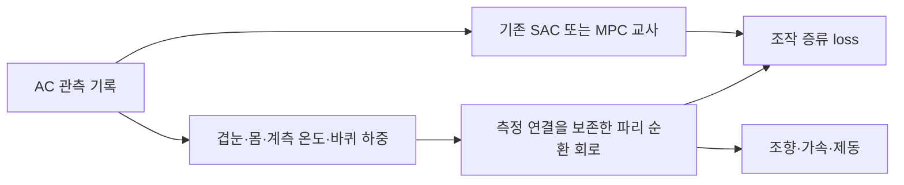

# 기존 AC 자율주행 모델을 파리 회로로 옮길 수 있는가

조사: **2026-10-27, Asia/Seoul**. 결론은 **기존 정책을 교사로 삼아 파리 연결 구조의
학생을 학습하는 경로가 유력하다**는 것이다. dense/Transformer 가중치를 실제 뉴런 ID에
그대로 복사하는 변환은 준비돼 있지 않다. 아래 이전 방법은 설계 제안이며 아직 AC→파리
정책의 증류·실제 주행을 성공시킨 결과가 아니다.

## 확인한 프로젝트

| 프로젝트 | 실제 확인한 구조·공개물 | 우리 프로젝트에서의 역할 |
|---|---|---|
| [AssettoCorsaGym](https://github.com/dasGringuen/assetto_corsa_gym) | SAC·MPC benchmark, 공개 운전 데이터와 Monza/GT3 SAC checkpoint. 해당 actor 파일을 받아 텐서 검사까지 완료 | **첫 교사 후보**. 학습을 처음부터 반복하는 비용을 줄일 가능성 |
| [SamuelOrtizV/Assetto-Corsa-RL](https://github.com/SamuelOrtizV/Assetto-Corsa-RL/tree/tmrl-based) | 화면 history+speed/gear/RPM, CNN 또는 CNN+RNN, SAC. server/trainer/worker 분리 | 시각 기반 교사·데이터 수집/학습 분리 구조 참고. 검토한 tracked tree에서 학습 완료 가중치는 찾지 못함 |
| [AARK / AC-MPC](https://github.com/Adelaide-Autonomous-Racing-Kit/ac-mpc) | 영상 segmentation→경계/위치 추정→MPC→조향·가감속. default Monza 설정은 map/localisation 사용 | 시각 전처리·MPC 교사 후보. 공개 asset script의 Monza segmentation URL은 이번 HEAD 요청에서404 |
| [Vector-Q Transformer SAC](https://github.com/chandankeelara/transformer-based-autonomous-racing-agent) | 75×50 상태 window, Transformer와3개 조작. 26,380,237바이트 demo checkpoint와216개 window 자료가 tracked tree에 있음 | 시간 문맥·offline replay·3조작 학습 참고. 정답 경계/미래곡률 입력이 있고 root license는 발견하지 못함 |
| [Jurredr/ACRL](https://github.com/Jurredr/ACRL) | SAC, 게임 앱과 외부 learner 분리. 위치·진행률·heading error·중심선 거리의10개 관측 | 역사적 비교·bridge 참고. 기본 actor는 우리의 비전 기반 정책과 다름 |

위 표의 주행 능력은 저자 자료와 코드 구조를 조사한 것이다. 이 PC에서 각 정책이 실제 AC를
운전하는 것은 아직 검증하지 않았다. 특정 저장소에 tyre/load 필드가 있다는 사실은 해당
기본 정책이 이를 학습 입력으로 사용했다는 증거도 아니다.

## 공개 SAC 가중치 실물 확인

[저자 README](https://github.com/dasGringuen/assetto_corsa_gym/blob/ef0fa502bdd257fc2affad9361c02b3dbdfe1632/README.md)의
Monza BMW Z4 GT3 예제에서 지정한 `step_05400000/policy_net.pth`를 받았다.
dataset revision은 `ad1df12c49cce10f159ba31967744750bb9edd8b`이며
[원본 파일](https://huggingface.co/datasets/dasgringuen/assettoCorsaGym/blob/ad1df12c49cce10f159ba31967744750bb9edd8b/data_sets/monza/bmw_z4_gt3/20241108_SAC/model/checkpoints/step_05400000/policy_net.pth)은
663,951바이트, SHA256은 `3f30cbb1b88ea221bf686c28b74d531ababe843da2e9529dc89a8a47aa157e84`다.

`torch.load(weights_only=True, map_location='cpu')`로 plain tensor state dict를 검사했다.
구조는 **125→256→256→256→6**, 텐서 원소165,382개다. 마지막6개는3조작의 mean/log-std로
분리된다. 이는 [GaussianPolicy 원본](https://github.com/dasGringuen/assetto_corsa_gym/blob/ef0fa502bdd257fc2affad9361c02b3dbdfe1632/algorithm/discor/discor/network.py)에 대응한다.
오프라인 모델 추론은 후속 단계에서 재현했다. 실제 게임 교사 주행은 아직 미검증이다. 저장 위치는
`assets/external/acgym-sac-teacher-20261027`이다.

후속 단계에서는 **125관측의 순서·정규화·history 구성과 조작 변환**을 공개 표본에서 대조했다.
2024-10-08 설정으로231개 상태의 교사 추론을 재현했고 원본 관측 구성과 오차0을 확인했다.
현재 default 설정은 정규화와 조향 스케일이 달라 그대로 대체하면 안 된다.
정확한 학습 실행 manifest는 미확보이며 실제 폐루프 주행도 별도 검증이 필요하다.
[수치 재현·제한·원본 결과](ac-teacher-reconstruction-20261027.md).
[환경 코드](https://github.com/dasGringuen/assetto_corsa_gym/blob/ef0fa502bdd257fc2affad9361c02b3dbdfe1632/assetto_corsa_gym/AssettoCorsaEnv/ac_env.py)는
경로 gap, 지도 경계 ray,300m curvature look-ahead를 포함한다. **이것은 겹눈 영상 기반 모델이 아니다.**

공개 dataset에는 인간·정책 주행 자료가 있지만 우리에게 필요한 동기 RGB·타이어 온도·하중이
전부 포함됐는지는 아직 확인하지 않았다. 제한된 숫자 판독기로 읽은234상태 표본에는 온도·하중이
있지만 영상은 없다. 대용량 전체 dataset은 받지 않았고 unrestricted pickle load는 사용하지 않았다.
센서 계약이 맞는 기존 자료는 즉시 재사용하고, 영상이 없으면 교사 주행 중 동기 기록이 필요하다.
이런 기록 수집은 처음부터 RL로 정책을 학습하는 작업과 구분한다.

## 무엇을 이전하고 무엇을 새로 학습하는가

기존 교사는 이미 운전 행동을 출력한다. 파리 학생은 같은 시간에 관측한 겹눈·기관 입력으로
그 행동을 재현하도록 학습한다. 이 제안은 [Policy Distillation](https://arxiv.org/abs/1511.06295)의
교사→학생 정책 학습 원리를 사용한다. 해당 논문은 AC나 파리 회로의 성공을 입증한 자료는 아니다.

- **교사:** 정답 위치·미래 커브를 사용하는 정책도 허용한다. 이 입력은 교사/평가에만 남긴다.
- **학생 입력:** 겹눈, 회전/가속도·조향/휠/서스펜션, **게임에서 제공하는 타이어 온도와 네 바퀴 하중**,
  실제 적용 조작 이력이다. 사용자 후속 지시에 따라 온도와 하중을 직접 감각 입력으로 사용한다.
- **학생 구조:** retina와 기관별 입력 어댑터→검토된 감각/CX/DN 경로→출력 readout이다.
  연결 mask와 학습 가능한 부분을 구분한다. 미검토 dense 우회로가 조작을 전부 결정하는 구조를
  파리 회로로 부르지 않는다. spike 모델 변환은 별도 문제이며 먼저 rate-based 회로에서 검증한다.
- **학습 대상:** 입력 transduction·허용된 신경 gain/time constant/시냅스 가중치·출력 readout 등이다.
  어떤 항목을 푸는지 실험마다 명시하고 원본 연결량을 임의의 생리학적 전도도로 해석하지 않는다.
- **현재 부분망:**2,626뉴런·92,740연결은 조향 후보였다. 온도/하중 감각 포트와 전진/감속 출력
  경로 검토·확장이 필요하다. 교사의 모든 기능을 이 부분망이 담을 수 있다고 미리 가정하지 않는다.

학생의 제한된 시야로는 교사가 본 미래 도로를 구분할 수 없는 경우가 있다. 관측 history·시야·속도
조건을 검토하고 관측 불일치를 학습 시간만 늘려 해결하려 하지 않는다. 동일 시각 입력을 받는
일반 신경망 학생도 비교해 감각 문제와 회로 용량 문제를 나눈다.

## 실행 순서와 성공의 증거

1. 공개 표본에서 재현한 SAC 추론과 상대 조작 설정을 실제 AC에서 검증한다.
   정확한 training manifest 미확보를 유지하며 교사 요청과 실제 적용 steering/throttle/brake를 분리한다.
2. 기존 dataset의 센서 구성을 감사한다. 부족한 RGB·계측은 교사가 운전하는 짧은 AC 세션에서
   함께 수집한다. 완전한 새 타이어 시뮬레이터를 만드는 작업을 이 재사용 경로의 선행 조건으로 두지 않는다.
3. 기록된 episode를 분리해 대부분의 **파리 회로 증류를 오프라인**으로 수행한다. recurrent 수치 상태를
   유지한다. MSE/Huber 또는 적합한 분포 loss와 명시한 조작 제약을 사용하고 actor에 경로 truth를 넣지 않는다.
4. 학생이 방문한 실패 상태에만 교사 label을 추가하고 다시 학습한다. 이는 [DAgger](https://proceedings.mlr.press/v15/ross11a.html)의
   분포 이동 문제를 다루는 방향이며 최종 평가에서는 교사가 대신 조작하지 않는다.
5. held-out episode의 조작 오차 외에 **학생 단독 AC 주행**으로 구간→1랩을 확인한다.
   회로/기관 제거·재배선·일반 RNN 대조로 무엇이 기여했는지 검사한다.

이 순서는 제안이다. 게임 interaction과 optimizer update·wall time을 따로 기록하고, 초기부터
AC에서 수백만 step을 새로 학습하지 않는다. MuJoCo는 부품/센서 검증과 보조 사전학습에 유지한다.
타이어 surrogate의 완전한 재현을 주 목표로 바꾸지 않는다. 모델을 파리 구조로 바꾸면 더 빠르거나
좋아진다는 주장도 아직 검증하지 않았다.

## 버전·자료 상태

5저장소의20개 검토 파일과 Git blob SHA1·SHA256을
`assets/external/ac-autonomy-research-20261027/source.json`에 보존했다. 초기 조사에서는 외부 소스를
실행하지 않았다. 후속 수치 재현에서는 해시를 확인한 원본의 검토된 수치 함수만 선택 실행했고,
외부 전체 모듈·플러그인·게임 제어 코드는 실행하지 않았다.

| 저장소 | 확인한 commit | root license 파일 |
|---|---|---|
| AssettoCorsaGym | `ef0fa502bdd257fc2affad9361c02b3dbdfe1632` | MIT |
| AC-MPC | `aef2d021991f77b445b228426c358f758060c599` | GPL-3.0 |
| Assetto-Corsa-RL | `b1b27d88b61f9e3e9a31e58d09eab9012933a1e9` | MIT |
| ACRL | `ff1b5dd9b2df42223d3c8911259e562f2d50e515` | GPL-3.0 |
| Vector-Q Transformer | `45d33fa3b33252031d91384b0f47fc449a276672` | root 파일 없음; vendored 하위 코드 license는 별도 |

HF dataset의 metadata license는 CC-BY-4.0이다. 코드·가중치·dataset의 자료 출처를 각각 남긴다.
AC-MPC의404는 해당 고정 script URL에 대한 이번 검사 결과이며 프로젝트 전체가 실행 불가능하다는
판정은 아니다. Vector-Q의 demo checkpoint는 tree에서 확인했지만 받아 실행하지 않았다.
