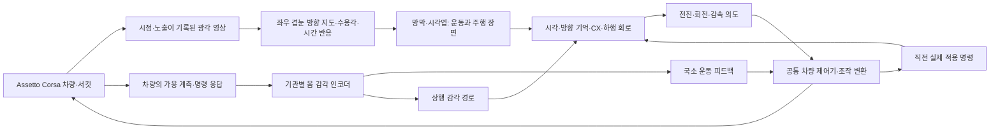

> **이전 문서 보존본입니다.** 당시의 진행 상황과 링크를 남긴 기록이며 현재 지침이 아닙니다. 현재 기준은 [프로젝트 대전제](PROJECT_CHARTER.md)와 [현재 문맥](CONTEXT.md)을 읽으세요.

# 설계안: 겹눈·몸 감각·초파리 회로로 Assetto Corsa 운전

> **2026-10-29 사용자 재확인 — 최우선 적용**
> 자동차를 초파리의 가상 몸으로 보고, 비행의 시각·날개 조종·균형·회전 감각 구조를 도입한다. 차체 기울기·가감속·하중·접지를 몸 감각으로 연결하고, 조향·가속·감속·빠른 레이싱 라인/랩타임을 함께 학습한다. 운전 성능만 좋은 일반 모델이나 실측 그래프를 단순 통과시키는 모델은 완료가 아니다.
> 최신 우선순위와 필수 부품 검증은 [비행 기반 계획](fly-flight-mechanism-plan-20261029.md)과 `configs/fly-flight-mechanism-plan-20261029.json`을 따른다. 아래 기존 교사 증류·보행 후보·이전 계측 기록은 보존한 과거 단계이며, 비행 기능 검증을 대신하지 않는다.

갱신: **2026-10-27, Asia/Seoul**. 사용자 확정 목표: **파리의 감각기관·신경회로를 모델링하고, 차량의 움직임을 몸 감각으로 되먹임하여, 비전 기반으로 Assetto Corsa 서킷을 완주한다.** 이 문서는 앞으로 구현할 설계다. 현재 코드의 지원 범위는 [구현 현황](implementation-status.md), 작업 순서와 통과 조건은 [연구 계획](research-plan.md)에 구분했다.

## 핵심 구조

차량을 에이전트의 가상 신체로 삼는다. 겹눈은 주변 도로의 모양과 움직임을 읽고, 몸 감각은 방금 내린 명령으로 차량이 실제 어떻게 움직였는지 알려 준다. 학습된 운동 회로가 전진·회전·감속 의도를 내면, 공통 차량 제어기가 게임의 조향·가속·제동으로 변환한다.

**최종 모델의 경로 판단은 영상에서 출발한다.** IMU·휠·조향 등은 자기 움직임의 피드백이다. 코스 중심선, 정답 횡오차, GPS/world pose, 코스 진행률·lap distance, AI line, 미래 곡률, occupancy map은 actor 입력에서 제외한다. 교사의 label·학습 보상·별도 critic·평가에는 사용할 수 있지만 경로를 분리한다. 속도계나 조작값이 표시된 HUD·미니맵·게임 운전 가이드도 영상에서 제거한다.

‘비전 기반’은 몸 감각을 쓰지 않는다는 뜻이 아니다. 본 목표의 이름은 **V+body**다. V-only는 몸 감각의 효과를 확인하는 대조군이다.

## 1. 겹눈: 육각형 표시를 넘어 방향·광학·시간 구조를 구현

눈마다 다음 정보를 파일로 고정한다: 광학축의 방위·고도, 수용각, 이웃 관계, 좌우 대응, 머리/차체 장착 변환, 유효 시야, 출처와 불확실성. 각 소안의 신호는 원영상의 한 픽셀을 단순 복사하기보다 수용각에 따른 밝기 적분으로 만든다. 눈 수와 원영상 카메라 수는 다를 수 있다. 여러 투영 영상을 두 눈의 방향 지도에 결합할 수 있다.

이전 합성 겹눈 주행의 `angular_hex`는 엇갈린 방향 샘플링이다. [눈 구조 연구 A25](https://www.nature.com/articles/s41586-025-09276-5)의 저자 저장소에서 μCT 재구성 광학축1,709개를 버전 고정해 확보했고, 좌우·인덱스·단위 벡터·시야를 검증했다. [자료와 한계](routed-repeat-eye-import-20261027.md). 재구성 축을 관측 경로에 연결하고 입력과 시각 readout을 별도로 다시 만들었다. [통합·주행 검증](anatomical-eye-driving-20261027.md). 수용각·시간 반응·MaleCNS 광수용 뉴런의 개별 대응은 확보하지 않았다. 합성 격자는 이전 결과와 함께 대조 기준으로 유지한다.

겹눈 전처리는 노출 시각별 밝기 적응 → ON/OFF → 방향성 운동 반응으로 나눈다. 공간·시간 주파수와 회전/병진 자극으로 부호·시간 상수·시야 경계를 검증한다. 같은 노출을 제어 틱마다 새로운 영상처럼 갱신하지 않는다. [flyvis](https://github.com/TuragaLab/flyvis)는 연결 제약 시각 모델의 비교·도입 후보이며 현재 프로젝트에 통합된 모듈은 아니다.

장면의 경계·노면·커브 방향 같은 형태 정보도 유지한다. 운동만으로 커브를 읽을 수 있다고 먼저 가정하지 않는다. 처음에는 같은 광수용 입력에서 나오는 경량 학습 가지를 허용하고, 이후 시각엽 출력으로 교체한다. 일반 CNN 가지를 썼다면 그 기여와 학습 파라미터를 별도로 보고한다. RGB를 사용하는 공학적 가지를 초파리의 색 수용체 재현으로 표현하지 않는다.

카메라 설계의 초기 후보는 좌우 광각, 새 노출 25 Hz, 정책 50 Hz다. 이는 해부학적 수치나 확정된 AC 성능이 아니다. 실제 캡처 속도·가용 시야·지연을 측정한 뒤 봉인한다. 입력 해상도와 소안 수는 시야 보존·작은 커브 식별·실행 비용으로 정한다. 기존 32×32 정책의 가중치를 128 입력이나 새 eye map에 그대로 넣고 같은 모델이라고 부르지 않는다.

## 2. 몸 기관: 차량 움직임을 기관별 신호로 부호화

아래 차량 대응은 **공학적 설계 가설**이다. 차량의 네 바퀴와 초파리의 여섯 다리를 일대일로 맞추지 않는다. 실제 감각 뉴런에 넣을 때는 유형·좌우·부호·정규화·어댑터를 명시한다.

| 기관·경로 | 설계할 신호 | 차량에서 얻을 후보 입력 | 첫 검증 |
|---|---|---|---|
| FeCO claw형 위치 집단 | 여러 선호 위치에 대한 지속 반응 | 실제 조향각·서스펜션 변위 | 고정 위치에서 지속 반응, 중립·좌우 부호 |
| FeCO hook형 운동 집단 | 증가·감소 방향의 별도 채널 | 조향/서스펜션 변화율 | 압축/신장·좌회전/복귀 분리 |
| FeCO club형 운동·진동 집단 | 양방향 운동·대역별 진동 에너지 | 가용 샘플링 속도의 서스펜션/가속도 신호 | Nyquist와 지연을 지킨 대역 반응 |
| haltere에서 착안한 회전 경로 | 빠른 회전과 시각 회전의 불일치 | 차체 각속도와 영상 회전 | yaw/roll/pitch와 시각 부호·시간차 |
| 하중·변형 감각에서 착안한 경로 | 좌우/전후 하중 변화의 추정 신뢰도 | 센서 모델로 추정한 하중 또는 변형 | 정답 접촉력과 추정 입력 분리 |
| 상행·국소 피드백 | 국소 반응과 전역 상태의 분리 | 위 감각 집단의 출력 | 국소/상행 분리 대 하나의 전역 통합 |
| efference copy | 직전 명령과 실제 응답의 차이 | 실제 적용 조작·조향/속도 응답 | 요청 명령·적용 명령·계측 응답 구분 |

FeCO의 위치·방향 운동·진동 선택성과 국소/상행 경로 분리에는 각각 [Mamiya 등, 2018](https://pubmed.ncbi.nlm.nih.gov/30293823/)과 [Lee 등, 2025](https://pmc.ncbi.nlm.nih.gov/articles/PMC12048489/)를 참고한다. haltere는 능동적으로 진동하는 기관이므로 gyro 값을 넣는 초기 단계는 기능적 근사다. 진동·기계적 변형을 포함한 기관 모델을 만든 경우에만 그 상세 재현을 따로 주장한다. [Dickerson 등, 2019](https://pmc.ncbi.nlm.nih.gov/articles/PMC7307274/).

첫 몸 감각 묶음은 회전·가속도·가용 휠/조향 피드백이다. 다음에 서스펜션 위치/방향, 그다음 충분한 대역폭이 있을 때 진동·하중을 넣는다. 각 신호의 가용 여부는 AC adapter의 capability probe로 확정한다. 없는 채널은 invalid로 남기며 시뮬레이터 정답 상태로 채우지 않는다. 프레임 변환, 중력 포함 여부, 단위, 지연·bias·포화도 채널 계약에 적는다.

더듬이·머리 자세·시선 안정화는 기본 묶음의 성공 뒤 추가 후보로 둔다. 속도를 바람 감각으로, world pitch를 중력 감각으로 이름만 바꾸어 넣지 않는다. 머리 자세 제어를 추가하면 카메라의 head-to-body 변환과 해당 고유감각을 함께 구현한다.

### 차량·타이어 상태를 추정하는 운전

사용자 요구에 따라 조향·가감속과 하중이동·타이어 상태·셋업 적응을 통합한다.
빠른 운동 제어와 느린 그립/차량 응답 추정 상태를 둔다. 추정 상태는 겹눈·기관 감각과
적용 조작의 이력에서 형성하며 실제 파리 회로와의 기능 대응은 별도 검토해야 한다.
사용자 후속 지시에 따라 게임이 제공하는 tyre temperature·바퀴별 load는 주 모델의
기관 감각 입력으로 사용한다. 수집·단위/순서·시각을 검증하고 누락은 invalid로 둔다.
그립과 셋업 반응은 이 피드백과 주행 이력으로 학습한다. setup 파일 값과 경로 정답은
actor에서 분리하며 식별되지 않은 셋업 특성에는 불확실성을 유지한다. 상세 단계와 통과 조건은
[현재 연구 계획](research-plan.md#조향가감속하중타이어셋업-대응--목표-확장)에 있다.

현재 MuJoCo의 고정 contact 마찰에는 타이어 열·압력·마모가 구현돼 있지 않다.
MuJoCo에서 이 효과를 학습할 때에는 surrogate와 하중/슬립 기준 시험이 필요하다.
기존 AC 교사·실제 계측 자료를 재사용하는 증류 경로는 별도로 우선 검토한다.
surrogate가 AC 타이어와 일치한다고 가정하지 않는다. 기본 contact model과의 차이는
[MuJoCo 공식 계산 문서](https://mujoco.readthedocs.io/en/stable/computation/index.html)도 참고한다.

## 3. 신경회로: 일반 정책에서 실제 구조를 갖춘 운전 모델로

주 후보는 **시각 입력 → 시각엽 → 방향/기억·CX → DN → 국소 운동 회로**, 그리고 몸 감각의 상행·국소 피드백이다. 실제 그래프에는 이 흐름의 회귀·교차 연결도 보존한다. 정확한 뉴런 유형과 ID는 주석을 조사한 뒤 고정한다. 그림의 블록만으로 실제 경로를 확보했다고 취급하지 않는다.

[MaleCNS v1.0](https://male-cns.janelia.org/download/)을 뇌·VNC 기능 경로 선정의 주 후보로 둔다. 초기에는 주석과 도달성이 확인된 기능 부분 그래프로 시작한다. 임의로 목표 뉴런 수를 정해 자르지 않는다. 전체 지도는 작은 회로의 입출력·안정성·실행 비용을 확인한 다음 확대한다. [BANC 연구](https://www.nature.com/articles/s41586-026-10735-w)는 뇌·신경삭에 분산된 제어 경로 선정의 추가 근거이며 MaleCNS와 다른 개체의 ID를 합쳐 하나의 측정 연결처럼 만들지 않는다.

시각 모델·뇌·VNC를 다른 데이터셋에서 가져올 경우 유형 대응과 학습 어댑터를 표시한다. 어댑터가 만든 연결과 측정 연결의 마스크를 분리한다. 출력에는 좌우 DN 집단의 합/차를 읽는 제한된 readout과 학습 readout을 비교한다. 실제 조향 관련 회로의 참고 근거는 [Westeinde 등, 2024](https://www.nature.com/articles/s41586-024-07039-2)다. 차량의 물리 단위로 바꾸는 부분은 별도 공학적 어댑터다.

시냅스 집계 수를 생리학적 전도도로, 전달물질 예측을 모든 수용체의 확정된 흥분/억제 부호로 취급하지 않는다. 연결·동역학·부호에서 확인한 부분과 근사한 부분을 manifest로 나눈다. 비교군의 학습 가능한 파라미터·고정 그래프 저장량·활성 상태 메모리를 각각 보고하고, 같은 interaction 상한과 같은 wall-time 상한의 비교를 구분한다.

비교 모델은 같은 감각·전처리·출력 권한을 받는다:

- **C0-S/C1:** 시각 기반 고전 제어와 GRU. 환경·학습·센서의 기준선.
- **C3-V:** 검토된 초파리 시각·CX·DN 회로. 우선 몸 입력을 같은 최소 묶음으로 고정.
- **C3-VB:** C3-V에 기관별 부호화와 국소/상행 몸 피드백을 추가한 주 목표.
- **C7-VB:** 포트·뉴런별 입출력 차수·연결 수를 보존한 재배선 대조군.
- **C1-VB:** C3-VB와 같은 기관 부호화를 받는 GRU. 감각 인코딩과 실제 연결 구조의 효과를 분리.

GRU 완주는 기반 기술의 성공이고 최종 목표 모델의 완주는 별도다. 성능과 생물학적 구조 충실도를 두 축으로 기록한다. 실제 부분 그래프의 의미 있는 기여 없이 큰 외부 CNN/decoder가 사실상 전부 운전하는지, 회로 제거·우회 readout 대조로 검사한다.

## 4. Assetto Corsa 연결: 먼저 작동 가능성을 확인

선택 대상은 **원작 Assetto Corsa**다. 읽기 전용 telemetry 앱·기록기·원본 RGB 기록기를
준비했으며 실제 게임 동기화·조작 적용은 미검증이다. [연결 조사](ac-bridge-20261027.md),
[영상 수집](ac-capture-20261027.md). 외부 [Assetto Corsa Gym](https://github.com/dasGringuen/assetto_corsa_gym)의
benchmark 결과를 우리 센서 기반 주행 결과로 가져오지 않는다. 외부 캡처 경로의 처리율은
우리 양안 동기 캡처나 전체 추론 속도를 보장하지 않는다.

연결부는 게임 측 bridge와 현대 Python의 학습·추론 측을 별도 프로세스로 나눈다. 오래된 게임/plugin 의존성 때문에 현재 학습 환경 전체를 낮은 버전으로 바꾸지 않는다. 메시지는 sequence ID, simulation time, host monotonic time, 노출 시각/수신 시각, 적용 조작과 telemetry를 포함한다. 시뮬레이션 pause·reset·메뉴·프레임 재사용을 명시적으로 처리한다.

**첫 관문은 10분짜리 동기 기록과 조작 응답 시험이다.** 화면·몸 감각·조작의 대응, 좌우 부호, 적용 범위, reset, 오래된 프레임 검출을 먼저 확인한다. 이때 수동 조작이나 미리 정한 조작은 진단용이다.

### 양안·넓은 시야 확보의 우선순위

1. 같은 simulation frame의 좌우 virtual view 또는 넓은 다중 투영 출력을 얻을 수 있는지 확인한다. 게임/plugin/render 경로의 실제 기능을 확인한 뒤 선택한다.
2. 하나의 충분히 넓은 panorama만 가능하면, 각 눈의 방향 중 관측된 영역만 샘플링하는 **공통 시점의 양안 방향 모델**로 시작할 수 있다. 이것은 실제 baseline을 가진 stereo가 아니다. 새로운 깊이·측면 정보가 생기지 않는다.
3. 좁은 전방 화면만 가능하면 부분 시야 프로토타입으로 표시한다. 보이지 않는 측후방은 invalid다. 화면을 두 번 복제하거나 순서대로 시점을 바꾼 영상을 같은 시점의 두 눈이라고 기록하지 않는다. 넓은 겹눈 목표 달성은 해당 기능을 확보할 때까지 미충족이다.

게임 telemetry와 이미지가 정확히 같은 tick에 나오지 않으면 차이를 기록한다. actor는 판단 시점까지 도착한 값만 사용하고 frame age·채널별 age를 받는다. 학습 label을 미래 영상에 맞추거나 평가에서 미래 telemetry를 끌어오지 않는다.

### 입력·조작 계약

| 구분 | 계획한 내용 |
|---|---|
| ActorObservation v2 | 눈별 ray response·validity·노출 ID/시각, 기관별 몸 감각·validity·age, 직전 실제 적용 조작 |
| TrainingOnly | 교사 행동, 정답 진행·횡오차·접촉·critic 특징; actor와 별도 객체/메시지 |
| FlyState | 시각 적응·운동 필터, 회로 상태, 기관 필터·짧은 기억; episode/reset 정책 명시 |
| DriveIntent | 첫 단계는 고정 속도의 회전 의도, 이후 전진/목표 속도·회전/곡률·감속 의도 |
| ACAction | 차량별 보정된 정규화 steering, throttle, brake. 첫 단계의 기어/클러치 자동화 설정은 기록 |
| Diagnostic | full-lap 판정, 실제 적용 조작, 개입·사고·이탈·reset·성능; actor로 반환하지 않음 |

현재 MuJoCo의 독립 후륜 토크·residual yaw action을 AC에서 그대로 사용할 수 있다고 가정하지 않는다. AC는 공통 조향·가속·브레이크의 범위부터 확인한다. 좌우 날개의 합/차 같은 기능 추상화는 전진/회전 의도로 변환하며, 게임에 없는 좌우 모터 명령을 출력하지 않는다. 하위 제어기에 정답 경로 추종을 숨기지 않는다.

## 5. 학습과 성공 판정

기존 AC 교사와 적합한 공개 자료를 우선 재사용하고 MuJoCo는 자극·기관·회로 점검과
보조 사전학습을 담당한다. 저장된 시퀀스로 오프라인 증류하고, AC의 화면·차량 반응 차이를 짧은 계측/교사 기록과 오프라인
미세조정으로 보완한다. 직접 전이 성공은 별도 검증한다. 게임 설치는 사전학습의 선행
조건이 아니며 AC에서 처음부터 장시간 RL을 수행하는 경로는 초기 계획에 없다.

기존 외부 주행 데이터에 필요한 영상·시야·몸 채널이 모두 있다고 가정하지 않는다. 없으면 새로 수집한다. 교사 수집에는 수동 운전 기록 또는 경로 정답을 사용하는 명시적 교사를 쓸 수 있다. 자율평가에서는 인간·게임 AI·교사의 개입과 정답 경로 입력을 모두 끈다. 개입이 있으면 완주 성공으로 세지 않는다.

학습 순서는 시각·기관 자극 시험 → 저속 고정 속도 조향 BC → 학생 상태에서 반복 DAgger → 속도/제동 확대 → 검토된 실제 회로 비교 → 성공 후보에만 선택적 RL → AC 구간 → 전체 랩이다. 실제 회로의 준비는 GRU 검증과 나란히 진행하되, 기본적으로 실패하는 학습기에 전뇌를 먼저 연결하지 않는다.

처음 보는 구간/서킷 일반화와, 익숙한 서킷의 시각 기억을 이용한 완주를 별도 평가한다. 첫 최종 산출물은 **설정과 모델을 고정한 실제 회로 에이전트의 AC 한 서킷 1랩 무개입 완주**다. 반복성 목표는 그다음이며, 다른 코스와 랩타임 경쟁은 후속 단계다. 속도·wall time·정지 시간을 함께 기록해 멈춘 정책을 성공으로 세지 않는다.

회로별 시각 기여는 영상 고정/차단/시간 지연, 동일한 물리 상태의 시각 변화, 미관찰 커브·시작 자세와 함께 검사한다. 몸 감각의 효과는 같은 영상의 기관 제거·원시 채널 대체·지연 조건으로 검사한다. 익숙한 코스에서 영상 제거 후에도 완주한다면 기억·몸 감각만으로 달린 가능성을 따로 보고한다.

## 6. 범위와 비용

첫 서킷은 설치·연동이 확인된 짧은 구성으로 고른다. 외부 Gym의 기존 트랙 설정이 있는 Red Bull Ring은 일반 서킷 완주 후보, Indianapolis oval은 단순 연결·연속 주행의 앞 단계 후보다. Spa·Nordschleife는 별도 확장 목표이며 첫 완주의 필수 조건으로 만들지 않는다.

25 decision/s의 실제 처리율을 **가정**하면 10만 interaction은 약1.11시간, 100만은 약11.11시간이다. 수집·reset·평가·학습 시간은 별도다. 이는 AC를 측정한 속도가 아니다. 우선 작은 동기 데이터와 오프라인 학습으로 점검하고, 실제 측정한 유효 decision/s로 다음 예산을 산정한다.

FPGA/RTL은 완주 모델의 입력·출력과 수치 계약이 고정된 뒤 탑재 최적화로 이어간다. 기존 회로 자료는 재사용하되, 겹눈 구조·뇌 모델·몸 감각을 새로 정하면서 가속기 수치 등가를 최종 정책 성능의 증거로 쓰지 않는다.

## 이번 갱신으로 결정한 것

- 최종 대상: 초파리의 감각·신경회로를 통해 운전하는 AC 에이전트.
- 몸의 역할: 차량 계측을 기관별 감각으로 바꾼 폐루프 피드백.
- 기본 목표 모드: 지도/정답 경로 없는 V+body.
- 첫 성공: 실제 회로가 포함된 모델의 한 서킷 무개입1랩. GRU 완주는 중간 기준선.
- 초기 선행 작업: 타이어·하중 물리 검증, 속도/제동·상태 추정의 source 사전학습. AC 준비 시 짧은 계측을 병행.
- 후속 선택: 구체적인 차량·트랙·eye map·회로 ID·캡처 방식은 조사/측정 결과로 고정.
