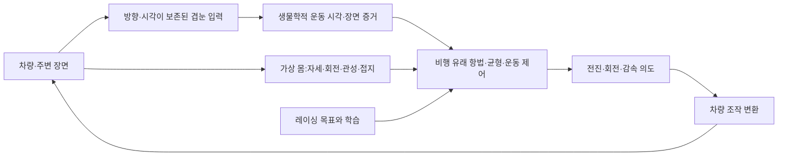

# 설계 — 자동차를 초파리의 가상 몸으로

갱신:2026-10-29,Asia/Seoul. [대전제](PROJECT_CHARTER.md)와 [구현 현황](implementation-status.md)을
함께 읽는다. 아래는 목표 구조이며 현재 모델이 이미 전부 구현했다는 뜻이 아니다.

## 전체 경로

시각·몸 감각·운동 명령이 닫힌 고리를 이뤄야 한다. 차체 기울기와 회전은 몸의 자세/회전으로,
하중 이동과 접지는 몸의 반응과 힘을 낼 여유로 대응시킨다. 운동 제어의 기준은 비행이다.
구조를 축약할 수 있지만 축약한 부분과 실측/생리학적 근거를 구분한다.

## 네 가지 경계

**시각:** 여러 카메라의 투영·방향·시각·유효성부터 고정한다. 겹눈 광학축·수용각·시간 반응과
ON/OFF·방향 운동 경로를 검토한다. 단순한RGB차이나 픽셀 격자를 실제 운동 시각 회로로
표시하지 않는다. 시야 합성과 실제 신경 대응은 검증된 범위에서만 연결한다.

**가상 몸:** 자세각과 각속도,회전과 선형 가속,원신호와 추정값을 분리한다. native roll/pitch의
축·부호·단위와 가속의 중력/좌표계를 검토한다. yaw는 회전/상대 방향으로 다루며 절대
world heading을 actor에 넣지 않는다. 타이어 온도·하중·슬립은 유용한 차량 피드백이지만
생물학적 수용기와 동일하다고 가정하지 않는다.

**운동 회로:** 시각 명령과 회전/기계 감각이 비행 유래 하행·국소 운동 제어에 어떻게 합쳐지는지
검증한다. DNg02/날개 운동/haltere 후보의 주석 존재만으로 기능을 확정하지 않는다.
기존DNa02직접 조향과 전진/정지 후보의 페달 변환은 비교용 경로다.

**차량 변환:** 회로의 운동 의도를 게임의 조향·가속·제동으로 보정한다. 단위·부호·포화·지연을
기록한다. 이 연결부가 정답 경로나 별도 일반 정책으로 운전 판단을 대신하지 않게 한다.
초파리 비행에 자동차 브레이크와 동일한 장치가 있다고 주장하지 않는다.

## 항법과 속도 전략

균형만 유지하는 것으로 목표가 끝나지 않는다. 코너 진입·제동·선회·재가속과 몸 상태에 맞는
레이싱 라인을 학습해야 한다. actor에는 영상과 허용된 몸 감각/내부 기억만 제공한다.
정답 라인·지도·world pose·진행률·미래 곡률·교사 조작은 teacher/critic/보상/평가에 분리한다.
HUD·미니맵·주행선으로 정답이 영상에 섞이지 않게 한다.

## 시간·상태·호환성

원래 노출/수신 시각과 출처를 보존한다. 측정되지 않은 센서 대역이나 노출 동기를 발명하지 않는다.
내부 빠른 비행 위상은 시뮬레이션 상태일 뿐 새 AC측정값이 아니다. 상태는 원래 에피소드 안에서
유지한다. 새 감각/운동 구조를 기존 체크포인트와 동일한 모델로 표시하지 않는다.

실제 게임 제어와 계측은 검증된 CSP API·native 센서·백그라운드 영상·vJoy 경로를 사용한다.
게임 창 전면 활성화·클릭·키보드 자동 조작으로 되돌아가지 않는다.

[단계별 검증](research-plan.md),[상세 근거와 현재 누락](fly-flight-mechanism-plan-20261029.md),
[재정리 전 상세 계약](assetto-fly-design-before-flight-20261029.md)을 구분해서 참고한다.
