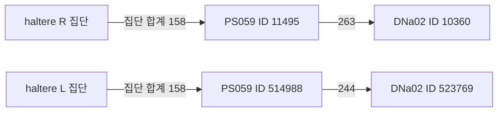

# 실제 몸 감각 회로의 연결 경로 감사

기록: 2026-10-27, Asia/Seoul. 목표는 기관 인코더를 임의의 뇌 뉴런에 넣는 대신, 측정된 감각 입력과 국소·상행·하행 경로를 구분해 모델에 연결하는 것이다. 이번 결과는 **구조 경로의 확인**이며 흥분/억제·응답 부호·운전 기능을 검증한 결과가 아니다.

## 직접 연결을 확인한 범위

MaleCNS v1.0의 확보된 Traced 구조 그래프와 공식 주석을 사용했다. [기관 목록](../configs/malecns-body-port-inventory.json)에서 chordotonal organ425개와 haltere201개를 골라, 좌우·진입 신경에 따른10집단으로 나눴다. 정확한 선택 조건은 [body-route-selectors.json](../configs/body-route-selectors.json)에 있다. 이 선택에 FeCO claw/hook/club의 미확인 기능 아형을 추가하지 않았다.

선택한626개 감각 뉴런에서 나가는 **64,458개 연결 레코드, 합계352,701개 구조 시냅스**를 보존했다. 대상 뉴런의 실제 ID·유형·상위 분류와 대상의 전체 입력 중 해당 집단이 차지하는 비율을 기록한다. 전체 입력의 분모는 복구된 Traced 그래프 범위이며 미추적 뉴런까지 포함한 완전한 생물학적 입력이 아니다.

| 입력 집단 | 감각 뉴런 | 직접 대상 뉴런 | 구조 시냅스 합계 | ascending_neuron 대상 시냅스 |
|---|---:|---:|---:|---:|
| chordotonal MesoLN L | 80 | 1,290 | 48,743 | 8,585 |
| chordotonal MesoLN R | 83 | 1,253 | 44,645 | 8,556 |
| chordotonal MetaLN L | 93 | 1,436 | 51,908 | 10,493 |
| chordotonal MetaLN R | 100 | 1,603 | 69,597 | 13,857 |
| chordotonal ProCN L | 25 | 884 | 11,517 | 2,747 |
| chordotonal ProCN R | 8 | 334 | 3,097 | 447 |
| chordotonal ProLN L | 23 | 827 | 9,275 | 1,992 |
| chordotonal ProLN R | 13 | 316 | 2,650 | 503 |
| haltere L | 102 | 2,243 | 61,122 | 14,487 |
| haltere R | 99 | 2,187 | 50,147 | 11,974 |

`ascending_neuron`은 공식 주석의 분류명이다. 위 표의 수치가 상행 회로 전체나 기능 전달량을 뜻하지 않는다. haltere 집단에서 `vnc_motor`로 가는 직접 시냅스도 L4,511/R3,621개이며, 국소 VNC 내부 뉴런과 뇌 내부 뉴런의 대상도 별도로 기록했다. 몸 감각을 전역 GRU 하나에만 섞는 구조와 실제 연결의 차이를 검토할 수 있게 됐다.

[직접 연결 감사 JSON](../assets/external/malecns-body-route-audit-20261027/audit.json), [원래 방향과 count를 보존한 연결 NPZ](../assets/external/malecns-body-route-audit-20261027/direct-edges.npz).

## 조향 후보까지의 경로

앞서 선정한 DNa02/DNa03의 정확한 유형·Traced 상태를 대상으로 직접 및 두 연결을 거치는 경로를 조사했다. 이번626개 감각 뉴런에서 이4개 뉴런으로 가는 직접 연결은 없었다. 중간 뉴런을 거치는 경로는 존재한다. 예를 들어 다음은 측정 구조의 한 부분이다.

그림의 숫자는 시냅스 수이며 흥분의 세기나 운동 방향이 아니다. 첫 연결은 집단 전체에서 해당 중간 뉴런으로 가는 합계다. haltere L에서 DNa02의 두 ID까지 중간 뉴런은 각각37/56개, haltere R에서는57/35개다. 약한1시냅스 경로도 제외하지 않았으므로 경로 존재를 기능적 중요성으로 해석하지 않는다. 전체 후보는 [paths.json](../assets/external/malecns-body-route-audit-20261027/paths.json)에 있다.

이 결과 때문에 haltere 입력을 DNa02에 직접 꽂는 모델은 측정 회로의 재현으로 표시할 수 없다. 다음 통합 후보는 중간 뉴런과 내부 연결을 포함하고, 어느 경계를 잘랐는지·측정 연결과 학습 어댑터가 무엇인지 보고해야 한다. PS059의 생리학적 부호, 개별 haltere 수용체의 선호 방향, 몸 감각→차량 회전 부호는 아직 검증되지 않았다.

## 검증과 남은 일

`connectome_routes.py`는 incoming CSR의 row=post/col=pre 방향, 집단 중복·누락, 대상 입력의 전체 분모를 처리한다. 작은 방향성 기준 그래프에서는 직접 경로와 두 연결 경로를 혼동하지 않는지 확인했다. 새 검증을 포함한 WSL 전체 테스트는 **122개 통과, 23.02초**다. [검증 로그](../runs/body-route-audit-20261027/body-route-pytest-t5.log), [검증 소스 해시](../runs/body-route-audit-20261027/body-route-source-t5.json).

주석·구조는 같은 MaleCNS 자료에서 확인했다. 외부 생리학 근거를 개별 ID로 자동 이식하지 않는다. 특히 [Lee 등, 2025](https://www.nature.com/articles/s41467-025-59302-3)는 FANC/FlyWire에서 FeCO의 위치/운동 경로와 진동 경로를 구분한 연구다. 이 구분은 기관 모델의 기능 가설을 세우는 근거이며 이번 MaleCNS의425개 chordotonal 뉴런을 아형으로 나누는 대응표가 아니다.

## 실제 ID로 확장한 후보망

확인한626개 기관 입력, PFL2/PFL3의36개 절단 입력 경계, DNa02/DNa03, 두 연결 경로의 모든 중간 뉴런을 실제 ID로 선택했다. 선택된 뉴런 사이의 모든 측정 연결을 유지한 결과는 **927개 뉴런·11,526개 연결**이다. [후보 등록부](../configs/malecns-body-steering-candidate.json), [시각·기관별 포트 구분](../assets/external/malecns-body-steering-candidate-20261027/ports.json), [경계 손실 감사](../assets/external/malecns-body-steering-candidate-20261027/audit.json).

DNa02 두 뉴런의 전체 입력 중 유지율은 각각 **9.40%와10.82%**다. 앞선40뉴런 후보보다 늘었으나 대부분의 입력은 여전히 경계 밖이다. 기관 입력626개 중601개가 선택된 출력 중 하나에 도달하며, 나머지25개도 숨기거나 임의 연결로 보충하지 않았다. 시각/CX 절단 입력36개는 모두 출력에 도달한다. [포트 도달성 원자료](../assets/external/malecns-body-steering-candidate-20261027/port-reachability.json).

유형 주석이 없는7개 뉴런은 `untyped:<body_id>`라는 공학적 표지를 사용한다. 실제 세포 유형을 추정한 이름이 아니며 서로 다른 미확인 뉴런을 하나의 유형으로 묶지 않는다. 원래 주석의 누락은 경계 감사에도 남겼다. 정확한 ID 선택과 미확인 유형 처리를 추가한 뒤 전체 테스트는 **124개 통과, 24.47초**다. [최종 검증 로그](../runs/body-route-audit-20261027/body-final-pytest-t5.log), [최종 검증 소스](../runs/body-route-audit-20261027/body-final-source-t5.json).

이 후보는 정책에 연결하거나 학습하지 않았다. 기존의 합쳐진 시각/몸 embedding을 모든 input 뉴런에 뿌리면 기관 경로를 구분했다는 의미가 사라진다. 시각/CX 절단 경계와 각 기관 집단에 서로 다른 어댑터를 연결하고, 생물학적으로 미확인인 변환을 공학적 가설로 표시해야 한다. 실제 시각 상위 경로, 흥분/억제·기관 튜닝, 기관 제거·연결 재배선 대조, AC 연결·연속1랩은 여전히 미완료다.
