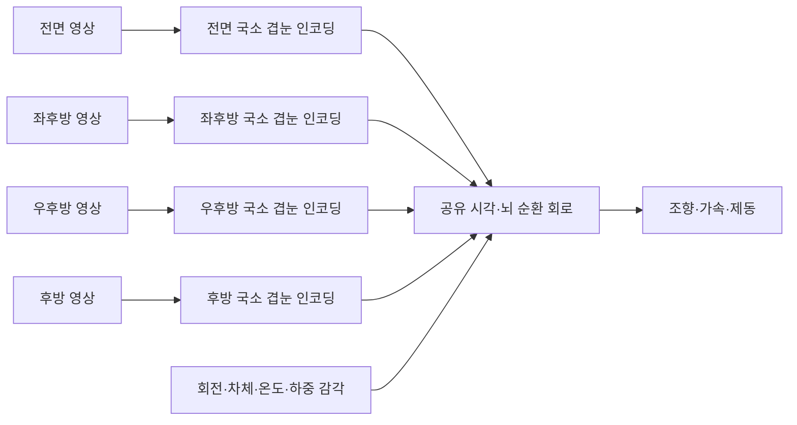

# 전면·거울 영상과 겹눈 입력 구성

2026-10-27 KST. 사용자 제안인 **전면 영상 + 좌우 사이드미러 + 룸미러**를 시각 입력 구성으로
채택한다. 사용자 추가 설명에 따라 **겹눈형 입력과 파리 뇌 구조를 이용한 다중 시점의
시공간 융합을 주 과제**로 둔다. 거울을 단순한 후속 보조 기능으로 미루지 않는다.
전방 단독 모델은 부품 검사와 비교군이며 다중 시점 주 모델의 대체 성공 조건이 아니다.

## 핵심 연구 가설과 합성 위치

가설은 방향별 국소 입력과 시간 반응을 보존하는 겹눈형 표현, 공유된 연결 구조와 지속
신경 상태가 여러 시점의 정보를 효율적으로 합성하는 데 도움이 될 수 있다는 것이다.
입력 카메라가 늘어난 이득과 파리 구조의 이득은 각각 확인해야 한다. 현재 성공 증거는 없다.

각 시점의 밝기·국소 움직임·관측 방향·원점·시각·유효성을 보존한다. 각 입력 어댑터는
자기 시점의 국소 수용장만 읽으며, 시점 사이 정보 교환은 공유 신경 연결과 지속 상태에서
이뤄지게 한다. 여러 시점의 특징을 외부 대형 모델이 전부 합성한 뒤 작은 파리 회로에
완성된 조작을 전달하는 구조를 주 모델로 취급하지 않는다.

뇌가 합성해야 할 후보 정보는 내 차의 회전·진행, 도로 경계의 연속성, 물체의 접근 방향과
가림 중의 움직임 이력이다. 전방·옆·뒤 장면은 서로 겹치지 않을 수도 있으므로 픽셀끼리
이어 붙이는 파노라마 복원이나 모든 시점의 동일 물체 대응이 항상 가능하다고 가정하지 않는다.
몸 감각은 자기 운동과 외부 물체의 운동을 구분하는 데 함께 사용할 가설이다.

[초파리 운동 시각 연구](https://www.nature.com/articles/s41586-025-09276-5)는 국소 방향 선택
신호와 넓은 시야의 optic flow 적분 사이 관계를 보여준다. 이는 설계 동기이며, 서로 떨어진
자동차 카메라·거울 융합이나 AC 주행 성능을 입증한 결과는 아니다. 현재 코드의 MeTu 경계
입력은 T4/T5·광시야 운동 적분 회로 전체를 구현한 것이 아니다. 해당 경로의 구체적
뉴런·연결 검토와 국소 운동 부호화의 공학적 근사를 별도 표시한다.

## 카메라 개수와 겹눈 개수는 다르다

겹눈의 각 소안에 별도 게임 카메라를 만드는 구조가 아니다. 몇 개의 원본 렌더 영상을
방향과 수용각에 따라 다시 샘플링한다. 현재 저자 자료에서 재구성한 광학축은 양안 합계
1,709개이며 `assets/external/eyemap-t4-20261027/eye-axes.npz`에 있다.
보이지 않는 축은 invalid로 남긴다. 카메라 사이를 임의 생성한 픽셀로 채우지 않는다.

| 원본 시각 채널 | 사용 목적 | 겹눈 연결 원칙 |
|---|---|---|
| front | 도로 경계·코너·소실점·시각 흐름 | 좌우 겹눈의 전방 광학축에 교정된 방향으로 투영 |
| mirror_left | 좌후방·옆 차량·복귀 확인 | 왼쪽 거울의 반사 광선·출처를 유지한 보조 시각 입력 |
| mirror_right | 우후방·옆 차량·복귀 확인 | 오른쪽 거울의 반사 광선·출처를 유지한 보조 시각 입력 |
| mirror_rear | 뒤 차량·접근 속도·간격 변화 | 후방 보조 시각 입력. 좌우 눈의 독립적인 새 카메라로 중복 계산하지 않음 |

전방 원본 하나를 양안의 전방 광학축에 샘플링하면 초기에는 **단안 기반 가상 양안**이다.
같은 영상을 두 눈에 공급한 것을 실제 양안 시차로 부르지 않는다. 독립 양안 렌더링은
원점·카메라 내부 파라미터·시각을 검증한 다음 별도 capability로 추가할 수 있다.

## 거울을 그냥 붙이면 생기는 오류

화면 왼쪽·오른쪽 위치와 차량 좌표의 광선 방향은 다르다. 거울 반사·곡면·UV crop·FOV와
카메라 pose를 확인해야 한다. 수평 반전만으로 모든 거울을 교정했다고 판단하지 않는다.
거울은 운전자 눈과 다른 위치의 광선·가상 시점을 제공하므로 단일 원점의 연속 겹눈으로
합치면 근거리 parallax가 틀릴 수 있다. 교정 전에는 **출처별 보조 시각 채널**로 보존한다.

좌우 거울과 룸미러가 서로 다른 실제 시점인지, 같은 후방 텍스처의 다른 UV 영역인지도
확인한다. 거울3개가 있다고 독립 시점3개나360도 시야가 확보됐다고 표시하지 않는다.
차체·기둥·거울 테두리·HUD·미니맵은 유효 영역에서 제외한다. 차량 자체의 가림은 실제
시야 제한으로 남기며 정답 위치나 다른 카메라의 숨은 상태로 대체하지 않는다.

## 취득 경로

1. **원본 AC 확인 단계:** 고정 운전석 화면에서 전방과 실제로 보이는 거울 ROI를 따로
   기록한다. 한 화면 취득 시각이 같아도 내부 거울 렌더 시각이 같다는 뜻은 아니다.
   특정 거울이 보이지 않거나 crop 픽셀이 부족하면 invalid로 두고 capability에 기록한다.
2. **텍스처 경로 후보:** CSP가 제공하는 HUD 없는 front와 virtual mirror 텍스처를 검토한다.
   사이드미러별 텍스처 또는 새 방향 렌더링은 별도 기능 검증이 필요하다. 아직 CSP나 OBS를
   설치하거나 기존 게임을 수정하지 않았다.
3. **후속 가상 겹눈 카메라:** 같은 가상 머리 원점의 전방·좌우·후방 카메라를 직접 렌더할 수
   있으면 실제 반사 거울 대신 일관된 광선 기하로 넓은 시야를 만들 수 있다. 이는 사용자가
   제안한 운전자 거울 시야와 구분한 추가 실험이며 현재 원본 AC에서 가능한지 미검증이다.

[CSP 공식 OBS Helper](https://github.com/ac-custom-shaders-patch/acc-obs-plugin)는 Clean view와
Virtual mirror 텍스처를 제공한다고 명시한다. 같은 GPU를 사용하는 조건이 있고, 선택돼
표시되는 소스만 렌더한다고 설명한다. 이 기능 설명만으로 최소화·잠금 상태의 갱신을 보장하지
않는다. 열람한 README Git blob SHA1은 `8883f00b2b06c91f423515996a2e92441bceb9c9`다.
[공식 거울 설정](https://github.com/ac-custom-shaders-patch/acc-extension-config/blob/master/config/smart_mirror.ini)은
거울별 정확한 반사와 별도 텍스처에 성능 비용이 있음을 설명하고, 프레임을 건너뛰거나
거울을 번갈아 갱신하는 옵션도 제공한다. 따라서 화면 취득 ID를 새 거울 프레임 ID로 쓰지 않는다.

## 데이터·학습 계약

각 채널에 source_id, ROI/해상도, 반사·투영 교정 해시, 원점/방향, 픽셀 유효성,
취득 구간과 확인 가능한 렌더 시각·frame ID를 기록한다. 모르는 시각·파라미터는 null이다.
서로 다른 주기의 영상을 최신 원본·age·validity와 함께 처리하며 동기 프레임으로 위장하지 않는다.

현재 `EyeSample`은 눈별 단일 exposure timestamp를 갖는다. 비동기 front/거울을 한 눈의
표본에 몰아넣기 전에 출처별 또는 광학축별 시각·유효성을 표현하도록 계약을 확장해야 한다.
정확한 기하 투영이 없는 거울 영상을 기존 `PerspectiveView`의 body ray로 재명명하지 않는다.

전방30–60Hz, 거울10–20Hz는 **측정 전 예산 후보**다. 실제 신호 지연·시각 흐름·추론 시간과
함께 조정한다. 원본 캡처 해상도와 소안 샘플링 해상도를 구분하고, 거울 속 차량이 너무 작으면
학습 입력을 줄이기 전에 crop 픽셀 수부터 확보한다.

주 학습은 확보된 다중 시점과 몸 감각을 함께 입력해 공유 회로에서 융합하도록 진행한다.
취득기·소안·시간 반응·단일 시점 부품 시험은 먼저 할 수 있지만 전방 완주만으로 주 과제를
완료했다고 판단하지 않는다. front 제거·각 거울 제거·거울 좌우 교환·반사 교정 오류·프레임 지연 대조를 둔다.
한 랩의 경로 판단, 주변 차량 인식, 추월/복귀를 각각 평가하고 모델의 미검증 기능을 합쳐
완전 자율주행이라고 부르지 않는다. 온도·하중은 기존 직접 계측 감각으로 계속 받는다.

동일한 다중 시점·몸 감각·학습 자료·interaction 예산을 주는 일반 순환 모델과 비교한다.
차수를 보존한 재배선 파리 회로도 비교해 카메라 수 증가, 파라미터 수, 측정 연결 구조의
영향을 분리한다. 일반 모델보다 적은 학습 표본·짧은 전체 실행 지연으로 같은 성능을 내거나,
카메라 결측·지연·가림에서 성능을 더 잘 유지하는지를 측정한다. 모델의 일부 연산 시간만으로
효율성을 주장하지 않는다.

## 현재 상태

후속 구현에서4개 직접 가상 카메라의 source별 겹눈 투영·비동기 노출/시간차 RGB 처리·
공유 순환 회로 연결을 만들고 MuJoCo 실제 렌더 영상으로 검사했다. 관련44검사와231파일
해시 대조 완료. [구현·실행·제한](multiview-circuit-20261027.md).
실제 AC의4채널 취득·거울 반사 교정·학습된 융합의 효용은 여전히 미검증이다.
게임 UI 조작은 사용자의 Esc 중지 상태를 유지한다. [백그라운드 운용 상태](ac-window-background-20261027.md).
