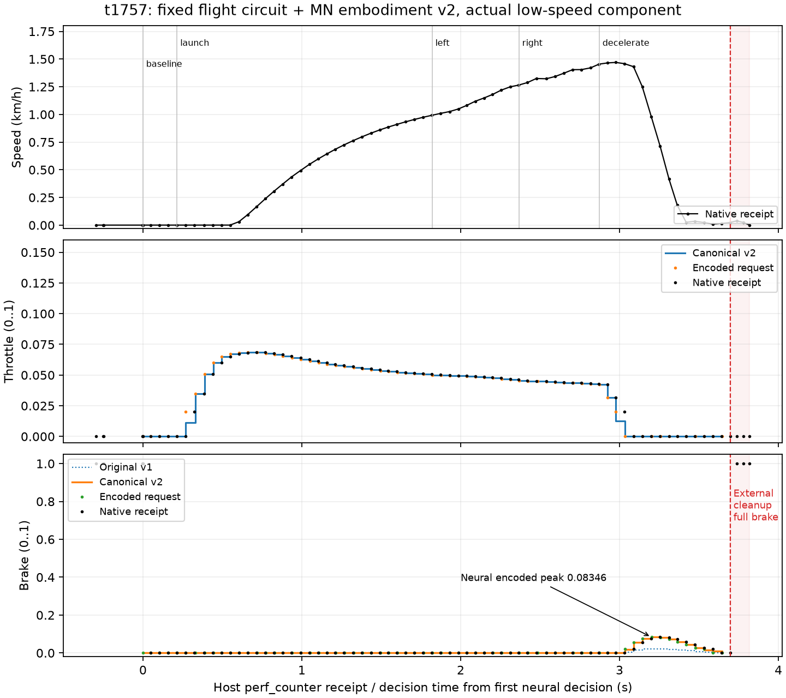

# MN embodiment v2 수치 자격·원천 시간 계측·새 엔진 소유권 재검증

2026-10-30, Asia/Seoul. t1733–t1762의 완료 원자료와 독립 감사를 기준으로 작성했다. t1758 전체 CPU/native 독립 감사까지 봉인 완료했다. **지속 목표는 active/미완료다.** 원래 비행 운동 회로를 거친 고정 시점의 도달 가능한 MN 응답으로 v2 제동 대응을 수치 검증했고, CSP 동기 heartbeat 저장의 실제 지연을 계측했다. 새 엔진에서 실제 v2 저속 부품 실행과 원래 전체 clock·적용·CPU replay의 독립 감사를 완료했다. 이번 범위의 optimizer/운전 fit 업데이트0, 시각 학생 배포0, 학생 유효 랩0이다.

## 유지하는 전체 목표와 정보 경계

> **초파리의 겹눈/운동 시각과 비행 유래 균형·운동 회로를 자동차라는 가상 몸에 연결한다. 차체 기울기·회전·하중·타이어 상태를 몸 감각으로 되먹임하며 조향·가감속과 빠른 레이싱 라인/랩타임을 학습한다.**

[프로젝트 대전제](PROJECT_CHARTER.md)의 기준은 보행이 아니라 **비행의 날개 조종·균형·시각 안정화**다. 전·좌·우·후방 영상은 방향·시간·운동 구조를 가진 시각 증거로 처리하고, 차체 기울어짐을 몸 기울어짐으로 받으며 회전·관성·하중 이동·접지·타이어/셋업 상태를 되먹임한다. 조향만이 아니라 가속·감속·코너 진입/탈출·가변속·변속을 다루고, 유효한 자율 완주 이후 조건별 레이싱 라인과 랩타임을 개선하는 목표를 유지한다. 네 화면이나 연결망 통과, 짧은 저속 부품 응답이 이 전체 기능의 구현을 뜻하지 않는다.

actor의 경로 판단은 영상과 허용된 몸 감각에서 나와야 한다. 정답 라인·지도·world pose·진행률·미래 곡률·교사 명령은 교사/보상/critic/평가용이다. 몸 자세·각속도와 절대 world heading을 구분한다. 실제 측정 연결/주석, 생리학적 기능, 기능 근사, 차량 대응 가설, 학습한 어댑터를 구분하며 전체 뇌·근육·공력 재현을 주장하지 않는다. 하중·타이어·셋업 적응과 실제 선행 시각 판단의 인과적 기여는 여전히 검증해야 한다.

## v2가 바꾼 대응과 원래 회로의 보존

과거 [운동 출력 한계](flight-pace-data-and-motor-learning-20261030.md)에서 원래 signed-forward readout은 MN common activity `p>=0` 때문에 private quiet reference 아래에서도 canonical brake 상한이 약0.28841이었다. 이는 full-brake1 교사 표적의 모방 능력 제한이며, 그 자체가 정지 불가능이나 교사의 최적성을 증명하지 않는다.

새 `src/flybrain_drive/flight_embodiment.py`는 원래 같은 상태의 raw intent와 MN6 요약을 받는 별도 순수 decoder다. 원래 raw intent, v1 canonical, steering과 양의 throttle을 그대로 보존하고 제동만 다음 차량 대응으로 계산한다.

```text
p = (power_left + power_right) / 2
brake_v2 = clip((p0 - p) / (p0 - p_anchor), 0, 1)
```

`p_anchor=0`을 가정하지 않았다. 원래 graph·body·readout gain/mix/ports를 유지한 실제 고정 시간의 신경 응답이 anchor다. 원래 회로 밖 task/PID/direct-axis residual은 없다. 같은 signed-forward manifold에서는 throttle/brake가 동시에 양수가 될 수 없으므로, 교사의 실제 coactivation 표적은 이 대응에서도 별도 모방 한계로 남는다. clamp 밖 gradient0과 경계의 원래 clamp 미분을 보존하며 이를 생리학적 제동 기전이라고 부르지 않는다.

[t1735 사전 계약](C:/Users/jeff4/AppData/Local/flybrain/runtime-runs/20261030-t1735-neural-anchor-review/anchor-review-contract.json)은 먼저100×0.01초 quiet를 수행하고, t1689의 원래68관측/67간격을 합성 몸100km/h·목표속도0·목표yaw0·실제yaw0에 그대로 적용하여 **T=3.6801013999502175초의 끝점만** anchor로 고정했다. 조건별/시간별 최솟값을 골라 넓히지 않았다. 초기·과도 상태, 이전 held input, nominal step과 fractional tail을 유지하며 에피소드 안에서 reset/retime하지 않았다. 같은 anchor로18개 속도/yaw grid와 quiet·matched-speed·lesion 대조를 검사한다. span은 `max(1e-6, .05*p0, 100*U)` 이상, raw/state parity≤2e-6, v2 parity≤1e-4를 사전에 요구했다. 이는 공학적 수치 안정성 기준이다.

## CPU 실제 실행과 독립 재계산

[t1734 원래 CPU 실행](C:/Users/jeff4/AppData/Local/flybrain/runtime-runs/20261030-t1734-cpu-mn-anchor-qualification/result.json)은 terminal0으로 완료됐다. 선언된 CPU private quiet 값과 고정 endpoint는 다음과 같다.

| 값 | 실제 값 |
|---|---:|
| quiet `p0` | 0.0014305992517620325 |
| 고정 endpoint `p_anchor` | 0.00016035125008784235 |
| span | 0.0012702480016741902 |
| span / p0 | 88.7913229% |
| 원래 관측 / 간격 | 68 / 67 |
| 원래 경과시간 | 3.6801013999502175초 |

quiet는 v2 brake0, 등록 endpoint는1이다.18 grid의 끝 brake는0.979913–1이고 단조 응답을 보였으며 speed-error lesion은 brake0이었다. 원래 관측에서 처음 양의 encoded brake/.5/.8에 도달한 시점은 각각0.0484603/0.1586981/0.2142087초다. 이는 저장된 합성 신경 표본의 첫 임계 통과이며 실제 차량 제동 지연이나 연속 시간의 정확한 교차 시각이 아니다.

[t1740 독립 감사](C:/Users/jeff4/AppData/Local/flybrain/runtime-runs/20261030-t1740-cpu-anchor-result-audit/result.json)는6,952검사에서2,176개 decoded 행과202개 quiet 행의 MN→raw→v1→v2→encoded 및 summary/coupling을 재계산했다. CPU raw 재구성 차이는0이었다. quiet/calibration의 양 반복은 저장돼 직접 비교할 수 있다. 원래24 core 조건의 반복 및 고정모델 불변은 실행 소스의 성공 전 guard로 검사됐지만 두 번째 전체 traces/고정 hash 표는 당시 따로 저장되지 않았다. 추가6 auxiliary 조건은 당시 단일 CPU pass였고, 다음 GPU 자격에서 전부 다시 반복했다.

CPU의 raw yaw/common coupling 최대는 span의0.00431496, decoded brake 편차0.00431496, speed/steering 결합 최대0.0000869632였다. 결합을 숨기거나 steering 보정으로 제거하지 않았다. reference의 historical body-mask hash는 t1689 출처 증거이며 실제 합성 입력 mask `[0,1,4,16]`와 구분한다.

## matched CPU/GPU 실제 자격과 t1742 감사

[t1741 실제 실행](C:/Users/jeff4/AppData/Local/flybrain/runtime-runs/20261030-t1741-matched-gpu-mn-qualification/result.json)은 소유 handle91836 terminal0으로 완료됐다. CPU 재실행1개와 GPU 반복2개 모두 동일한 원래 고정 graph/몸/readout에서 시작하며, **CPU private quiet readout을 그대로 GPU에 설치**했다. GPU별·조건별 재중립화나 reanchor는 없다. 전체30조건×68관측과 각101 quiet 관측을 저장했고, 새6 auxiliary 조건도 포함했다.

| 실제 matched 지표 | 최대 차이/값 |
|---|---:|
| raw / v1 / v2 / encoded cross-route | 4.842877388000488e-7 |
| 전체 neural state cross-device | 4.470348358154297e-8 |
| MN6 | 6.984919309616089e-10 |
| common power uncertainty `U` | 4.656612873077393e-10 |
| 두 GPU 반복의 모든 저장 출력·상태 hash | 정확히 같음 |
| GPU 표본의 CPU decoder 대 GPU decoder | 0 |
| quiet raw 최대 절댓값 | 6.015648779111871e-8 |
| quiet v2 brake / encoded pedals | 0 / 정확히0 |
| span / U | 2,727,836.8125 |
| GPU peak allocated | 276,677,632 bytes |

실제 새 class와 같은 경로를 검증하기 위해 GPU가 낸 정확한 float32 raw/MN 값을 **CPU에서 decode한 값**을 control trace의 v2/encoded로 기록했다. GPU-device decoder 결과도 별도 저장하고 CPU/GPU모델×두decoder 경로의 전체 조합을 검사했다. 원래 CPU30조건의 state hash·MN·적용 가능한 출력은 재실행과 정확히 같다. graph/body/readout뿐 아니라 command tensor/buffer/비텐서 gain 및 계약을 포함한 whole-model fingerprint의 실행 전후 동일성이 저장돼 있다.

[t1742 독립 감사](C:/Users/jeff4/AppData/Local/flybrain/runtime-runs/20261030-t1742-matched-gpu-anchor-audit/result.json)는 **120,457검사/6,423행**을 통과했다.9개 필수 artifact의 실제 bytes/SHA, 원래 source/registration/manifest/CPU link,30조건·원래 clock/mask, 각 행의 raw/MN/v1/v2/encoded, 모든 비-state max summary/100U를 재계산했다. GPU raw의 같은MN 재구성 오차는2.9802322387695312e-8, CPU는0이었다. 실제 proof를 `load_qualified_embodiment_inputs`로 읽고 `recheck_files()`까지 통과했으며 감사는 CUDA를 초기화하지 않았다.

전체 neural state는 hash로 보존되고 배열 자체는 저장되지 않았다. 따라서 원래 CPU와 GPU 반복의 full-state hash는 독립 비교했지만, **cross-device state 수치 최대4.47035e-8은 봉인된 실행 소스의 finite-array comparator와 저장된 summary가 뒷받침한다.** 독립 감사가 전체 상태 배열을 다시 재생한 결과로 쓰지 않는다.

cleanup 후 실행 안에서 측정한 `gpu_allocated_after_cleanup_bytes`는 **113,246,208 bytes로0이 아니다.** 원래 receipt를 보존했다. 소유 model/state/input 해제·gc·synchronize·empty_cache가 실행됐지만 소스만으로 남은 tensor/workspace의 소유자를 확정하지 않았다. 별도로 root가 소유 실행의 terminal0을 확인했으므로 process 종료와 in-process allocator0 측정을 구분한다. [cleanup 범위 부록](C:/Users/jeff4/AppData/Local/flybrain/runtime-runs/20261030-t1742-matched-gpu-anchor-audit/cleanup-source-scope.json)에 이 한계를 남겼다.

## 실제 v2 부품 연결과 저속 실행 범위

별도 `src/flybrain_drive/flight_embodiment_trial.py`의 `NeuralEmbodimentV2Probe`와 명시적 `native_neural_embodiment_v2_component` 모드를 추가했다. 기존 trial과 옛 모드를 바꾸지 않았다.75 관련 CPU 검사와 Ruff에서 synthetic proof·부모 stub으로 proof 거부, source/artifact 변조 거부, 원래 부모 호출1회/상태·시각·raw 보존 및 새 모드 guard를 검사했다. 이 CPU 검사를 실제 GPU/차량 실행이라고 세지 않는다.

loader는 `matched_cpu_gpu` 성공 status, 정확9개 artifact,30×68/67, 원래 source/spec/checkpoint/readout, 등록·manifest·실행 프로그램, span/parity를 확인한다. 부모 quiet1초는 한 번만 수행하고 이후 같은 CPU neutral offset만 설치하며 gains/mix/graph/body와 quiet state를 유지한다. 실제 quiet raw≤2e-6, v2 brake≤1e-4와 encoded pedal0을 acquire 전에 요구한다. steering roundoff는 보존하고 deadband나 잔차로0에 맞추지 않는다.

매 요청은 부모를 정확히 한 번 호출해 이전 held body/command의 원래 경과시간을 진행한다. 같은 state의 raw/MN으로 v2를 계산하고 원래 값을 `canonical_v1_request`로 남긴다. generic `canonical_request`와 schema는 **실제 반환 v2**이며 codec/vJoy 앞에서 반환 배열과 metadata가 정확히 같은지 검사한다. 이후 별도 minimum-positive .02 codec, 실제 driver 요청, 후속 native 적용 관측은 각각 다른 단계다. 요청 성공을 같은 call의 게임 적용이라고 해석하지 않는다.

[새 실행 계획](../configs/ac-native-neural-embodiment-v2-20261030.json)은 실제 GPU proof와 아래 새 엔진 보정을 묶는다. 기존 NEURAL_PROGRAM과 native physics/graphics freshness, AI/소유권/profile, gear,12km/h·8m 및 steering .05/throttle .15/brake1 상한, 마지막 외부 full-brake ACK/FREE 가드를 유지한다. 주입한 목표yaw/속도를 쓰는 diagnostic 부품 시험이지 영상으로 경로를 고르는 학생이 아니다.

[t1757 실제 v2 저속 실행](C:/Users/jeff4/AppData/Local/flybrain/runtime-runs/20261030-t1757-native-neural-embodiment-v2/result.json)은 소유 process4217 terminal0으로 완료됐다. 신경 부품 요청67개/관측71개/전체 actuator 메시지75개이며 최고1.4696794748306274km/h, 최대 변위0.7258546923609239m였다. native first gear2를 관측했고 마지막 별도 full-brake native ACK와 vJoyFREE를 확인했다. `vision_used=false`, `actor_deployed=false`인 **외부 목표 주입 운동 부품** 실행이다. 신경 부품이 실제 메시지를 보낸 사실과 시각 학생 미배포는 함께 성립한다.



그림은 원래67개 decision/encoded point와 **71개 sample+4개 final_native receipt**를 모두 보존한 파생 표시다. x축은 첫 neural decision 기준의 host `perf_counter` receipt/decision 시각이며 빨간 선3.6969476초는 첫 외부 cleanup driver-call start다. 정확한 물리 source/application clock이 아니고 연결선은 표시용이다. 신경 encoded brake peak0.08346과 빨간 영역의 **외부 cleanup brake1**을 구분한다. 제동 인과성·학습 제동·full-range 차량 응답을 주장하지 않는다. [t1761 독립596검사·시각 검토](C:/Users/jeff4/AppData/Local/flybrain/runtime-runs/20261030-t1761-v2-receipt-figure/independent-audit.json)에서 원래 event/source/PNG hash, raw prefix 값·전체 수·clock/요청 link와 그림 가독성을 확인했다.

[t1758 전체 독립 감사](C:/Users/jeff4/AppData/Local/flybrain/runtime-runs/20261030-t1758-embodiment-v2-actual-audit/result.json)는 **4,015검사/terminal0**으로 완료됐다. 원래 source/input binding43개와 physics308-byte75개/AI420-byte142개/graphics264-byte71개/initial SDK1개를 확인했다. 같은packet AI/body prefix134개가 모두 byte-identical이다. 원래 body21 재구성·mask와 CPU 순수 v1/v2 decoder·codec/driver 값은 정확히 맞았다.

별도 CPU full original graph replay는 **67관측/66개 실제 이전-held 간격, 총3.645322899974417초**를 재생했다. 최대 간격62.6614ms, reset/retime0, initial SDK만 사용했고 중복 graphics의 원래 receipt를 유지했다. live raw/v1/v2/encoded 대비 최대차2.452288754284382e-7, MN4.656612873077393e-10, common3.4924596548080444e-10이었다. 실제 quiet full GPU state hash는 자격 GPU quiet와 같다. 그러나 quiet 이후 full GPU state hash가 live trial에 저장되지 않아 **전체 graph의 CPU 동역학을 재생하되 live 비교는 기록된 출력에 한정**한다. 후속 full-state 동일성 검증으로 쓰지 않는다.

| 실제 제동·codec 구분 | 봉인 감사 결과 |
|---|---|
| neural 위상 | baseline4 / launch29 / left10 / right9 / decelerate15 =67 |
| 양의 canonical brake16개 | 작은6개는 명시적0 투영,2개는.02로 투영,8개는 문턱 위 값을 보존 |
| decelerate 제동 | canonical 양수12개, encoded 양수10개, 최고0.08345752209424973 |
| 요청 뒤 native 대응 |10개 encoded 양수 요청 모두 ordered following native brake 양수; 최대 요청/native 차2.316385508e-5 |
| 움직이는 제동 표본 | 관측속도>.1km/h에서 요청7개, 뒤 native도>.1km/h인 양의 brake6개; 최대 native brake0.08345001936 |
| coactivation |0 |
| 별도 cleanup | native4행은 brake0 뒤1/1/1. 세 외부 full-brake ACK를 신경 출력에서 분리 |

감속 위상에서 최고1.46968km/h와 cleanup 전 최소0.00993962km/h를 관측했다. 그러나 ordered following 표본은 비동기 후속 증거이며 같은call의 적용·연속 적용 시간·정확한 actuator latency를 증명하지 않는다. 제동 대 타력/engine drag/경사 대조가 없어 감속의 인과성을 분리하지 않았다. 마지막 외부 cleanup full-brake1은 학습하거나 신경이 만든 brake1이 아니다. 목표속도1m/s에 실제 최고는 약0.408m/s이므로 목표 추종 성공도 아니다. 고속/full-range plant 응답·yaw 정착 추종·학습 제동·시각 자율주행의 검증은 남아 있다.

[t1759 후속 fresh3표본](C:/Users/jeff4/AppData/Local/flybrain/runtime-runs/20261030-t1759-post-v2-fresh-state/result.json)은 PID24200/같은 generation에서 nativeAIoff/gear2/gas0/brake1/마지막0.00049678865km/h/FREE1/background와 CSP age0.00474048초를 확인했다. 이후 [t1760 API pause](C:/Users/jeff4/AppData/Local/flybrain/runtime-runs/20261030-t1760-post-v2-pause/result.json)는 target_state_observed=true/terminal completed이며 후속 `after.json`에서 paused=true/live=false/CSPAIoff/cameraoff/expertinactive/gas0/brake1/속도0.0004880756km/h를 확인했다. pause 뒤 native packet이 계속 진행하거나 새 native AIoff를 재관측했다고 덧붙이지 않는다. t1758 원본 결과와 별도로 이 마지막 상태를 보존했다.

## 원천 per-call 시간 계측과 실제 heartbeat 지연

t1736은 기본off인 bounded `source_timing_v1`/`--source-timing`을 준비했고296 관련 CPU 검사/Ruff를 통과했다. [t1737 독립 검토](C:/Users/jeff4/AppData/Local/flybrain/runtime-runs/20261030-t1737-source-timing-review/result.json)는80소스 검사와27독립 CPU 검사에서 기존 caps/timer/ownership/freshness를 보존함을 확인했다. 원래 `os.preciseClock` 초 단위의 fixed-column ledger는131,072행 상한이며 overflow/잘못된 clock·capture bound는 nonqualifying이다. ledger 추가 hot-loop disk write는 없다.

camera/expertProbe/brakeSettle/pendingReceipt가 모두 끝나고 paused/AIoff/정차/fullbrake가 관측된 뒤에만 frozen ledger를 terminal flush한다. release 때 quiescence가 관측되지 않으면 저장을 건너뛴다. 선택 기능의 ledger 대기만 최대10초이며 기존 producer terminal 대기2초와 live-control caps는 그대로다. 설치 SDK의 seconds/ensure temp→move 계약과28개 session consumer inventory를 보존했다. `io.saveAsync`는 이 계측에 사용하지 않았다.

t1738은 timing Lua SHA `b6d87d2708a13b37e858bf6cfe87f362540bf645514223e18e2c870fbd66e1f7`를 배포했고 engine45604/generation `37294426ULL:0.0013415`에서 UI0으로 완료했다. 이후 두 실행은 영구 diagnostic/fit=false다.

| 원래 실행 | 관측 / 원천 camera groups | ledger / overflow | camera wait miss | 실제 최고속도 | heartbeat `io.save` 최대 |
|---|---:|---:|---:|---:|---:|
| t1739 camera3 | 80 / 183 | 2,643 / 0 | 0 | 15.6301km/h | 16.5134ms |
| t1743 pace30 | 736 / 885 | 13,057 / 0 | 0 | 100.9780km/h | 73.4062ms |

[t1746 pace30 원천 감사](C:/Users/jeff4/AppData/Local/flybrain/runtime-runs/20261030-t1746-source-timing-analysis/pace30/result.json)에서151개 heartbeat 저장 중 최대73.4062ms가 같은 update157의 heartbeat73.6711ms/pollSession73.6732ms/update76.2974ms 안에 실제로 들어 있다. 중첩 시간을 합산하지 않는다. false save2개와 failure counter1→3을 보존했다. 단순한 `fileExists=false`는 기대 파일이 없는 predicate일 수 있어 이 I/O false와 구분한다.

t1744의 원래 pixel replay는 두 실행 모두7개 배열 오차0, 원래 관측 간격 기준을 통과했다. pace30의 최대 관측 간격은43.849ms,80ms 초과0이었다. **이전에 본182/363ms stall은 이번에 재현되지 않았다.** 동기 heartbeat가 한 prerender update의 상당 부분을 차지한 원인을 직접 측정했지만, 과거 모든 지연의 유일한 원인이거나 모든 문제가 해결됐다고 쓰지 않는다. 두 capture는 GPU qualifier와 겹치지 않았고 새 TRAIN/학습 자료로 승격하지 않았다.

**원천 분석 프로그램의 보존 한계:** t1746 analyzer는 당시 inline으로 실행돼 원래 executed Python 파일이 남아 있지 않다. 저장 ledger·분석 결과·receipt는 보존하지만 이 부재를 source 파일이 있는 것처럼 쓰지 않는다. [t1762 현재 재계산 supplement](C:/Users/jeff4/AppData/Local/flybrain/runtime-runs/20261030-t1762-current-source-timing-recompute/result.json)는 별도 저장한 `executed-recompute.py`로 같은 원래 hash-pinned ledger를 다시 계산해 **31,604검사/terminal0**을 완료했다. heartbeat 저장31/151회와 최대16.513400000008/73.406200000022ms 및 동일한 poll/update 포함 관계를 재확인했다. 이 결과는 t1746 당시 실행 소스를 소급 복원하거나 대체하지 않는다.

현재 재계산의 첫 validator는 capture 종료 뒤 각 ledger의 마지막 `script.update`에 원래 `capture_index=false`가 있다는 이유로 실패했다. `executed-recompute-v1.py`와 `v1-failure.json`을 보존하고, **원래 capture_closed_clock 이후 끝난 script.update에만 false를 허용**하도록 validator 한 줄을 바로잡았다. 원시 행·clock·duration을 고치지 않았다. t1762의 result/receipt/새·실패 source 및 양쪽 ledger/원래 result hash를 이 문서 작성 시 다시 확인했다.

## async 후보와 같은-copy authority prototype

[t1745 설계](C:/Users/jeff4/AppData/Local/flybrain/runtime-runs/20261030-t1745-async-heartbeat-design/REPORT.md)는 오래된 AIoff snapshot의 비동기 완료가 새 mtime을 얻어 freshness를 통과할 위험을 보였다. 단순 `io.saveAsync` 전환은 해결로 승인하지 않았다. 원래 source clock과 보수적인 hostQPC/Unix lower bound를 보존해야 한다.

[t1747 격리 후보](C:/Users/jeff4/AppData/Local/flybrain/runtime-runs/20261030-t1747-heartbeat-candidate-preparation/result.json)는 별도2slot session MMF, CRC/identity/sequence, exclusive host writer lease, single-flight/latest queue와 retirement fence를 CPU/합성 interop72검사로 확인했다. private part에 원래 source time의 보수적 mtime을 먼저 설정한 뒤 atomic rename한다. clock/age/lease/commit 실패는 드러내고 제어 요청을 재시도하지 않는다. **실제 MMF 생성·host worker·production Lua 통합/배포는0**이며 기존 네 배포 파일과 동기 heartbeat는 바뀌지 않았다. 실제 Windows IPC·mtime·clock/teardown 자격은 후속이다.

별도 `src/flybrain_drive/ac_teacher_physics.py`는 같은 반복420-byte copy에서 body308-byte와 AIflag@416을 나눠 보존하는 prototype다. 같은packet/body prefix/receipt/hash를 만들며 AI flag는 actor 입력이 아니다. 작성 시점의 `scripts/record_ac_engine_ai_probe.py`에는 이 reader가 아직 import/연결되지 않았다. 따라서 이 prototype이 이전/새 recorder 자료 전체의 teacher authority를 소급 인증하지 않는다. repeated-copy 일치는 engine atomicity/원래 simulation sample time/교사 최적 제어를 증명하지 않는다.

## 신선한 native AI 충돌·API reset·새 엔진 보정

t1733의 paused nativeAI=true는 frozen baseline으로 보존했고 이를 곧바로 현재 학생 소유권 차단으로 반복 해석하지 않았다. 그러나 [t1748 fresh preflight](C:/Users/jeff4/AppData/Local/flybrain/runtime-runs/20261030-t1748-v2-native-preflight/result.json)는 resume 후 **실제로 진행한** native packet에서 별도 충돌을 발견했다. t1749의73독립 검사는 raw bytes/SHA와 다음 사실을 확인했다.

- paused baseline packet2132454 뒤 fresh packet2133727로1,273 증가했다. actor308-byte와 양쪽420-byte AI prefix가 같은packet/body bytes이고 AIflag는 둘 다true다.
- 그때 CSP는 live/unpaused/AIoff였고 native gas0/brake1, speed0.000463478km/h, vJoyFREE1/background였다. 이는 옛 paused flag와 다른 **신선한 ownership conflict**여서 acquire/actor deployment 전에 거부됐다.
- pause API의 즉시 receipt는 여전히 unpaused다. 뒤의 `pause-after/after.json`이 script_clock2873.952626에서 paused=true/live=false/CSPAIoff/gas0/brake1을 관측했다. 새 post-pause native AI read는 저장되지 않았으므로 nativeAIoff/새FREE/native graphics pause를 만들어 쓰지 않았다. 실패는 그대로 failed다.

[t1750 reset-only 복구](C:/Users/jeff4/AppData/Local/flybrain/runtime-runs/20261030-t1750-native-ownership-engine-reset/result.json)는 API restart1회로 old PID45604의 실제 exit0을 확인하고 **새 PID24200 / generation `733364ULL:0.0027459`**를 얻었다. reset은 운전 소유권 부여가 아니며 video 변경0/UI0/axis0/background였다. 이어 t1751 API start, t1752 stationary full-brake hold7메시지/해제, t1753 작은 steering 보정과 t1754 native coordinate 자격을 수행했다.

| 새 엔진 증거 | 실제 확인 범위 |
|---|---|
| t1753 작은 steering 보정32표본 | 요청±.1 → native median±.1406249851, SDK median±44.9999962; native gain1.406249851/request, SDK449.999962/request. 양쪽 nativeAIoff, foreground0, 최대0.0230763km/h. 큰 입력/이동 조향 자격 아님. |
| t1754 좌표24표본 | 원래 graphics264-byte/좌표offset252와 SDK 정차 위치의 최대차6.103515625e-5m. nativeAIoff/FREE1/background. world XZ는 진단 변위 가드용이며 actor입력/이동 위치 정확도 검증 아님. |
| t1756 fresh admission3표본 | 진행 native packet20865→20902→20916, 각 body 앞뒤 AIflagfalse. PID24200/위 generation/producer `ac-file-24200-1793302721270009`, Neutral gear1, gas0/brake1, 마지막 speed0.000474564km/h, CSP age0.0140009초/FREE1/background. |

[t1755 봉인 독립 재자격 감사](C:/Users/jeff4/AppData/Local/flybrain/runtime-runs/20261030-t1755-post-reset-requalification-audit/result.json)는 **1,803검사/실패0**으로 t1750–t1754의 원래 bytes/SHA·reset process receipt·32개 steering/24개 coordinate 관측을 확인했다. post-reset AIoff raw flag112개는 calibration64+position48개다. t1752 hold의 AI guard는 실행 소스로 강제됐지만420-byte raw flag가 따로 저장되지는 않았다. t1753 generation도 각 행에 직접 저장되지 않아 보정 source guard와 일치하는 PID/producer 및 t1754의 명시적 generation을 함께 사용했다. 이 한계를 생략하거나 saved audit 자체를 향후 운전 소유권으로 바꾸지 않는다.

새 계획은 이 calibration/coordinate/proof를 묶지만 **매 실제 실행의 acquire 직전에 freshness·진행packet·AIoff·소유권을 다시 검사**한다. t1756은 그 시점의 읽기 전용 자격이며 이후 상태를 영구 보장하지 않는다. 창 활성화·클릭·키 입력이나 외부 프로세스 종료로 복구하지 않았다.

## 학습 이력과 이번 범위의 수치

[이전 t1696 시각 시간 학습](flight-visual-temporal-fold-learning-20261030.md)은 원래 저자망에서 각각 새로 시작한3fold×detach2/8의 **서로 다른6모델**이다. 각186회, 합계1,116회 Adam 업데이트가 실제 있었다. 보조 readout1,200회, 이전 별도 t1659의1,107회와 합쳐 한 모델의 누적으로 쓰지 않는다. 모든6모델이 body-only보다 나빴고 선행 시각 기준은 통과하지 못했다. 알려진 DEV를 이용한 새 후보 선택이나 학생 배포로 전환하지 않았다.

이번 t1733–t1760의 neural anchor/decoder/timing/reset/저속 부품 검증은 **fit0/optimizer0**이다. 합성 desired-speed/yaw injection은 외부 부품 과제이며 시각 경로 판단이 아니다. timing 자료는 diagnostic fit=false, 새 TRAIN activation0, teacher authority label 생성0이다. 현재 수치 자격과 실제 센서·driver/후속 적용 대응을 분리해 앞으로 검증하며, 학생 자율 시각주행·유효 랩/라인·랩타임 목표는 남아 있다.

## 핵심 원본 및 감사 SHA256

원자료는 `C:/Users/jeff4/AppData/Local/flybrain/runtime-runs/` 아래에 보존한다. 원래 NPZ/PT/event/camera payload를 이 문서 작성 과정에서 복사하지 않았다. 다음은 이 판본에서 직접 읽은 핵심 receipt의 hash다.

| 원본/감사 | SHA256 |
|---|---|
| t1735 anchor-review-contract.json | `a897f49ba8af680feb14e17bbbb9bc45a64cad46f0fefb80cad0cde534aaf300` |
| t1734 reference.json | `97fc57dff725808150972f4555a2b83d33a2fd096b90c30427cb668f89130175` |
| t1740 result.json | `952ed387087318fbe9538a4ff72ada47b1ac726039ef9cdd2eb7d4670e5a2e1c` |
| t1741 executed-program.py | `22d7016fa2e1bc7e151aabb89d4e53a1767d601ad431a815422db0dfe4bc12f6` |
| t1741 result.json | `dbd21224f167915614c4317b196972d48aaa046dfc9ec8a139a764fd8a153800` |
| t1742 result.json | `6e791573fbcb4e323420c1e96b37371b0a787723005f9075a8914570e40767a7` |
| t1746 pace30 ledger | `171995e8127c3f4044fc12fe17f39b6a8533ed6fdaf942628d5cac5430723401` |
| t1749 result.json | `94124bfb5b8094d0643cd1df623210a6a86ef40f8c603946c0e128e84f9e5265` |
| t1750 result.json | `8952cca0ed44f3f3cecc860a34f68e6dc6ff4764f8316df2b4f6f042c8f8dd12` |
| t1753 result.json | `17e9ba7fbd2b1fdd2ffa9afa64808a2b44eef87c8f2c011621f0d26eb33e81ba` |
| t1754 result.json | `91463c67d3a9aa44dd71469d71dc700292047d3fe03e1e700927b9b2ade5b3b2` |
| t1755 result.json | `07f9cc053e83428ce7d3ac7c63c398f2c522e1af335d6d9e79f0aca800f1c479` |
| t1756 result.json | `5b5a69e4058834b3edee097d40aeef98dd1d3b3804bbe112e7eed4f98f8184f4` |
| t1757 result.json | `f0ba9dca150ed7835e6dbfaf2b14320645f4e39ce5adf2ceb14dc5b02fbdca57` |
| t1758 result.json | `4405d0d69b23b1bd8a28c484b99c4885aea36204cb7be25464414af72befab40` |
| t1759 result.json | `44319f8697258ba6fda37d5c9a701b9a6c594e33ece407d658b721b691a0c6a7` |
| t1760 result.json | `622784ab0e77ac5468dd1457edbf3b37da5d60613107e753674e42569476c36e` |
| t1761 figure PNG | `52b6d110b3ad461a45801bddb00733fb0983a7082a2a680bdea4e1913d813904` |
| t1761 independent-audit.json | `c1b17b7bcadf27ae851e6c6847e44a0a08aed88b887e4043caf4e73fdd3b374b` |
| t1762 result.json | `397009ccf3779d3a37bbcd065cb4e52ca52875c628b12e9a77b4c05b68864301` |
| t1762 executed-recompute.py | `bb4891e1fab4bd37df14d20eb362d5bedff08464240fbec6f7b1206394ca2219` |

이 판본은 완료 원자료의 문서화만 수행했다. t1757의 canonical_v1/v2/encoded/native 단계와 원래 held-clock 전체 CPU replay·gear·moving-brake의 독립 감사는 t1758 봉인 원본으로 확인했다. 원래 실행의 마지막 stop ACK/FREE·terminal0과 t1759/1760 상태는 별도 증거로 기록했다. 실제 고속 응답·제동 인과 대조·시각 학생의 유효 랩/라인·랩타임 자격은 미완료다.


## 소형 보존의 실패와 교정

첫 `runs/flight-embodiment-and-source-timing-20261030-t1763`은 **실패한 보존본**이다. [t1764 독립 감사](C:/Users/jeff4/AppData/Local/flybrain/runtime-runs/20261030-t1764-independent-archive-verification/result.json)는277개 복사본의 해시·크기와 전체 파일 범위를2,724검사로 확인했으나, 이름으로 거르지 못한 `control/native-motion-samples.json`과 `control/native-after.json`이 두 수집에 걸쳐 **원본 raw JSON4개/2,111,970byte/1,159개 physics prefix**를 포함한 것을 발견했다. 최초 archive의 payload0 선언과 root의 제외 attestation은 잘못됐다. 신경 회로·실차 검증의 원본/결과와는 별도 실패다.

[t1766 교정](C:/Users/jeff4/AppData/Local/flybrain/runtime-runs/20261030-t1766-failed-archive-payload-cleanup/result.json)은 정확한 네 복사 경로가 실패한 보존 폴더 안에 있는지, 원본과 복사본 SHA가 모두 사전 목록에 맞는지 먼저 확인했다. 네 **복사본만** 비재귀 삭제했고 원본 파일의 해시 불변을 재확인했다. 실패한 기존 manifest/result는 과거 증거로 유지하고 `FAILED-ARCHIVE.md`/교정 receipt로 실패·불완전 상태를 표시했다. 원본 raw JSON/NPZ/PT/event/camera는 삭제하지 않았다.

최종 보존 경로는 `runs/flight-embodiment-and-source-timing-20261030-t1767`, 명세는 `configs/flight-embodiment-timing-archive-20261030-t1767.json`이다. 검토된 첫 선택에서 위 네 원본 payload를 명시적으로 제외하고 실패 감사·교정 소스·receipt를 추가한다. filename 중간의 sample 토큰과 native-before/after/motion snapshot도 파일을 열기 전에 차단하도록 새 helper를 보완한다. 현재 소스와 당시 실행 소스·메타데이터를 구분하고 JSON 시계열·모델·영상·이벤트 원본은 원래 경로/hash 선언으로 보존한다. t1746 analyzer 소스 부재와 t1762의 새 supplement도 구분한다. 보존은 fit 허가·운전 성과·목표 완료를 뜻하지 않는다.
