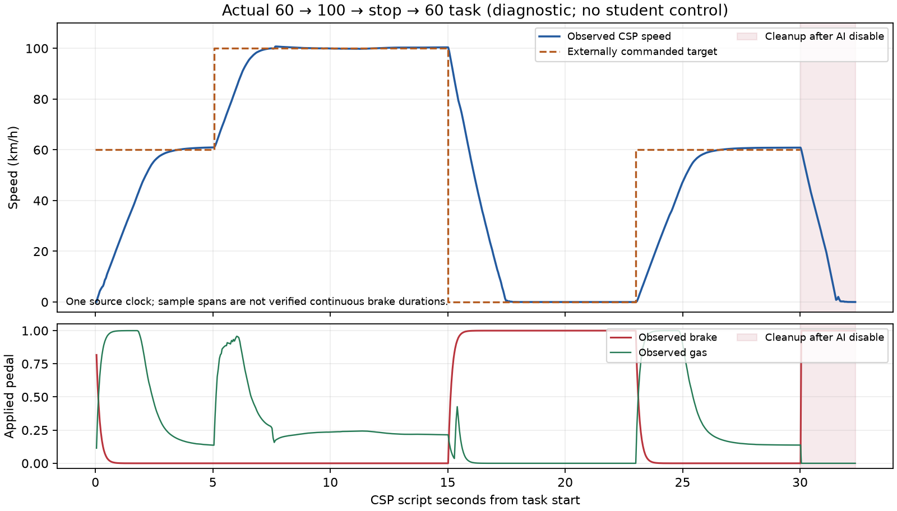

# 실제 60→100→정지→재출발 자료와 비행 운동 학습 경계

2026-10-30, Asia/Seoul. 지속 목표 **파리운전시키기**는 진행 중이다. 교사의 새 과제와 부품 자격 검사를 학생 운전 성과로 세지 않는다.

**초파리의 겹눈/운동 시각과 비행 유래 균형·운동 회로를 자동차라는 가상 몸에 연결한다. 차체 기울기·회전·하중·타이어 상태를 몸 감각으로 되먹임하며 조향·가감속과 빠른 레이싱 라인/랩타임을 학습한다.** 비행 기준, 영상+허용된 몸 감각, 실측 회로·기능 근사·차량 대응의 구분을 유지한다. 60→100/가변속·변속·타이어/하중/셋업·유효 완주·레이싱 라인/랩타임 전체 목표가 남아 있다.

## 자료의 역할을 먼저 정했다

t1704의 역할 감사는 알려진 개발 구간 [.2,.25], [.67,.84], [.94,1] 및 평가 [.08,.125]를 새 TRAIN에서 제외한다. 실제 새 코너 TRAIN의 과거 범위는 약 [.294,.542]다. 새 지리 [.55,.65]는 직선/완만한 곡선만 있으므로 양방향 코너 일반화로 부르지 않는다. 기존 지리에서 조건만 바꾸는 검증은 geometry_seen/condition_unseen으로 따로 표시한다. 개발·평가 배열은 열지 않았다.

실제로 구현한 별도 과제는 `expert-pace60-100-stop30` 하나다. 기존 60km/h 프로파일과 상한을 유지하고, 새 과제에만 30초/120km/h/진단 변위1100m 경계를 둔다. 외부 목표는 0–5초60, 5–15초100, 15–23초0, 23–30초60km/h다. 정지 중 AI 속도 상한은100이고 외부 목표는0이다. 두 값을 같은 신호로 취급하지 않는다.

15초에 실제40–110km/h일 때 `physics.setAIStopCounter(0,8)`을 한 번 요청한다. 재출발 전에는 실제20km/h 초과·brake>.05, 속도<1·brake>.05 및 최소5km/h 감속을 요구한다. 8초는 API 요청값이며 실측 제동 지속시간을 뜻하지 않는다. 불확실한 setter를 반복하지 않는다. 이것은 명시한 공학적 과제이며 자연 AI의 최적 레이싱 제동 정답이 아니다. 제안만 된 8/12초 프로파일은 아직 구현하지 않았다.

`scripts/record_pace_task.py`는 수집 전 역할·프로파일·엔진/generation·입력 SHA를 봉인한다. 실행한 작은 Python/JSON/Lua 소스는 원본과 구분해 보존한다. TRAIN은 시작 [.275,.44], 전체 경로 [.275,.54]에 있어야 한다. before/주행/정지/after 전부와 바퀴 이탈·랩 변화를 검사하며, 실패한 끝을 잘라 TRAIN으로 바꾸지 않는다. 모든 자료는 원시 감사와 표적 검사가 끝날 때까지 fit=false다.

## 실제 배포와 실패를 보존했다

t1707 API pause 후 t1709에서 Lua SHA `c984364d016d2d7018285e083f93b35bf0e0751d2b81de6e1a2e77912d2be777`을 배포했다. 같은 엔진45604의 generation은 `37294426ULL:0.0014905`다. t1710 기존60km/h3초75관측과 t1711 원시 감사에서 재생 오차0, 80ms 초과0, 주행선OFF를 확인했다. UI·vJoy 조작은0이다.

첫 t1713은 수신 코드의 정확한 실수 비교 때문에 관측0개로 실패했다. 실제 CSP 숫자 `16.666666666667`과 Python의 `60/3.6` 차이는 `3.304023721284466e-13m/s`였다. 84개 카메라 묶음, 단일 request, 취소·disable·full brake·pause 영수증을 보존했다. 100 가속이나 정지8초는 실행되지 않았다.

수정은 직렬화 절대오차≤`5e-10m/s`만 허용한다. raw 숫자·출처·관측 시각을 바꾸지 않고 bool/문자열/NaN/inf 및 범위 밖 차이는 거부한다. 상대오차 허용은 없다. Lua·timer·위상·caps·cleanup을 바꾸지 않았다. t1714 독립 감사가 당시 실행 소스에서 원래 실패를 재현하고 새 경계와 전체 receipt를 검사했다. 새 V2 계획·새 request로 실행했으며 t1713을 성공으로 덮어쓰지 않았다.

## 첫 전체 과제의 실제 결과

원본은 `C:/Users/jeff4/AppData/Local/flybrain/runtime-runs/20261030-t1715-pace30-diagnostic-pilot-v2`다. parent handle56713 및 child58428은 종료0이다. 이 이력의 역할은 영구히 diagnostic/fit=false다.

| 항목 | 실제 결과 |
|---|---:|
| 관측/네 시점 모두 유효 | 741/741 |
| 카메라 대기 누락 | 0 |
| 최고 속도 | 100.737030km/h |
| 정지 요청 직전 속도 | 100.392250km/h |
| 정지 위상 최소 속도 | .000559932km/h |
| API telemetry의 움직이는 제동 | 42표본 |
| 카메라 묶음 | 871 |
| 카메라 원본 bytes | 664,979,743 |
| 시간 변환 불확실성 | 3.980900ms |

그림은 같은 CSP script clock의 API telemetry만 사용했다. 음영은 AI disable 이후 cleanup이다. native 표본의 정확한 물리 시각 정렬이나 학생 제어 성과를 뜻하지 않는다.

t1716 원시 감사는 원본6107개 파일 SHA와 모든 관측의 픽셀·contrast·validity·age·몸·몸 mask를 재계산했다. 일곱 배열의 최대 오차는 모두0, 고유 native packet741개, 최대 결정 간격42.519300ms, 80ms 초과0이다. 원래 baseline 이후 패킷 증가와 모든871묶음의 주행선OFF도 확인했다. raw 재생 통과만으로 교사 label 또는 학습 가능성을 선언하지 않는다.

t1717 `20261030-t1717-pace30-task-native-audit`의 독립14,827검사는741개 event와1,026개 control prefix의 SHA·원래 필드를 확인했다. native moving brake51개는 stop0 위상46개와 마지막 cleanup5개로 나뉜다. stop 요청→clear는7.9880035초, stop0 brake 표본 범위는7.9512208초/움직이는 제동 표본 범위는1.8354529초다. 표본의 첫/끝 간격이며 연속 제동 지속시간이라고 주장하지 않는다. native gear는2→1→3→1→2였고1은Neutral이므로 자동변속 과도를 삭제하지 않는다. 학생 변속 학습의 증거는 아니다.

마지막 event737–740의 원본 카메라 시각은 AI disable 이후이고736은 경계 불확실성이 있다. 이전 AI-active heartbeat에서 받은 외부 지시는 유지됐지만 그 사실만으로 해당 native 표본의 교사 authority를 증명하지 못한다. 원래 native prefix308byte에는 AI flag@416이 없다. 따라서 카메라 시각을 native의 정확한 물리 시각으로 대체하지 않고, 향후 loss는 원본 clock bounds와 authority의 보수적 유효성 마스크 또는 같은420byte copy의 별도 자격이 필요하다. 모든741state·clock·몸 mask는 그대로 유지한다. 프레임 삭제/이력 절단/역할 전환으로 통과시키지 않는다.

원래 t1671 단계에서 다시 구한 steering gain1.406249850988388 기준11개 조향 표본이 작은 보정 canonical±.1 영역 밖이었다. gas/brake 동시 양수는3개, 양의 subfloor 페달은0개다. capability만 적용한 축별 유효 count730/738/738은 teacher-authority 마스크 적용 전 숫자다. 이들을 같은 유효성으로 합치지 않는다.

t1718 읽기 전용 마지막 기준은 엔진45604/새 generation/paused/CSPage.032초/CSP AIoff/cameraoff/vJoyFREE/비전면/gas0/brake1/.00979031km/h/진행률.946180이다. paused native AI=true는 마지막 교사 패킷의 동결된 값이며 신선한 학생 소유권 판정이 아니다. 다음 교사 수집은 매번 CSP lifecycle과 정차·소유권을 다시 검사하고, 향후 학생 제어는 별도의 진행하는 native AIoff 자격을 다시 요구한다. 과거 동결 flag를 현재 제어 차단으로 반복 해석하지 않는다.

## 운동 회로 학습은 어디까지인가

[운동 경계 보고서](flight-motor-boundary-learning-20261030.md)의 t1705는 새 네 계수의 CPU 자격 검사다. 원래68입력/67간격에서 초기 명령·상태가 bitwise 같았고, 제한된 유효 몸 mask의 합성 조건에서 원래 실측 화학 그래프를 거친 gradient rank4를 확인했다. 원래 graph·haltere/body·readout은 동결했다. 세 독립 qualifier의 진단 step1은 운전 학습이 아니다. 실제 운전 fit 업데이트0, 학생 배포0, 학생 유효 랩0이다.

운동 명령 계수는 DNa 좌/우 gain, DNg speed-error gain, DNg feedforward다. 페달/조향 출력에 residual/PID를 추가하지 않는다. native 교사 페달<.02, gas/brake 동시 양수, 보정된 작은 조향 영역 밖은 실제 표적과 도달 가능한 loss mask를 구분한다. 정지 상태 brake1을 무조건 최적 학생 표적으로 만들지 않는다. 실제 fit 전 matching neutral reference를 명시·동결·hash 검증하고 원래 전체 clock/마스크/상태를 유지해야 한다.

하중8:12·타이어 온도12:16·바퀴17:21은 보존돼 있지만 motor causal 경로에는 아직 연결되지 않았다. 새 자료에서 값이 변한 것과 그 감각으로 제어가 적응한 것을 구분한다. 이전 시각망6모델 모두 body-only보다 부족했던 판정도 유지한다. epoch만 늘려 승격하지 않는다.

후속 t1723/t1724 운동 capability 감사에서 중요한 전체 범위 제한을 찾았다. `forward=tanh(exp(g)*(p-p0))`, MN common activity `p>=0`이므로 `brake<=tanh(exp(g)*p0)`다. t1689 private quiet reference의 상한은.28840891135이고, 원래 v5 checkpoint/기본 네 DN 생성자의 reference는 다르므로 그 상한은.58030823048이다. 네 DN 계수만 학습해 두 경우 모두 full brake1을 모방할 수 없다. t1724의 독립1,667검사가 원래 체크포인트·68행·수식·실제 float32를 확인했다.

진단 pilot의201개 양의 brake가 모두1이어서 두 상한을 넘는다. 이를 전부 마스킹하면 양의 제동 표적이0개다. 마스킹한 뒤 제동을 해결했다고 판정하지 않는다. 이것은 표현 가능한 모방 범위의 불일치이며, brake1이 최적이라는 증거나 낮은 제동으로 차를 멈출 수 없다는 증거는 아니다. 이론상p=0이 실제 회로에서 유한 시간에 도달 가능하다는 뜻도 아니다. 명시적으로 버전이 바뀐 MN→차량 embodiment 계약, neutral·부호·도달 가능 범위와 실제 적용/차량 응답 검사가 필요하다. 조용히 rescale하거나 기존 qualifier의 동결 범위를 변경하지 않는다.

## 실제 새 TRAIN 후보와 사전 기준에 따른 중단

t1719에서 기존60km/h3/30초 프로파일만 쓰는 finite transit wrapper를 독립47검사/관련256검사/Ruff로 검토했다. t1720 parent handle74137은 종료0, 네30초 이력으로 .946180→.032636→.119026→.204838→.291310에 도착했다. 총2,941관측과3개 wait miss는 전부 영구 transit/fit=false다. t1728 독립240검사가42개 입력·원래 역할·전체 영수증·출발/정차를 확인했다. 이미 기록한 진단/이동 자료를 TRAIN으로 바꾸지 않았다.

새 `configs/flight-pace30-train-batch-20261030.json`은 첫 활성화 전에 최대3개 전체 TRAIN 후보를 등록했다. SHA는 `b96f20623041164bbcc2462c7b6183c6ef536e06f4950f2ca26339f3464d61ee`, 원본48입력 SHA를 고정했다. 각 이력 뒤 wait miss0/7배열차0/원래 모든 간격≤80ms/aidOFF/baseline증가를 통과해야 다음 활성화를 허용하며, 실패/불확실하면 전체를 보존하고 묶음을 중단한다. 코드나 profile을 바꾸지 않았다.

원본 parent는 `C:/Users/jeff4/AppData/Local/flybrain/runtime-runs/20261030-t1726-pace30-train-batch`, raw 감사는 `20261030-t1727-pace30-train-raw-audits`다.

| 사전 TRAIN 후보 | 전체 관측 | 시작→정차 spline | 최고km/h | wait miss | 최대 원래 간격 | >80ms | 7배열 재생 오차 | 결과 |
|---|---:|---|---:|---:|---:|---:|---:|---|
| attempt00 | 737 | .291310→.373677 | 100.981064 | 0 | 43.2731ms | 0 | 0 | raw 연속성 통과/fit=false |
| attempt01 | 732 | .373677→.436738 | 100.744881 | 9 | 350.0353ms | 2 | 0 | 사전 기준 실패/fit=false |

두 전체 경로의 before/주행/정지/after는 지정 TRAIN 지역에 남았다. 각각 parent handle13184/14569, child38444/60412, raw handle70437/29819가 모두 종료0이다. 두 번째의 수집·재생 프로세스 종료0은 학습 자격 통과와 다르다. 사전 기준 실패로 parent 결과는 `stopped_preregistered_raw_qualification_failure`다. 세 번째는 실행하지 않았다. 원래1,469관측을 모두 유지하며 중간 상태 reset/시간 재매김/프레임 삭제/역할 변경/성공 이력 선택으로 해결하지 않는다.

외부 목표와 실제 달성 속도도 구분한다. attempt00의 첫60 위상은60.6774km/h에 도달했지만, attempt01의 첫120관측은 실제.113–6.29648km/h/중앙값3.6284였다. 뒤100 위상과 재출발60 위상은 각각100.7453/61.2299km/h에 도달했다. 따라서 모든 이력이 각 속도 위상을 달성했다고 부르지 않는다. 이 초기 저속 구간도 삭제하지 않았다.

t1730 독립 감사는 두 이력의 원래 native/task/clock/역할/전체 지리를 검사했다. 양의 brake는197/202개가 모두1이고 두 수학적 상한을 넘는다. 움직이는 제동은47=stop0 46+cleanup1, 52=stop0 46+cleanup6이다. body21은 원래308byte prefix에서 RAM에 재구성했으며 실제 저장된132개 organ 벡터와 구분했다. 교사 native authority는 여전히 미인증이고 yaw command reference도 아직 선언되지 않아 fit=false다. 원시 연속성을 통과한 첫 이력도 즉시 운전 학습 자료로 승인하지 않는다.

t1729는9개 wait miss를2개 cluster로 분리했다. frame154→155 발행 간격229.800ms, frame380→381은410.220ms였다. 실제 render call은 약1.73ms, host MMF→발행은약4.90/5.90ms인 반면, 같은 producer update의 시작→첫 render 구간은182.399/363.450ms였다. heartbeat snapshot 시각이 해당 update 시작 약.085ms 뒤에 있어, render 앞의 동기 heartbeat `io.save` 경로가 우선 계측/분리할 대상이다. per-call duration이 없으므로 heartbeat 파일 쓰기만이 유일 원인이라고 단정하지 않는다. native packet은 해당 기간에도 진행했다. freshness 한계를 늘리거나 공백을 지우는 수정은 하지 않았다.

t1731 마지막 읽기 전용 기준은 같은engine45604/generation `37294426ULL:0.0014905`/paused/CSPAIoff/cameraoff/vJoyFREE/비전면/gas0/brake1/.00229978km/h/spline.4367379248다. paused nativeAItrue는 여전히 동결된 마지막 교사 패킷이며 학생 소유권 자격이 아니다. 실제 제어/카메라/원시감사 job은 모두 종료했다.

다음은 producer의 render 이전 구간을 세분 계측하고 heartbeat 파일 쓰기의 분리를 검증하는 일과, 새 embodiment의 neutral·부호·도달 가능 범위 및 실제 신경 제동 응답을 검증하는 일이다. 기존 실패 과제를 그대로 반복하지 않는다. 신경 회로 안의 실제 단위 학습 전에 TRAIN provenance/교사 authority·yaw-reference·원래 몸/clock/손실 마스크를 완성한다. 시각 진입·탈출과 causal 하중/타이어 경로, 유효 완주·가변속·변속·셋업 적응과 빠른 레이싱 라인/랩타임 전체 목표는 그대로다. 새 운전 fit0/학생 배포0/학생 유효 랩0이다.
