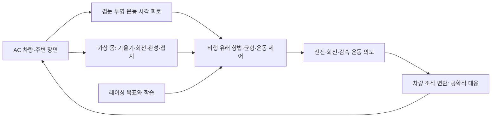

# 비행 감각·몸 제어 구조로 자동차를 운전하는 계획

## 최신: 시각 방향 회로 재생 및 잔차 후보 평가 (2026-10-30)

1917 오프라인 내부 holdout에서 실제 시각 yaw 근사 RMSE 0.16593, 몸 전용 0.07221 rad/s였다. 1919의 알려진 개발 기록에서도 시각 잔차 0.08361, 몸 전용 0.03626으로 후보가 비교를 통과하지 못했다. 새 1909 영상의 저자 시각망 재생은 조직 코드 무결성 정책 차단으로 실패했다. 학생 배포·유효 자율 랩은 0이며 레코드라인 추종은 미검증이다. 기존 페달 fit 123회는 유지되고 별도 몸 baseline 200회는 저자 시각망 학습이 아니다. [실험·제약·원본 증거](visual-yaw-causal-replay-20261030.md). 아래 상태와 다음 작업 표현은 해당 시점의 이력이다.

## 현재: 새 TRAIN 첫 페달 fit 완료, 학생 라인 추종은 미검증

갱신 2026-10-30T16:47:19.284517+09:00. 새 1909 TRAIN986상태를 원래 시간·마스크와 함께 전부 유지해 TBPTT8/한 번의 순회/Adam1e-3로 **실제123회 업데이트**했다. 두 DNg 페달 계수만 바뀌었고 고정 backbone·readout·DNa fingerprint는 동일하다. 학습18.32초/전체59.81초, 같은 TRAIN 평균 페달 MSE0.12065442→0.11707838(2.9639% 감소)다. fullbrake1 오차·정지 hold는 미해결이며 시각 조향·학생 트랙/레코드라인 추종·유효랩 검증은0이다. 전체 비행·겹눈·몸 되먹임·변속·하중/타이어·셋업·빠른 레이싱 라인 목표는 active·미완료다.

[원본 실행·범위·다음 시각 조향 연결](first-new-train-pedal-fit-20261030.md). 원본955d16/session36427→d528e1 종료0, source drift0, 새 작은 두 계수 checkpoint를 보존했다. 현재 fit는 조건부 zero-yaw/속도 과제의 페달 학습이며 레코드라인 학습 성공이 아니다. 아래의 GPU/fit0·미봉인·다음 gradient 표현은 이 첫 fit 이전 진행 시점의 기록이며, 프로젝트 대전제와 원본 이력은 유지한다.

갱신:2026-10-29,Asia/Seoul. 사용자는 단순한 자율주행 모델이 아니라 초파리의 시각 인식·몸 제어 구조를 도입하려는 목적을 재확인했고, 보행보다 **비행의 날개 조종·균형·시각 안정화**를 기준으로 선택했다. 자동차를 가상 몸으로 보고 조향·가속·감속, 차체 기울기와 하중 이동, 접지·타이어 상태에 맞는 빠른 레이싱 라인과 랩타임을 함께 학습하는 것이 목표다. 전체 서킷 완주와 기존 반복 검증 요구도 유지한다.

## 2026-10-30 현재 자격

새 MMF lifecycle 정책의 실제 배포와3초100관측·30초986관측의 원본 heartbeat/권한/7배열·trace·echo 감사를 통과했다. 최대 원래 decision 간격은33.5161/44.0383ms,80ms 초과와 camera wait miss는0이며 정상 반납했다. 이 두 horizon의 진단 자격이며 모든 스케줄러 지연 해결을 뜻하지 않는다. [현재 증거](flight-teacher-authority-and-heartbeat-runtime-20261030.md)를 따른다.

MAIN·설치는80605ed6…7ab5f/gen.0019078이다. 별도1908 nonce를 미리 봉인한1909 새 TRAIN986상태가 원시 감사와1913 전체 로딩을 통과했다. 상태/body21/원래clock/drop0,최대47.795ms·80ms 초과0·7배열 차0이며,fullbrake1 원래266개/eligible257개를 보존했다.1274개 pose 표본은B 안에 있으나 연속 기하와 heldout 독립성은 인증하지 않았다. 관측된 전체 이력의 첫 offline fit 입력 계약을 준비 중이고124window/123supervised step은 아직 예산이다. 새 모델/GPU·optimizer·학생·유효랩0,전체 목표active·미완료를 유지한다.

## 목표를 구현 구조로 연결

이것은 목표 구조이며 현재 source949가 이미 이 전체 경로를 구현했다는 뜻이 아니다. 비행 제어의 기능적 원리를 차량에 대응시키되 전체 날개 공력이나 생체 초파리 전체를 먼저 시뮬레이션해야 한다는 추가 조건을 만들지 않는다. 어떤 단계를 축약했는지, 어떤 연결이 실측인지, 어떤 차량 대응이 설계인지 남긴다.

| 차량 신호/과제 | 가상 몸/회로에서의 역할 | 검증 조건 |
|---|---|---|
| roll/pitch·각속도 | 몸의 자세와 회전, 균형 되먹임 | 각도와 회전속도를 분리하고 단위·축·부호·지연을 보정 |
| yaw 회전 | 회전 감각과 시각 회전의 일치/불일치 | 상대 방향 상태는 허용하되 절대 world heading을 actor에 넣지 않음 |
| 가감속·하중 이동 | 운동 명령 결과와 힘을 낼 여유 | 중력/좌표계가 명시된 가속과 전후·좌우 변형/하중 피드백 |
| 슬립·온도·접지 | 차량이라는 가상 몸의 상태 | 생물학적 수용기에 일대일 대응했다고 가정하지 않음 |
| 영상·옵틱플로 | 도로/커브와 자기 움직임의 시각 증거 | 같은 노출을 새 영상으로 재사용하지 않고 방향/시간 반응 검증 |
| 레이싱 라인·랩타임 | 항법과 속도 전략의 학습 목표 | 정답 라인·좌표는 교사/보상/평가 전용, actor는 영상과 몸 감각으로 판단 |
| 조향·가속·제동 | 운동 의도를 차량에 적용 | 비행에 자동차 브레이크가 있다고 주장하지 않고 변환을 별도 선언 |

현재 원본 physics prefix에는 pitch/roll이 있지만 기존 BODY_FIELDS에는 노출하지 않는다. 이번 계획 변경만으로 기존 actor가 차체 기울기를 이미 사용하게 된 것은 아니다. 새 관측 버전에서 축·단위·정적 기울기와 각속도 차이를 검증한 뒤 연결한다. haltere는 단순한 자세각 센서로 취급하지 않는다. 날개/haltere의 위상 및 기계 감각과 비행 운동 제어의 관계를 반영한 축약 모델이 필요하다. [초파리의 시각 입력·haltere·날개 조종 실험](https://pubmed.ncbi.nlm.nih.gov/31607538/).

## 현재 모델에서 실제로 부족한 부분

t1008은 체크포인트·원본 등록 그래프·공식 주석을 해시로 대조했다. 현재6,557뉴런/644,512연결은 실측 구조 부분망이지만, 초기 운동 시각T4/T5가 없고, 입력은 국소RGB/시간대비를 MeTu에 주입하는 공학적 경로다. 현재 AC의1,709샘플/시점은 엇갈린 픽셀 격자이며, 보유한 microCT1709개 광학축의 실제 좌우 눈 투영이 자동 연결됐다는 뜻이 아니다.

현재 그래프에는 DNg02 계열0개, DNp54 2개, `wm`주석 운동 후보3개가 있다. 그러나 날개 운동 후보를 출력으로 읽는 수는0이고 기존 출력은DNa02/전진/정지 후보를 직접 차량 값으로 바꾸는 형태다. VNC 뉴런이 일부 있다는 사실이나 실측 연결을 통과했다는 사실만으로 비행 운동 제어가 재현됐다고 보지 않는다.

## 도입할 자료와 경계

**시각:** [flyvis 저자 구현](https://github.com/TuragaLab/flyvis)을commit `0a69fa2fc8e1bfe1d837d722c252ab5f5d6fcbfa`에 고정했다. MIT라이선스와 연결 템플릿·동역학 소스 해시를 기록했다. 현재 소스 JSON에는65개 타입 템플릿과605개 연결 템플릿이 있고T4a–d/T5a–d가 들어 있다. 이는 버전 고정한 현재 소스의 목록이며 논문의 세포 수나 MaleCNS개별 뉴런 ID와 동일하다고 해석하지 않는다. 별도 환경에 설치하고 공개 가중치 flow/0000/000을 GPU에서 실행했다. 기존 학생 통합은 아직 하지 않았다. 깜박임/이동 경계 예비 반응의 저자 지표 대조(t1020)에서 T4d 대비 극성이 기대와 달랐다. 12방향/6속도 144조건(t1019/t1021)에서도 T4d의 극성 불일치가 유지됐다. [부품 결과와 한계](flyvis-component-response-20261029.md)를 따른다. 이 계열의 저자 모델은 연결 제약과 시각 과제 학습을 함께 사용한다. [원 논문](https://doi.org/10.1038/s41586-024-07939-3).

**비행 몸 제어:** 원래 MaleCNS주석과 그래프에서DNg02계열29개,DNp54 2개,T4 6865개,T5 6720개,HS8개,VS34개,`wm`운동 후보67개,haltere주석205개를 확인했다(t1007). 이는 구조 후보 목록이다. Traced/좌우/표적 근육/부호/연결 경계의 추가 검토 없이 전체를 기능 포트로 지정하지 않는다. pyarrow는 별도 로컬 폴더에만 설치해 기존ROCm/PyTorch환경을 바꾸지 않았다.

DNg02는 비행 중 시각 운동에 반응하고 날개 운동 범위와 관련된 집단으로 실험된 후보지만, 그 활동을 조향이나 가속으로 바로 복사하면 차량 대응 가설이 된다. 하행 집단→국소 날개 운동 회로→좌우 운동/힘의 공통·차동 조절과 되먹임을 먼저 검토한다. [저자 연구기관의 원 논문 설명](https://www.janelia.org/node/67892). 서로 다른 자료의 뉴런 ID를 형태·유형·좌표 대응 없이 임의로 직결하지 않는다.

## 구현 순서와 통과 조건

1. **현재 구조 감사와 출처 고정:** t1008/t1007/저자 소스 등록 완료. 기능 재현은 미완료.
2. **운동 시각 부품:** 광수용/ON-OFF/공간·시간 경로를 도입하고flash·이동 밝은/어두운 경계·방향 선택성·회전/병진 시각 자극을 재현한다. 먼저 반응 부호·지연·시야·시간 연속성을 확인한다.
3. **가상 몸과 비행 운동 부품:** 차체 자세/회전과 국소 되먹임을 등록하고 좌우 공통/차동 운동 명령, 회전 교란 후 안정화, 시각-기계 감각 지연/위상 상호작용을 검증한다. 내부 빠른 위상은 시뮬레이션 상태이며 새로운 실제 센서 표본으로 표시하지 않는다.
4. **회로가 실제로 기여하는지 검증:** 특정 경로 제거,좌우/시간 교란,시각/몸 감각 제거,공정한 재배선 회로와 일반 순환 모델을 같은 데이터·학습 예산에서 비교한다. 뉴런이 있거나 운전만 성공한 것으로 통과시키지 않는다.
5. **AC운전과 최적화:** 영상·몸 감각으로 조향·가감속을 함께 결정하고,접지·온도·셋업 조건을 바꿔 레이싱 라인/랩타임을 평가한다. 교사 없는 전체 유효 랩과 반복·독립 조건 검증이 필요하다. 전역적으로 가장 빠른 경로를 증명하지 않은 상태에서는 발견한 최선의 유효 랩/경로라고 보고한다.

실행 가능한 계약과 상태는 `configs/fly-flight-mechanism-plan-20261029.json`에 있다. 기존 운전 모델과 기록은 비교 기준으로 보존하고 새 시각/몸 구조로 자동 전환됐다고 표시하지 않는다. 성능을 높이는 추가 페달 증류보다 위 부품 검증을 우선한다.

## 진행 중이던 수집의 마무리

t1002의805학생+2대기+736교사 관측을 원래 순서로 보존했다. 로컬 원본 이벤트11,302,193bytes와NAS복사 SHA256이 일치한다. t1003학생 출력/t1004전체 감각·대기 상태 재생오차0,최대간격65.8939ms/80ms초과0,실제 정차/FREE를 검증했다. t1005에 원래1,543관측을 보존한1에피소드로 봉인했고 교사 표적은722개/출력,학생·대기 표적0개다. 제동 양성 표적0개여서 일반 제동 학습을 입증하지 않는다. 새 구조에 필요한 원자료로 보존했으며 추가 운전 학습은 실행하지 않았다.
