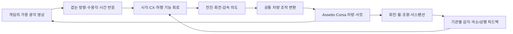

> **이전 문서 보존본입니다.** 당시의 진행 상황과 링크를 남긴 기록이며 현재 지침이 아닙니다. 현재 기준은 [프로젝트 대전제](PROJECT_CHARTER.md)와 [현재 문맥](CONTEXT.md)을 읽으세요.

# FlyBrain — 겹눈·몸 감각·신경회로로 Assetto Corsa 운전

**최종 목표는 파리의 감각기관·신경회로를 모델링하고, 차량의 움직임을 몸 감각으로 되먹임하여, 비전 기반으로 Assetto Corsa의 서킷을 무개입 완주하는 것**이다. 2026-10-27 사용자 목표에 맞춰 [현재 연구 계획](research-plan.md)과 [겹눈·기관·AC 설계안](assetto-fly-design.md)을 갱신했다. 차량을 가상 신체로 사용하는 독립 Python 연구 저장소이며 기존 MECar-Simulation을 실행 의존성으로 사용하지 않는다.

설계하는 경로는 **겹눈 → 시각·방향/기억 회로 → 하행·국소 운동 회로 → 게임 조작 → 기관별 몸 감각 → 회로**다. FeCO형 위치/방향 입력과 회전 피드백을 단계적으로 구현한다. 경로 판단은 영상에서 얻고, 정답 위치·AI line·진행률은 교사와 평가에 분리한다. GRU는 기준선이며, 최종 모델에는 검토된 실제 초파리 기능 회로를 사용한다.

겹눈을 쓰는 핵심 가설은 **전면·좌우·후방의 여러 시각 입력을 파리 뇌 구조 안에서 효과적으로
합성할 수 있는지**다. 시점별 국소 입력을 공유 순환 회로로 보내며, 전방 단독 주행은 비교군이다.
다중 시점 융합의 이득은 아직 검증하지 않았다. [카메라·회로 융합 계획](compound-eye-camera-plan-20261027.md).
현재4개 직접 가상 카메라의 source별 겹눈 입력·비동기 노출 처리·공유 회로 연결을 구현했고,
MuJoCo 렌더 영상으로 검사했다. 이어4시점512결정의 교사 데이터를 수집하고 고정 속도
조향을 오프라인 학습·개발 주행 평가하는 경로를 추가했다. 첫 실험은 시각 제거보다 주행
오차가 커 유용한 시각 융합을 확인하지 못했다. AC 조작·가감속·효율성 우위는 미검증이다.
[다중 시점 학습·결과·다음 통과 조건](multiview-learning-20261027.md),
[입력 부품과 제한](multiview-circuit-20261027.md).

후속으로 시점별 밝기·시간 대비 정규화를 추가했다. 동일 학습 예산의 모델을24초 개발 구간
두 곳에서 비교해 합친 횡오차가 **1.153m→0.181m**로 줄었고, 시각 제거는0.966m였다.
각 구간약34m 주행이며 서킷 완주는 아니다. 실제 AC의 Z4 GT3·Monza 연습 엔진도 실행했으나
당시 보안 확인창과 센서 앱 재로딩이 남았다. 이후 사용자 보안 처리와 직접 공유메모리 계측을 완료했다.
[정규화·긴 구간 비교·실제 AC 상태](multiview-photometry-20261027.md).

추가 전체 도로 시험에서는 학생이18.55m에서 이탈했고 교사만 완료했다. 짧은 개발 구간의
개선을 일반 주행으로 확대하지 않는다. 실제 AC의 읽기 전용 공유메모리에서는 Z4 GT3·Monza의
바퀴 하중·타이어 온도 등250표본을 확보했다. 단위/영상 동기·조작 반응은 미검증이다.
[네이티브 계측·전체 도로 실패·다음 학습](ac-native-physics-20261027.md).

그 실패 뒤 학생 상태의 DAgger 기록을 더해2,781결정으로 재학습했다. 새 모델은 기본 도로와
미사용 곡선 도로를2/2 완료했고, 시각 제거는0/2였다. 이는 고정 속도 모형 도로 평가이며
실제 AC 완주는 아니다. vJoy 설치·장치 조회는 완료했고 게임 축 적용은 미검증이다.
후속 읽기 전용 시험은 비활성 상태100장을10.813초에 받아9.156Hz를 측정했다.
연습 메뉴·정차 조건이며 실제 주행 중25Hz·동기 입력은 검증 전이다.
[복귀 학습·수집·평가](multiview-dagger-20261027.md),
[전면5장·비활성3장 실제 캡처와 남은 검증](ac-wgc-capture-20261027.md).

최신 실제 AC 연결에서는 vJoy 정차 축 응답을 두 번 검증했고, SDK 파일 출력 복구 뒤
200표본을 확보했다. 현재 정책 자율주행이나 실제 AC 가감속 학습을 실행한 결과는 아니다.
[게임 적용값·엔진 중단과 복구](ac-axis-response-20261027.md).

학습 순서는 **기존 AC 교사·적합한 공개 자료 재사용 → 파리 회로 오프라인 증류 → AC 보정·주행 평가**다.
공개 Monza/GT3 SAC actor의 추론을 공개 표본231상태에서 재현했다. 동기 영상·계측이 부족하면 이미 학습된
교사의 짧은 주행에서 추가 기록한다. MuJoCo는 부품 검증과 보조 사전학습에 사용한다.
학습된 파리 모델은 고정 전진 조향 모델이다. 온도/하중 인코더와 **6,557뉴런의 확장 구조 후보**는
추가했지만 새 감각 튜닝·속도/제동 출력과 운전 학습은 미완료다.
[추론 재현](ac-teacher-reconstruction-20261027.md), [확장 회로·한계](vehicle-circuit-extension-20261027.md).
[조사·확보한 가중치·이전 설계](ac-autonomy-to-fly-20261027.md).

최근 주행 시험을 통과한 모델은 **국소 겹눈·2,626뉴런 회로·기관별 조향/회전 되먹임**으로 기본4조건과 큰 곡선8조건을 **12/12 완료**했다. 몸 감각 제거 대조군도 모두 완료했고 오차 차이는 작았다. 기관 튜닝은 공학적 가설이며, AC 연결·속도/제동·생리학적 검증은 남아 있다. [기관 연결과 큰 곡선 비교](local-organ-feedback-20261027.md).

직전 시각 전용 국소 겹눈→MeTu→2,626뉴런 회로 모델은 원본 입력량 정규화와 연속 학습 후 개발 조건 **4/4 완료**, 영상 제거·첫 영상 고정은 각각 **0/4**였다. 조건별 횡오차 RMS 평균은0.568m다. 몸 피드백은 아직 고정0이고 EPG 억제도4/4여서 생리학적 방향 계산을 재현했다고 주장하지 않는다. [최신 시간축·정규화·대조 결과](local-temporal-20261027.md).

이전 검증에서는 **합성 겹눈·기관 근사·MaleCNS927뉴런 부분망을 연결한 고정 모델이 사전 등록한 새 시작 조건30/30을 완료**했다. 이전4조건 대조에서 영상 제거·연결 절단은 각각0/4였다. 시각 경계·기관 튜닝·신경 동역학은 공학적 근사이며 전체 파리 뇌나 AC의 완료가 아니다. 저자 μCT 자료의 재구성 광학축1,709개를 연결한 별도 모델도 개발4조건을 완료했고 영상 제거·회로 절단은 각각0/4였다. 새 모델은 이전30시작조건 반복을 아직 수행하지 않았다. 최신 전체 테스트는163개 통과했다. [새 겹눈 통합·주행 결과](anatomical-eye-driving-20261027.md). [최신 반복·실행 시간·겹눈 자료](routed-repeat-eye-import-20261027.md), [부분 회로 주행·대조](routed-circuit-driving-20261027.md), [측정 몸 감각 경로](body-route-audit-20261027.md).

시각·방향·목표 회로를 추가한 **2,626뉴런·92,740연결 구조 후보**도 추출했다. FC2 목표 집단의 입력이98.16% 잘리는 점과 겹눈→뉴런 대응·부호의 빈틈이 남아 있다. [구조·전달물질 조사와 다음 구현](visual-cx-audit-20261027.md).

이전 정지 자세 기반 국소 겹눈→MeTu 모델은 시험 조향 RMSE0.161까지 줄었지만 **연속 주행0/4**로 승격하지 않았다. 고정64틱 fitting 이후 출력이 크게 변하는 문제를 확인했고, 시간축 학습용 교사 관측10,700결정을 수집했다. [구현·실패 원인 분리·연속 자료](local-retinal-circuit-20261027.md).

`retina_v1` 후속 경로는 광각 방향 샘플링·ON/OFF 운동 필터와 3-action의 learned residual
TV를 지원한다. 제한된 공통/좌우 토크를 배분하며 교사 V sequence의 BC, 혼합 주행
DAgger 수집/재학습 뒤 PPO를 실행한다.
이는 합성 시각/구동 프로토타입이고 측정한 겹눈·초파리 운동 회로는 아니다.
[구현과 비교 조건](vision-tv-implementation.md).



현재 실행 경로는 MuJoCo의 6자유도 차체·4개 서스펜션·전륜 조향·좌우 후륜 구동, 합성 경사/뱅킹/요철, 두 카메라, GRU 및 합성 그래프 정책, 순환 PPO다. `num_envs>1`이면 여러 MuJoCo 프로세스를 병렬 실행하고 정책/optimizer를 CPU 또는 CUDA에서 배치 계산한다. 물리는 CPU에서 계산한다. 차량 수치와 타이어 접촉은 **검증 전 프로토타입**이다. 합성 그래프는 초파리 측정 커넥톰이 아니다. 초기 PPO를 성능 비교나 실차 검증 결과로 해석하지 않는다.

주 실행 목표 backend는 Assetto Corsa, MuJoCo는 감각·회로·학습 부품을 빠르게 검증하는 시험장으로 둔다. 첫 서킷은 설치와 동기 캡처가 확인된 짧은 구성으로 고른다. Red Bull Ring은 후보이며 Nordschleife는 후속 확장이다. 구체적인 근거와 확보 조건은 [출처 목록](../references.json), [자산 등록부](../configs/assets.json), [단계별 로드맵](../configs/assetto-fly-roadmap.json)에 있다. 코드·입력 계약은 [구조](architecture.md), 준비 상태는 [구현 현황](implementation-status.md)를 기준으로 한다.

## 설치와 실행

원본 AC 창의 RGB·캡처 구간·해시를 남기는 [영상 기록기](ac-capture-20261027.md)도
준비했다. 실제 AC 창은 아직 찾지 못했고, 몸 센서와의 clock 대응은 확인해야 한다.

AC용 [읽기 전용 센서 앱·기록기](../integrations/ac/README.md)를 준비했다.
WSL 전체184검사와 Windows 선택22검사는 통과했지만 실제 게임은 미연결이며,
영상 동기·native 단위·조작 적용을 확인해야 한다. [AC 연결 조사·검사](ac-bridge-20261027.md).

AC 설치 위치만 읽어서 확인하는 명령도 있다. 게임을 실행하거나 조작하지 않으며, 설치 파일 발견을 실제 영상·조작 연동 성공으로 표시하지 않는다.

```powershell
python -m flybrain_drive.cli ac-probe --output runs/new-ac-install-probe
# 등록된 Steam 라이브러리 밖에 설치했다면 --game-path "D:\SteamLibrary\steamapps\common\assettocorsa" 추가
```

새 감각→순환 정책 경로의 실제 영상·물리 진단과 모델 재생 방법은 [감각 통합 기록](sensory-integration-20261027.md)에 있다. 고정 저속 조향 학습은 `python -m scripts.train_sensory --config configs/sensory-bc-pilot.json --output runs/new-sensory-pilot`로 재현한다. 물리·학습 의존성이 필요하며 출력에는 새 폴더를 사용한다. [실패 결과와 후속 계획](steering-pilot-20261027.md), [진행 상태](implementation-status.md).

Python 3.11 이상. 가상환경을 만들고 이 저장소에서 실행한다. Windows 공유 드라이브에서는 가상환경을 로컬 디스크에 두는 편이 낫다.

```powershell
python -m venv .venv
.venv\Scripts\python -m pip install -e ".[physics,learning,dev]"
.venv\Scripts\python -m flybrain_drive.cli doctor
.venv\Scripts\python -m flybrain_drive.cli rollout --mode O --steps 300 --output runs/first-rollout
.venv\Scripts\python -m flybrain_drive.cli rollout --mode V --steps 20 --output runs/camera-smoke
.venv\Scripts\python -m flybrain_drive.cli train --config configs/train-smoke.json --output runs/ppo-smoke
.venv\Scripts\python -m flybrain_drive.cli train --config configs/train-vision-smoke.json --output runs/vision-ppo-smoke
.venv\Scripts\python -m flybrain_drive.cli evaluate --checkpoint runs/ppo-smoke/checkpoint.pt --output runs/ppo-eval
.venv\Scripts\python -m pytest
```

CPU 전용 Torch가 필요하면 공식 CPU wheel index로 먼저 설치한다. V 모드는 실제 MuJoCo 카메라 렌더링을 요구하며 OpenGL 환경이 필요하다. 렌더링 실패를 빈 영상으로 대체하지 않는다. O 모드는 정답 경로 정보를 받는 진단 모드이고, V 모드는 정답 경로 입력을 차단한다. 지도와 위치 추정기를 추가하는 M 모드는 아직 지원하지 않는다.

```powershell
python -m pip install torch --index-url https://download.pytorch.org/whl/cpu
flybrain import-graph --nodes assets/external/nodes.csv --edges assets/external/edges.csv --output assets/external/reviewed-graph.npz
```

`nodes.csv`의 입력·출력 역할은 주석을 검토해 지정해야 한다. 가져오기 기능이 자동으로 시각/CX/DN 기능 회로를 추출하지는 않는다. 모든 실행은 새 출력 디렉터리를 요구하고 소스·설정 해시, 버전, 시드, 종료 이유를 기록한다.

`rollout --mode V`는 고정 의도로 카메라와 구동 경로를 점검한다. 영상에 반응하는 정책 평가가 아니다. `train-vision-smoke.json`은 V 관측만 사용하는 PPO 연결을 확인한다. `train-graph-smoke.json`은 명시적으로 합성 그래프를 사용한다. 기존 smoke는 32 px 카메라, 요청30 Hz/실제25 Hz다. 새 겹눈 해상도·캡처/판단 주기는 AC 시야·지연 측정 후 정한다. 기존 `evaluate-suite --record`에는 HTML 생성 경로가 남아 있으므로 새 설명 자료는 Markdown+JSON/NPZ/PNG/영상으로 준비한다. 기존 설명용 HTML을 새로 생성·갱신·자동 실행하지 않는다.

검증에 사용한 설치 버전은 `requirements-tested.txt`에 고정했다. 하드웨어와 운영체제가 다른 환경의 설치 가능성까지 검증한 것은 아니다.

## 읽는 순서

- [연구 계획](research-plan.md): 사용자 목표, A0–A8 단계·통과 조건, 초기 예산과 다음 작업.
- [겹눈·몸 기관·AC 설계](assetto-fly-design.md): 차량을 가상 신체로 쓰는 감각·신경·조작 계약.
- [이전 연구 계획](research-plan-20261005-archive.md): R01–R18, C0–C7, E0–E10, T0–T5의 원 설계 보존본.
- [구조와 계약](architecture.md): 센서/정답 분리, 좌표·부호, 순환 상태, PPO와 backend 범위.
- [구현 현황](implementation-status.md): 실행 코드, 검증, 외부 자산, 후속 순서.
- [이전 파일럿](history.md): 2026-09-27 결과와 새 실험에서 바로잡을 항목.
- [실험 등록부](../configs/experiments.json): 비교 모델·단계·시드·합격 조건.
- [검증 기록](validation.md): 이 저장소의 로컬 실행 결과.
- [원격 GPU](remote-gpu.md): CUDA 학습·Slurm 제출·자동 회수와 정리.
- [GPU 활용 개선](gpu-utilization.md): 카메라 병목 측정, GPU 렌더링 반복 검증,
  후속 실행 launcher와 배치 처리 계획.
- [로컬 선별 → 원격 본학습](local-to-remote-main.md): 두 시드 재검사, 상위 후보와
  기준의 새 3시드 본학습, 계정 한도 안에서 GPU task 두 개 병렬 실행.
- [RX 9070 XT 로컬 피드백](local-rdna4.md): ROCm 실행 검증·처리량 비교,
  기존 원격 캠페인을 유지하면서 추가 네 조건을 로컬에서 비교.
- [결과 점검과 후속 실험](followup-experiments.md): 긴 평가에서 발견한 이탈,
  연속 주행·할인 시간·몸 감각 대조, 4개 조건 × 2개 시드 GPU 캠페인.
- [처리량과 대기 최적화](performance-and-queue.md): 노드 권한 확인, 동일 replay
  처리량 비교, 30분 array 분할과 GPU 없는 결과 집계.
- [겹눈·좌우 날개 후속 설계](vision-wing-followup.md): 카메라의 실제 범위,
  동기화 재생, 좌우 모터 residual TV와 감각/구동/회로 대조.
- [시각·TV 구현과 실험](vision-tv-implementation.md): 3-action/mask/제한 배분,
  방향 샘플링·운동 응답·교사 BC/DAgger/PPO·일곱 조건의 후속 실행.

Git remote는 별도로 설정한다. 원격 GPU 학습은 SSH/Slurm 경로를 사용하며 공개 Git 저장소 없이도 봉인한 패키지로 실행한다.
