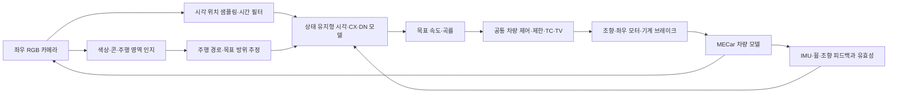

# 초파리 커넥톰·몸 감각·3D 주행 연구 계획

> 이 문서는 이전 설계 검토를 독립 저장소에 옮긴 것이다. 이전 코드에 대한 점검은 과거 증거이며 런타임 의존성이 아니다. 현재 실행 가능한 부분은 [구현 현황](implementation-status.md)과 [구조](architecture.md)를 기준으로 한다. 모든 비교 예산·학습 gate는 확정 전 제안이다.

2026-10-05 기준 설계안. 대상 차량은 **별도 조향장치와 좌우 구동모터가 있는 MECar**다. 이 문서의 학습량·주기·합격 기준은 새 실험을 위한 제안이며, 실행 결과가 아니다. 확인된 기존 결과는 [2026-09-27 파일럿 보고서](history.md)에 보존한다.

첫 후보는 **시각 회로와 중앙복합체(CX), 하행 뉴런(DN)을 연결한 상태 유지형 모델**이다. 두 카메라를 시각 위치에 맞춰 입력하고 DN 집단에서 목표 속도·곡률을 읽는다. 공통 차량 제어기가 이를 조향·가감속·요모멘트와 좌우 토크로 변환한다. 다리·날개 운동 뉴런과 모터의 일대일 대응은 가정하지 않는다. 전체 MaleCNS 모델은 이 작은 후보의 입력·출력과 실시간성을 확인한 뒤 비교한다.

## 확인된 출발점

기존 파일럿은 MaleCNS v1.0에서 추출한 뉴런 165,122개와 뉴런 쌍 사이 집계 연결 25,563,197개를 사용했다. 56개 관측을 VNC 감각 뉴런에 난수로 배정하고, 제어 판단마다 상태를 0으로 초기화한 뒤 네 번 갱신했다. VNC 운동 뉴런 전체에서 조향을 읽었고 종가속도·요모멘트는 LimitDriver가 담당했다. 카메라 학습과 강화학습은 수행하지 않았다.

명목/무작위 30 m 평가에서 LimitDriver와 MLP는 완주했고 실제 연결 모델은 약 6.6 m에서 이탈했다. 한 학습 시드의 결과이므로, 커넥톰의 일반적 우열보다 **무작위 입력·상태 초기화·출력 집단 선택을 먼저 검증해야 한다**는 출발점으로 삼는다. 현재 구현은 양의 연결 이득을 쓰는 수치 모델이며, 흥분·억제 전달물질을 재현한 생물학적 모델로 해석하지 않는다.

이 독립 저장소는 T0 물리/센서 계약과 E0의 포트·상태·부호 검증부터 시작한다. [구현 현황](implementation-status.md)의 prototype과 아래 과학적 실험 계획을 구분한다. 학습 규모는 검증 성과에 따라 확대한다.

## 레퍼런스와 적용 위치

다음 18개 레퍼런스를 모두 설계 근거 또는 비교·검증 항목으로 사용한다. 선행연구의 결과와 MECar에서 검증할 가설을 구분한다. FLYNN·FlyGM·FlyCNS는 아래에 고정한 arXiv 버전을 기준으로 읽었으며, 이 계획에서는 심사 완료 논문으로 취급하지 않는다. Eon은 기업의 기술 설명이다.

| ID | 원문과 확인한 근거 | MECar에서 적용할 설계·실험 | 적용 범위와 한계 |
|---|---|---|---|
| R01 | [Dorkenwald 등, FlyWire, Nature 2024](https://www.nature.com/articles/s41586-024-07558-y): 성체 뇌와 시각엽 연결 지도 | C4의 FAFB v783 그래프, 뉴런 유형·좌우·시각 위치 명세 | 뇌 지도이며 VNC 전체를 포함하지 않는다. 개별 시냅스 수와 집계 연결 수를 구분한다. |
| R02 | [MaleCNS v1.0 공식 데이터](https://male-cns.janelia.org/download/): 뇌·VNC 연결, 유형·좌우 주석, 전달물질 예측 | C3/C5의 기능 부분 그래프와 전신 감각 피드백 후보 | 파일럿의 추적된 부분집합을 전체 공개 데이터의 뉴런 수와 혼동하지 않는다. |
| R03 | [Shiu 등, Nature 2024](https://pmc.ncbi.nlm.nih.gov/articles/PMC11446845/): 전뇌 LIF 모델의 먹이·그루밍 회로 예측 | E9의 국소 회로 자극과 rate/LIF 비교 | 주행 성능의 증거가 아니다. 신경조절·비발화 뉴런 등 생략을 기록한다. |
| R04 | [Lappalainen 등, Nature 2024](https://www.nature.com/articles/s41586-024-07939-3), [flyvis](https://github.com/TuragaLab/flyvis): 연결 제약 시각 모델과 운동 시각 학습 | E3의 망막 위치 대응, 유형별 파라미터 공유, 시각 사전학습 | flyvis의 뉴런 인덱스를 MaleCNS ID로 그대로 복사하지 않는다. |
| R05 | [목표 방향에서 조향으로 이어지는 CX 회로, Nature 2024](https://www.nature.com/articles/s41586-024-07039-2): PFL 계열과 DNa02 조향 경로 | C3의 CX→DN 선택, E9의 방향 신호 개입 | 논문 좌우 정의를 MECar의 좌회전 양의 부호로 변환·검증한다. |
| R06 | [Neural circuit mechanisms for steering control in walking Drosophila, eLife](https://elifesciences.org/articles/102230): 좌우 하행 활동과 회전 관계 | 좌우 DN 활동의 합·차를 읽는 해석 가능한 출력 대조군 | 특정 뉴런의 회전 관계가 차량 토크의 물리 단위를 정하지는 않는다. |
| R07 | [상행·하행 뉴런 비교 연결 연구, Nature 2025](https://www.nature.com/articles/s41586-025-08925-z) | 뇌↔VNC 연결 주석, 피드백 포트 선정·좌우 점검 | 서로 다른 개체·데이터셋은 유형 대응표로 연결한다. |
| R08 | [Eon의 embodied fly 기술 설명, 2026](https://eon.systems/updates/embodied-brain-emulation), [후속 설명](https://eon.systems/updates/more-flies-are-getting-uploaded) | DN 의도 출력→별도 신체 제어기→감각 피드백의 통합 방식 | 초기 설명은 시각의 행동 영향이 제한적이고 별도 운동 제어기를 쓴다. 시각 자율주행의 검증 결과로 사용하지 않는다. |
| R09 | [FLYNN, arXiv:2607.00025v2](https://arxiv.org/html/2607.00025v2), [코드](https://github.com/ben-gitdev/fly-gym) | 상태 유지형 커넥톰 RNN, 시각 입력·DN 출력, DAgger, OOD 비교 | MuJoCo 차동구동 탐색 과제다. 목표 방위·접촉 입력이 남는 시각 소실 결과를 무접촉 차량 주행으로 해석하지 않는다. |
| R10 | [FlyGM, arXiv:2602.17997v3](https://arxiv.org/html/2602.17997v3), [프로젝트](https://lnsgroup.cc/research/FlyGM/) | C6의 고정 그래프 연산자+공유 노드 갱신기, 모방 후 RL 후보 | 가상 초파리 운동 과제다. 공식 프로젝트의 코드는 확인 시점에 Coming soon이므로 구현 확보를 전제하지 않는다. |
| R11 | [FlyCNS, arXiv:2609.28816v1](https://arxiv.org/html/2609.28816v1) | E9의 전역 의도와 국소 구동 피드백 사이 통신량 대조 | 구조 통계를 쓴 통신 조직화 연구다. 전체 뉴런 이식이나 필수 CAN 보호 신호의 학습식 차단을 뜻하지 않는다. |
| R12 | [NeuroMechFly v2, Nature Methods 2024](https://www.nature.com/articles/s41592-024-02497-y), [flygym](https://github.com/NeLy-EPFL/flygym) | 시각·신체·접촉을 같은 시간축으로 묶는 폐루프 검증 | 초파리 몸체 모델은 MECar 차량 모델을 대체하지 않는다. R09의 fly-gym 저장소와 다르다. |
| R13 | [Neural Circuit Policies, Nature Machine Intelligence 2020](https://www.nature.com/articles/s42256-020-00237-3), [ncps](https://github.com/mlech26l/ncps) | C2의 작은 LTC 제어기, 시간·메모리 비교 기준 | C. elegans에서 착안한 회로다. 작은 제어 뉴런 수에 외부 영상 인코더 비용을 포함해 비교한다. |
| R14 | [Fine-grained descending control of steering, Cell 2024](https://pubmed.ncbi.nlm.nih.gov/39293446/) | 속도 성분과 좌우 비대칭 성분을 분리하는 출력 가설 | 다리의 보행 위상과 차량 바퀴 회전을 동일한 운동으로 가정하지 않는다. |
| R15 | [Stone 등, 곤충 CX 경로 적분, Current Biology 2017](https://pmc.ncbi.nlm.nih.gov/articles/PMC6196076/), [코드](https://github.com/InsectRobotics/path-integration) | E9의 방위·자기운동 기억 대조군, IMU/휠 피드백 | 종을 넘는 기능 추상화다. 초파리 측정 뉴런 ID의 직접 대응은 아니다. |
| R16 | [BeeNav, Nature 2026](https://www.nature.com/articles/s41586-026-10461-3), [열람본](https://pmc.ncbi.nlm.nih.gov/articles/PMC13216067/), [코드](https://github.com/tudelft/Bee-Nav) | E9의 반복 코스 시각 기억, E10의 실제 계산 비용 기록 | 실제 드론의 시각 귀소 연구다. 익숙한 코스 기억과 처음 보는 코스 일반화를 따로 평가한다. |
| R17 | [LGMD 기반 로봇 충돌 회피, Frontiers 2021](https://www.frontiersin.org/journals/robotics-and-ai/articles/10.3389/frobt.2021.529872/full) | E9의 looming 위험도→감속 요청 보조 가지 | 위험 추정의 기여를 검증한다. 같은 카메라를 쓰므로 센서 소실에 독립적인 보호 장치로 계산하지 않는다. |
| R18 | [CurvACE, PNAS 2013](https://pmc.ncbi.nlm.nih.gov/articles/PMC3677439/) | E3/E8의 시야각·시간 해상도·밝기 적응 비교 | 겹눈형 하드웨어의 설계 원리를 참고한다. 전용 센서 구매를 전제하지 않는다. |

## 차량에 연결할 구조



### 감각 입력

| 입력 | 모델로 보내는 내용 | 확보·검증 조건 |
|---|---|---|
| 좌우 카메라 | 휘도 운동 경로와 RGB 의미 경로, 촬영 시각·프레임 ID·유효성 | 내·외부 보정, 좌우 시야·겹침·왜곡·노출을 manifest에 고정한다. 두 영상이 곧 두 겹눈의 동일 해상도를 뜻하지는 않는다. |
| 운동 시각 | 실제 영상 좌표에서 샘플링한 휘도, 밝기 적응, 시간 고/저역 필터 | L1/L2/L3 또는 주석이 충분한 광수용 경로에 명시적으로 대응한다. 전처리 방식은 비교군에도 동일하게 제공한다. |
| 경로·목표 | 카메라 인지로 얻은 주행 가능 영역·콘·목표 방위 또는 선언된 지도+위치 추정 | 파란색/노란색 콘 같은 의미를 잃지 않도록 RGB 가지를 유지한다. 정답 코스 오차를 카메라 모델에 몰래 넣지 않는다. |
| 자기운동 | 추정 속도·요레이트·휠 속도·실제 조향각·이전 적용 명령 | IMU·엔코더·추정기의 지연·오차·유효성도 입력한다. 차량 센서→상행 포트 연결은 학습 어댑터이며 생물학적 상동성으로 주장하지 않는다. |
| 위험·접촉 | 시각 위험도, 실제로 확보한 접촉/장애물 신호 | 충돌 정답은 학습·평가 표식으로만 쓴다. 배치 차량에 접촉 센서가 없으면 추론 입력으로 사용하지 않는다. |

두 운용 모드를 따로 봉인한다. **V 모드**는 영상으로 경로를 인지하고 자기운동 센서를 사용한다. **M 모드**는 사전 지도와 실제로 구현한 위치 추정기를 추가한다. 두 모드의 결과는 별도 표로 낸다. 정답 위치·코스·마찰을 쓰는 **O 모드**는 교사와 구조 진단용이며 실제 센서 주행 점수에 합치지 않는다.

넓은 좌우 시야를 확보하는 배치와 깊이 추정에 필요한 영상 겹침을 함께 검토한다. 겹침이 작은 두 카메라를 전 시야의 스테레오 깊이 센서로 취급하지 않는다. 실제 배치의 거리·속도 추정에 필요한 센서와 보정은 별도 관측 계약에 포함한다.

### 신경 모델과 기억

R09를 참고한 초기 rate 모델은 다음 형태로 둔다. 이는 MECar용 학습 모델의 정의이며 초파리의 실제 시간 상수를 재현했다는 뜻이 아니다.

```text
z_k       = retina_and_sensor_adapter(observation_k, preprocessing_state)
h_(k+1)   = (1-alpha) * h_k + alpha * tanh(W_masked * h_k + B * z_k + b)
intent_k  = DN_readout(h_(k+1))
```

`W_masked`는 선택한 연결만 갖는 희소 행렬이다. 초기에는 뉴런 유형별 누설과 유형 쌍별 연결 이득을 공유해 학습 자유도를 줄인다. 이득의 초기 크기에 시냅스 집계 수를 사용할 수 있지만 이를 생리학적 전도도로 취급하지 않는다. 연결별 가중치 학습은 작은 모델의 성과를 확인한 뒤 별도 대조한다. 전달물질 예측을 사용할 경우 근거가 있는 부호와 불확실한 부호를 나누고, 수용체 정보를 모르는 전달물질을 일괄 흥분성으로 고정하지 않는다.

주 후보의 목표·자기운동 입력도 `z`와 지정한 감각 포트를 거쳐 전달한다. decoder에 정답 경로 또는 목표 정보를 직접 우회 입력하지 않는다. 감각 특징에서 곧바로 명령을 읽는 decoder-only 대조군을 두어 신경 회로 계산의 추가 기여를 확인한다.

갱신 횟수를 비교할 때는 양의 유형별 시간 상수 `tau`에서 `alpha = 1 - exp(-dt_neural / tau)`를 계산한다. 동일한 누설 계수를 여러 번 적용해 유효 기억 시간을 함께 바꾸는 혼동을 피한다. R09 원형의 누설 표기와 이 문서의 새 입력 비율 `alpha`는 구분해 변환한다.

`h`, 망막 시간 필터, CX 경로 적분, 시각 기억은 제어 틱 사이에 유지한다. 에피소드 시작·명시적 재시작 때만 배치 행별로 초기화한다. TBPTT의 gradient detach는 수치 상태 초기화가 아니다. 시퀀스를 무작위로 뽑을 때 현재 가중치로 앞부분을 다시 계산하는 burn-in을 사용한다. 이전 정책이 만든 숨은 상태를 그대로 재사용하지 않는다.

부분 그래프는 주석이 확인된 시각 입력 집단, CX 및 조향 관련 DN을 기준으로 만든다. 입력→출력 경로뿐 아니라 선택 영역의 회귀 연결과 피드백을 보존하고, 잘려 나간 연결·감각/조절 입력·도달 불가능한 DN을 보고한다. 추출 후 뉴런·연결 수를 측정한다. 임의로 목표 뉴런 수를 먼저 정해 기능 경로를 자르지 않는다. FlyWire와 MaleCNS 사이 대응은 유형·좌우·형태·시각 위치에 대한 검토 표로 관리한다.

추출 규칙에는 선택한 ROI·유형, 연결자 포함 조건과 경로 범위를 먼저 고정하고 선택 뉴런 사이의 내부 연결을 보존한다. 무제한 경로 폐쇄가 사실상 전뇌를 포함할 경우 이를 부분 그래프로 부르지 않는다. 동일 규칙에서 얻은 후보의 경계 손실과 크기를 비교한다.

### 운동 의도와 구동계

주 실험의 출력은 `v_ref [m/s]`, `kappa_ref [1/m]` 두 값이다. 저속에서 `yaw_rate / speed`를 계산하는 대신 `yaw_rate_ref = v_est * kappa_ref`를 사용한다. 정지 상태의 제자리 회전을 목표로 만들지 않고 차량 곡률·속도 범위를 적용한다.

공통 차량 제어기는 이 의도와 센서 추정값을 받아 기존 단위의 `[delta_roadwheel [rad], a_x [m/s²], M_z [Nm]]`를 만든다. `atan(wheelbase * kappa_ref)`는 저속 조향의 초기 기하 기준이며 고속 동역학·조향 응답은 기존 차량 모델과 보정으로 처리한다. 요모멘트는 별도 TV 제어기 또는 명시한 잔차로 생성한다. 이 공통 변환기가 담당한 성능도 기록한다.

좌우 DN 활동의 평균과 차에서 전진·회전 성분을 읽는 제한된 decoder와 전체 DN의 학습 decoder를 비교한다. `delta`, `M_z`, 곡률의 양은 좌회전으로 통일하고 영상 반전·좌우 교환 시험으로 부호를 확인한다. 주행 구동 조건에서는 오른쪽 추진력을 더하면 좌회전 요모멘트가 생기는 관계를 확인하되, 감속·회생·감속비·효율·모터 포화는 기존 배분 계약으로 처리한다.

정책이 좌우 PWM이나 CAN 프레임을 직접 만들지 않는다. 하위 계층이 조향각/속도 제한, 타이어·구동계 제약, TC/TV, 모터 응답, 회생과 기계 브레이크 분담을 처리한다. 목표→제한 후→배분 후→실제 응답을 모두 기록한다. 다리와 날개 회로를 참고하는 지점은 좌우 비대칭·운동 피드백·계층적 의도 분리다. VNC와 비행 회로를 추가하는 효과는 E9에서 따로 검증한다.

### 시간과 상태 계약

현재 차량 계산의 1 ms 적분과 10 ms 정책 주기를 출발점으로 한다. 새 카메라는 우선 60 Hz를 후보로 두고 타임스탬프·프레임 나이·동기화 오차를 측정한다. 같은 프레임을 여러 제어 틱에 사용할 때 망막 시간 필터를 새 촬영처럼 반복 갱신하지 않는다. 정책은 실제 경과 시간과 유효성을 받는다.

신경 갱신은 정책 틱당 5회, 2 ms 상당의 계산 간격을 초기 후보로 두고 1/5/10회와 비교한다. 이는 공학적 이산화 선택이다. 카메라 입력 크기는 R09 재현에 128×128을 사용하고 MECar에서는 콘 인지 성능과 계산 비용으로 다시 결정한다. 10 ms 실행 예산은 전처리·신경 계산·의도 변환 전체의 p95/p99와 마감 초과율로 평가한다. 실제 목표 계산 장치가 정해지기 전에는 GPU 평균 추론 시간으로 탑재 가능하다고 판정하지 않는다.

## 비교할 모델

| 후보 | 구조 | 역할 |
|---|---|---|
| C0-O | 정답 코스/상태를 쓰는 현재 LimitDriver | 교사·상한 진단. 센서 기반 정책과 동일 정보 조건의 성능 비교로 표시하지 않는다. |
| C0-S | 카메라 경로 인지+센서 추정+고전 제어 | 같은 V/M 입력으로 동작하는 배치 가능한 기준선. 경로 인지와 추정기 구현이 먼저 필요하다. |
| C1 | 공통 시각 전처리·인코더+GRU+동일 의도 decoder | 시간 기억을 갖는 일반 신경망 기준선. 기존 56차원 MLP는 상태 진단에만 유지한다. |
| C2 | 공통 인코더+NCP/LTC+동일 decoder | 작은 순환 제어기의 비용·성능 기준선. 인코더를 포함한 총비용을 낸다. |
| C3 | MaleCNS 시각·CX·DN 기능 부분 그래프 | 주 후보. 입력·출력 경로와 지속 상태를 검증한다. |
| C4 | FAFB v783 기반 FLYNN 재현 후보 | 논문 환경의 재현과 차량 이식 효과를 구분하는 참조. 논문 그래프·전처리·학습 차이는 명세한다. |
| C5 | MaleCNS 전체 추출 그래프+명시적 감각 어댑터·DN decoder | C3 이후 규모 확대의 추가 이득과 VNC 피드백을 검증한다. |
| C6 | C3과 같은 포트·그래프를 쓰는 FlyGM식 공유 노드 갱신기 | 연결을 고정한 공유 함수 학습과 연결별 학습을 비교한다. 원 논문의 구현을 재현했다는 표현은 일치 확인 후 사용한다. |
| C7 | C3의 연결을 재배선한 상태 유지형 모델 | 실제 연결 구조의 효과를 분리하는 필수 대조군. |

C7은 방향 있는 edge swap으로 **각 뉴런의 입력·출력 차수**, 입력/출력 포트, 연결 수와 가중치 분포를 보존한다. 연결 도달성·입출력 경로 길이 변화도 보고한다. 필요하면 경로 길이를 맞춘 small-world 대조군을 추가한다. 기존 파일럿의 presynaptic 열 순열을 엄밀한 뉴런별 차수 보존 대조군으로 부르지 않는다.

그래프 모델끼리는 동일한 포트·전처리·decoder·시간 갱신·파라미터 공유 규칙을 사용한다. C1/C2에는 같은 운동 시각·RGB 의미 정보와 자기운동 입력을 준다. 구조상 같게 만들 수 없는 인코더는 그 차이를 공개하고 별도 전처리 교차 대조를 한다. 센서 dropout 증강을 특정 모델에만 주지 않는다.

모든 후보의 학습 가능한 파라미터, 고정 그래프 저장량, 활성 상태·역전파 메모리, 전체 지연을 구분한다. **동일 상호작용 수**와 **동일 계산 시간 한도**를 각각 비교한다. 전체 그래프와 작은 NCP를 동일 파라미터라고 표현하지 않는다. 규모를 맞춘 GRU와 경량 GRU를 구분해 보고한다.

## 학습 구조

### 데이터와 교사

교사는 검증된 LimitDriver와 필요 시 코스 경로 계획기를 사용한다. 정답 위치·경계·마찰은 교사·시각 지도 학습·critic에만 사용할 수 있다. actor의 관측 경로와 export에서 이 정보가 제거됐는지 검사한다. V/M/O 모드마다 관측 목록과 유효 조건을 별도 명세한다.

데이터는 `(episode, time, frame_id, observation, validity, teacher_desired, selected_action, limited_action, allocated_action, actual_response, events)`로 저장한다. 교사 label은 **학생이 방문한 같은 상태에서, 공통 제한기를 통과하기 전의 교사 목표 명령**이다. 이전 틱에 이미 적용된 제한 명령을 새 관측의 정답으로 붙이지 않는다. 의도 2출력 실험은 교사의 목표 속도·경로 곡률을 직접 기록한다. 제한·배분 후 값은 별도 기록해 학습과 제어기의 기여를 구분한다.

코스/전체 에피소드 그룹을 대략 70/15/15% 학습·검증·시험으로 분할한다. 한 에피소드의 이웃 프레임을 서로 다른 split에 넣지 않는다. 코스가 적으면 구간 단위 교차 검증을 하고, 처음 보는 전체 코스 일반화는 별도 확보할 때까지 주장하지 않는다. 정규화 통계·인지 학습·시각 기억 데이터베이스는 학습 split에서만 만든다. 시험 경로를 기억하는 운용 조건은 별도 사전 답사 모드로 표시한다.

### 순서와 목적 함수

1. **시각 사전학습:** 운동 시각 가지는 광류·이동 에지·looming 합성 자극으로, RGB 가지는 콘/주행 영역 label로 학습한다. 정답 깊이·광류·분할은 학습에만 사용한다. 같은 전처리·학습 데이터를 기준선에도 제공한다.
2. **BC:** 먼저 저속 조향 과제, 이후 속도·곡률 공동 과제로 이동한다. 단위별 scale로 정규화한 Huber/MSE에 명령 변화와 제한 초과를 약하게 벌점으로 추가한다. 직선·커브·복귀·감속·정지 표본을 균형 있게 뽑고 실제 분포도 따로 보고한다.
3. **DAgger:** 학생 궤적의 같은 상태에서 교사를 다시 질의한다. 초기 교사 혼합률 후보는 1.0→0.5→0.25→0이며 수집 주행에만 적용한다. 평가에는 교사 혼합을 쓰지 않는다. 개입 직전·직후의 상태를 기록하고 이를 성공적인 학생 단독 주행으로 세지 않는다.
4. **선택적 RL:** BC+DAgger가 held-out 구간을 안정적으로 주행할 때만 PPO를 시작한다. 초기에는 신경 회로를 고정하고 decoder를 조정한 뒤, 검증 이득이 있으면 공유 이득과 회로를 단계적으로 해제한다. privileged critic은 학습 전용 경로와 파라미터로 분리한다.
5. **봉인·이식:** 관측·그래프·상태 갱신·출력 변환·차량 보정·가중치를 함께 고정하고 독립 평가한다. 그래프만 고정하고 전처리나 하위 제어기를 계속 바꾸지 않는다.

TBPTT 초기 후보는 burn-in 16 제어 틱, 손실 구간 64 틱이다. 짧은 구간에서 시작해 128/256 틱 기억이 도움이 되는지 검증한다. 실제 배치 크기는 희소 연산의 메모리 측정으로 정하며 일반 MLP의 배치 크기를 전체 그래프에 그대로 적용하지 않는다. optimizer·난수 상태·데이터 순서와 순환 상태의 재계산 규칙을 체크포인트에 남긴다.

PPO도 순환 정책용 시퀀스 배치를 사용한다. 수집 당시 정책 버전·log probability·에피소드 mask를 저장하고, 갱신 정책의 상태는 동일한 관측 이력과 reset 규칙으로 재계산한다. 시간 순서를 섞은 단일 프레임 PPO를 그대로 적용하지 않는다. 촬영·센서 전송·제어 판단 시각을 구분하고 해당 판단 시각 이후의 영상이나 센서값은 actor에 제공하지 않는다.

RL 보상은 정규화된 경로 진행에서 횡오차·방향오차·슬립·명령 변화·제한기 개입을 뺀다. 충돌·경계 이탈은 종료 실패로 별도 기록한다. 정지 반복이나 가짜 진행으로 보상을 높일 수 없는지 먼저 확인한다. 보상 가중치는 검증 split에서 정하고 시험 전에 고정한다. 높은 보상이 기하·토크·주기 위반을 상쇄하지 못하게 합격 기준은 독립적으로 적용한다.

## 단계별 실험

E0–E4가 첫 실행 범위다. 작은 후보가 기준선과 비교할 만한 성과를 보인 뒤 E5 이후를 확장한다. 각 단계에서 원인 하나를 먼저 바꾸며 전체 조합을 한 번에 돌리지 않는다.

| ID | 질문·실험 | 비교와 산출물 | 다음 단계 조건 |
|---|---|---|---|
| E0 | 카메라·차량·시간·부호가 같은 세계를 가리키는가? | 좌우 반전/교환, 알려진 직선·좌우 회전, 콘 재투영, 지연·프레임 반복, reset 검사. calibration과 골든 시퀀스 | 부호·타임스탬프·기하 일치. 오류를 학습으로 보상하지 않음 |
| E1 | 그래프 입력이 출력까지 전달되는가? | 도달성·경로 길이·국소 자극·DN 응답 시간·반복 갱신·희소 메모리/지연 측정. R09 재현은 별도 원 환경 실험으로 기록 | 도달 가능한 DN, 안정된 상태, 신경 응답과 센서·구동 지연을 합친 제어 가능성 확인 |
| E2 | 기존 실패에 상태와 포트가 기여했는가? | 같은 56차원 진단 입력에서 지속/매 틱 reset, 난수/명시 포트, MN/DN 읽기를 순차 비교. MLP와 C3/C7 | 기존 30 m 완주 가능성 확인. 시각 성능으로 보고하지 않음 |
| E3 | 시각 입력이 방향·운동·색상을 구분하는가? | 운동 자극과 RGB 콘 시험, 시야각·밝기 적응 대조, 동일 입력 C1/C2/C3. 동기화 renderer 추가 | held-out 인지·운동 자극과 폐루프 센서 계약 통과 |
| E4 | 카메라 기반 커넥톰이 저속 조향을 학습하는가? | C0-S/C1/C2/C3/C7, 같은 종방향·TV 제어기와 30 m/미사용 구간. BC 및 작은 DAgger | 완주·무접촉·재현성을 확인한 후보만 확대 |
| E5 | 학생 방문 상태 추가가 복귀 능력을 높이는가? | BC 대 BC+DAgger, 횡위치·초기 방향·제동 진입 교란, 데이터 균형 대조 | 검증에서 실패 감소, 독립 시험에서도 개선 방향 확인 |
| E6 | 공동 속도·회전 제어와 전체 코스로 확장되는가? | 의도 2출력+공통 제어 대 직접 `[delta, ax, Mz]` 3출력. 모든 모델에 같은 축의 권한. 속도 계획 배율 0.2→0.4→0.6→1.0 후보 | 단계별 같은 고정 속도 조건으로 기준선과 비교, 전 랩 진입 조건 충족 |
| E7 | RL이 모방보다 이득을 주는가? | C1/C3의 BC+DAgger 동결 대 동일 초기값 PPO. 고정/부분/전체 학습을 순차 비교 | 실패·제한기 개입이 늘지 않고 유효 성능 개선 |
| E8 | 미학습 조건과 센서 장애에서 버티는가? | 아래 OOD 조건, C1/C2/C3/C7 및 통과한 C4–C6. 같은 시나리오 seed | 명목 주행과 장애 시 감속·정지를 각각 판정 |
| E9 | 어떤 회로·보조 모듈이 실제로 필요한가? | 아래 모듈별 제거/추가 실험, 내부 활동·출력·주행 효과 동시 기록 | 검증 이득 있는 모듈만 최종 모델에 포함 |
| E10 | 계산·차량 backend·실제 인터페이스가 일치하는가? | 동일 봉인 정책의 CPU FP64 시퀀스, native Simscape, 이후 SIL/HIL. 기존 정책 gate (`이전 저장소: ../../docs/neural-driver.md`)와 native 검증 (`이전 저장소: ../../docs/native-driving-validation.md`) | 기존 필수 gate를 통과한 정확한 bundle만 후속 후보로 지정 |

E2에서 여러 요소가 함께 개선돼도 어느 하나의 효과로 결론 내리지 않는다. 가장 먼저 지속 상태만 바꾸고, 다음에 입력 포트, 마지막에 decoder 집단을 바꾼다. 가능성이 보이면 중요한 쌍의 교호작용을 추가 확인한다. 직접 3출력과 의도 2출력의 차이는 모델 순위와 별도 축으로 보고한다.

E4의 공통 종방향·TV 제어기는 센서 추정 기반을 우선한다. 기존 정답 기반 LimitDriver가 이 축들을 계속 담당하는 시험은 O-hybrid 조향 진단으로 표시한다. 카메라 조향 모델이 이 시험을 완주해도 독립 자율주행을 달성한 것으로 보고하지 않는다. E6에서 모든 출력 축과 제한·정지 경로의 센서 기반 실행을 확인한다.

### 모듈별 E9 대조

| 대조 | 레퍼런스 | 확인할 가설 |
|---|---|---|
| 지속 상태 ↔ 매 틱 reset; 망막 필터 상태 유지 ↔ reset | R04/R09 | 시간 기억 자체가 이득을 주는가? |
| 실제 연결 ↔ 차수 보존 재배선; 입력 포트 무작위화 | R01/R02/R09/R10 | 포트 대응과 실제 배선의 기여가 구분되는가? |
| 유형별 공유 ↔ 연결별 학습; rate ↔ 국소 LIF | R03/R04/R10 | 학습 자유도·생리 가정의 비용 대비 효과는? |
| CX/PFL 또는 좌우 DN 신호의 개입·제거 | R05/R06/R14 | 내부 방향 변화가 예측한 회전 변화를 만드는가? 생체 회로 재현의 증명으로 확대하지 않음 |
| DN 상태를 0/평균으로 고정 ↔ 정상 출력; 감각 decoder-only | R04/R09/R10 | 성능이 신경 회로 계산에서 나오는가, 앞단 인지와 출력부만으로도 가능한가? |
| 자기운동 피드백 없음 ↔ IMU/휠 ↔ VNC 상행 경로 | R02/R07/R12/R15 | 지연·마찰 변화에서 피드백이 도움이 되는가? |
| 반복 코스 시각 기억 없음 ↔ 제한된 기억 | R15/R16 | 답사한 코스의 반복 주행과 새 코스 성능이 어떻게 다른가? |
| looming 보조 감속 없음 ↔ 추가 | R17/R18 | 선행 감속이 접촉 위험·오검출·완주 시간에 미치는 효과는? |
| 전역/국소 latent 전체 전달 ↔ 통신량 제한 | R11 | 정확도·대역폭·지연의 교환 관계는? 보호·상태 CAN은 항상 유지 |
| DN 의도 변환 ↔ 더 넓은 운동 집단 decoder | R08/R12/R14 | 저차원 의도 인터페이스로 충분한가? |

시각 기억·looming·통신 모듈은 필수 직렬 블록으로 한꺼번에 추가하지 않는다. 조향·주행 기준 실험을 통과한 뒤 각 효과를 확인한다. 카메라가 모두 끊기면 looming 가지도 신뢰할 수 없으므로 관측 유효성에 따른 공통 정지 정책을 별도로 적용한다.

## 실험량과 통계

아래는 **후보·학습 시드당 초기 상한**이다. transition은 10 ms 제어 틱의 고유 표본으로 세고, 반복 optimizer 업데이트 수와 구분한다. 시각 사전학습 표본·교사 질의 수·GPU 시간도 별도 기록한다. 실제 실행 manifest에는 확정한 예산과 조기 종료 규칙을 적는다.

| 항목 | 작은 선별 실험 | 최종 비교 실험 |
|---|---:|---:|
| 학습 난수 시드 | 3개: 3001–3003 | 5개: 4101–4105 |
| 초기 BC 고유 표본 | 최대 100,000 | 최대 500,000 |
| DAgger 추가 표본 | 최대 4회×50,000 | 최대 4회×250,000 |
| 선택적 PPO 상호작용 | 최대 500,000 | 최대 2,000,000 |
| 조건별 검증 시나리오 | 20개: 51001–51020 | 별도 검증 집합 고정 |
| 조건별 시험 시나리오 | 선별에는 사용하지 않음 | 50개: 61001–61050 |

시나리오 seed는 모든 후보에 공통으로 적용하되 코스·조건 manifest와 함께 해석한다. 학습 환경 seed는 별도 namespace에 두어 검증/시험 집합과 겹치지 않게 한다. 최종 선택은 검증 집합으로 끝내고 시험 실패 후 같은 시험에 맞춰 튜닝하지 않는다. 수정 모델은 새로운 독립 시험 집합을 사용한다.

완주율·접촉률은 학습 시드별 결과와 합계를 함께 낸다. 후보 차이는 같은 시나리오를 짝지어 비교하고 학습 시드→시나리오 순으로 재표집하는 계층 bootstrap 95% 구간을 보고한다. 같은 궤적의 수천 프레임을 독립 반복 실험으로 세지 않는다. 확정 단계의 학습 5회·시나리오 50개는 조건당 250회지만 학습 재현성의 독립 단위는 5개다.

## 평가 조건과 판정

평가 전에 코스·속도 계획·제어기·렌더러·센서 계약을 고정한다. 실패한 주행의 짧은 시간은 좋은 랩타임이 아니다. 완주 시간은 유효 완주에 대해서만 비교하고 실패율을 함께 보여 준다.

| 조건 | 초기 시험 범위 | 주 지표 |
|---|---|---|
| 명목 | 미사용 코스/구간, 고정 속도 계획 | 무접촉 완주율, 차체/바퀴 포함 경계 여유, 횡·방향오차, 유효 완주 시간 |
| 외관 OOD | 미사용 바닥·배경·조명·그림자·노출 | 같은 기하에서 실패 증가, 의미 인지 오류. 콘 색상 의미를 바꾸는 조건은 별도 과제로 표시 |
| 센서 지연 | 추가 10/20/50 ms, 프레임 누락·비동기 | 지연별 완주·오차, stale frame 검출, 마감 초과·fallback |
| 한쪽 시각 소실 | 좌/우 각각 50/100/500 ms 및 지속 소실 | 감속 개입, 무접촉 복구/정지, 시야 비대칭 |
| 양쪽 시각 소실 | 짧은 소실과 지속 소실, 목표/위치 정보의 가용 여부 분리 | 정지 거리·정지 전 접촉·유효성 반응. 지속 소실의 성공 기준은 통제된 정지 |
| 자기운동 오차 | IMU/휠 잡음·bias·누락을 센서 사양에서 확정 | 추정 오차·불확실성·제한기 개입 |
| 차량 OOD | 기준 마찰의 ±20% 후보, split-mu, 모터/조향 지연 | 슬립·요 응답·토크 포화·경계 여유. 설정값을 actor에 전달하지 않음 |
| 초기·복귀 교란 | 횡위치·방향·초기 속도와 제동 진입 | 복귀율, 첫 실패까지 거리·시간, 무리한 명령 |

고정 지표는 접촉/콘 충돌, 경계 이탈, 완주/시간 초과, 진행 거리, 횡·방향오차, 타이어 슬립, 요청·적용 토크, 제한기 개입률, 에너지, 추론 p95/p99·마감 초과율이다. 차체 외곽을 포함한 기하 판정을 사용하고 CG만 코스 안에 남는 것을 성공으로 세지 않는다. 정책 자체의 위반 요청과 하위 제어기의 보정 후 결과를 모두 낸다.

초기 승격 기준 제안은 다음과 같다. 기존 gate의 더 엄격한 기준이 있으면 그것을 유지한다.

- 명목 조건의 무접촉 완주율 95% 이상, 명목 시험에서 하드 접촉·경계 이탈 0회. 이는 선별·승격 기준이며 안전성 인증을 뜻하지 않는다.
- 기준선 C0-S/C1 대비 완주율 차이의 짝지은 95% 구간 하한이 -5%p보다 높고, 사전 지정한 OOD 실패율·개입률·계산 비용 중 적어도 하나가 개선된다. 커넥톰 배선의 우위는 C7 대조에서도 별도로 확인한다.
- 장애 조건은 주행 유지와 통제된 정지를 나눠 판정한다. 주행 불능을 정지로 처리한 경우 완주 성공으로 세지 않는다. 정지 전에 기하·토크·응답 제약을 만족해야 한다.
- 실제 목표 장치의 10 ms 주기 실행, 상태 복구, 센서 유효성 처리를 통과해야 탑재 후보로 지정한다. 확정 시 마감 허용치와 대응을 manifest에 먼저 고정한다.

50회 시험에서 접촉 0회라도 조건별 사건 확률이 0이라는 결론은 낼 수 없다. 실패율의 신뢰 구간과 시험 노출량을 함께 기록한다. 어느 단계에서든 일반 순환 제어기가 같은 입력·예산으로 더 잘하면 그 결과를 채택한다. 전체 그래프 확대는 부분 그래프의 실패 원인이 규모 부족이라는 근거가 있을 때 진행한다.

## 고저차·뱅킹·몸감각을 포함한 Python 강화학습

이 확장은 도로의 높이뿐 아니라 중력의 경사 성분, 노면 법선, 네 바퀴 접촉, 차체 자세와 서스펜션 반응을 함께 다룬다. **MECar 자체 차량을 구성하는 연구 환경은 PyChrono를 첫 후보로, 유명 서킷에서 정책을 시험하는 외부 기준 환경은 Assetto Corsa Gym을 후보로 둔다.** 대량 병렬 학습이 필요하면 MuJoCo/MJX를 별도 벤치마크한다. 모두 Python에서 정책·환경을 다루는 방식이며 물리 엔진까지 순수 Python이어야 한다는 조건은 두지 않는다.

### 사용할 수 있는 환경과 서킷

| 환경 | 확인한 지원 | MECar 연구에서의 용도·추가 작업 |
|---|---|---|
| [Assetto Corsa Gym](https://github.com/dasGringuen/assetto_corsa_gym), [NeurIPS 2024 연구](https://assetto-corsa-gym.github.io/) | Python Gym 인터페이스, SAC 기준선, 인간 주행 데이터, 영상 수집. 기존 데이터는 Barcelona·Monza·Red Bull Ring·Indianapolis 등 | 이미 있는 유명 서킷에서 신경 정책을 시험하는 출발점. 기존 주행 데이터는 커넥톰 BC의 외부 참조로 사용할 수 있으나 MECar의 교사 데이터와 섞어 같은 차량이라고 취급하지 않음 |
| [PyChrono/Chrono::Vehicle](https://api.projectchrono.org/manual_vehicle.html), [Python 예제](https://api.projectchrono.org/development/tutorial_table_of_content_pychrono.html) | 차량·조향·서스펜션·타이어·지형을 구성하는 Python 접근, JSON 차량 예제 | MECar 질량·기하·서스펜션·타이어를 구성하고 Gymnasium adapter를 추가. 좌우 독립 모터의 토크 전달도 별도 구현·검증하며 기본 throttle 인터페이스로 완료됐다고 하지 않음 |
| [MuJoCo/MJX](https://mujoco.readthedocs.io/en/stable/mjx.html) | GPU 병렬 물리, MJX-Warp의 배치 영상 렌더링 | 두 카메라·몸 감각을 묶는 대량 실험 후보. 자동차 타이어의 슬립·하중 특성과 구동계를 직접 보정해야 하며 기본 마찰 접촉을 검증된 MECar 타이어 모델로 취급하지 않음 |

**Nordschleife는 실행 가능한 후보지만 기존 Gym 데이터에 바로 포함된 벤치마크는 아니다.** Assetto Corsa의 [공식 Dream Pack 1](https://store.steampowered.com/app/347990/Dream_Pack_1/)은 레이저 스캔 기반 Nordschleife를 제공하며 본 게임이 필요하다. Gym 저장소의 새 트랙 생성 절차로 경계·참조 경로·occupancy를 만들어 연결해야 한다. 기존 영상 수집은 화면 캡처 방식이므로 좌우 카메라를 동기화해서 별도로 얻는 기능도 확인·추가해야 한다. 이 경로의 기본 조작은 게임 차량의 조향·가속·제동이며 MECar 좌우 모터 토크 검증과 구분한다.

공식 [Nordschleife 안내](https://www.nuerburgring.de/info/nuerburgring/race-tracks/nordschleife?locale=en)는 약 20.8 km, 약 300 m 고저차와 최대 18% 오르막을 설명한다. 처음부터 전체 랩에서 학습하기보다 합성 경사 과제와 짧은 구간을 거쳐 최종 장거리 시험에 쓴다. 준비된 Gym 데이터가 있는 Red Bull Ring을 먼저 사용하고, Spa와 Nordschleife는 확보한 자산·데이터 범위에 따라 후속 시험으로 고정한다.

자체 환경용 실측 노면은 [3D Mapping Solutions](https://www.3d-mapping.de/sample-data/)가 Nordschleife·Spa 등의 제품과 Nordschleife OpenCRG 데모를 안내한다. 데모는 문의 방식이며 전체 코스의 무료 공개·재배포·학습 사용 가능 여부를 확인하지 않았다. 확보 전에는 다운로드 가능한 전 구간 자산으로 계획하지 않는다. [TUM racetrack-database](https://github.com/TUMFTM/racetrack-database)는 중심선 XY와 좌우 폭을 제공하므로 그것만으로 고도·뱅킹을 재현할 수 없다. 여기의 Nuerburgring 표기는 DTM 코스이며 Nordschleife로 바꿔 부르지 않는다.

도로 계약은 `centerline_xyz`, 양쪽 경계 XYZ, 3D 진행거리, 노면 법선·종경사·횡경사·수직 곡률·요철·마찰의 출처와 유효 범위를 포함한다. [OpenDRIVE](https://www.asam.net/standards/detail/opendrive/)의 경로·고도 및 [OpenCRG](https://www.asam.net/standards/detail/opencrg/)의 정밀 노면 자료를 각각 검토한다. 지도·DEM으로 추정한 높이를 쓸 경우 합성/근사 코스로 표시하고 실측 서킷의 정밀 재현이라고 주장하지 않는다.

Chrono의 [지형 계약](https://api.projectchrono.org/vehicle_terrain.html)은 높이와 노면 법선을 제공한다. OpenCRG는 SDK/빌드 옵션이 필요하고 CRGTerrain 자체에는 일반 충돌 정보가 없어 호환되는 반경험 타이어 모델을 골라야 한다. 차체·가드레일 충돌은 별도 geometry로 구성한다. MuJoCo의 [일반 mesh 충돌](https://mujoco.readthedocs.io/en/stable/XMLreference.html#asset-mesh)은 convex hull을 사용하므로 시각용 서킷 mesh를 넣는 것만으로 굴곡진 접촉 노면이 완성되지 않는다. 충돌용 heightfield·분할 패치와 시각 mesh의 일치를 확인한다. 다층 도로·교량은 단일 높이장으로 표현할 수 없는 부분을 분리하고 잘못된 도로층 접촉을 검사한다.

### 이전 MECar 모델에서 확인한 고저차 지원 범위

- track.py (`이전 저장소: ../../src/mecar_simulation/model/full_lap/track.py`)는 중심선 Z를 `elevation_m`에 보관하지만 길이·접선·곡률·투영은 XY에서 계산한다. 현재 `src` 검색에서는 이 고도를 사용하는 동역학 경로를 확인하지 못했다.
- Tensor 상태·입력 (`이전 저장소: ../../src/mecar_simulation/model/tensor_core/interface.py`)에 롤·피치·서스펜션과 네 바퀴 road height 채널은 있다. 그러나 현재 core (`이전 저장소: ../../src/mecar_simulation/model/tensor_core/core.py`)는 종횡 평면 운동에 단순 롤·피치·서스펜션 반응을 결합한 모델이다. world Z·heave 상태와 완전한 3D 접촉을 갖춘 모델로 해석하지 않는다.
- NumPy 14DOF (`이전 저장소: ../../models/pysim/src/mecar_sim/plant/vehicle14dof.py`)는 바퀴별 노면 높이·노면 수직 속도와 수직/롤/피치 반응을 다룰 토대다. 확인한 종횡 힘 식은 수평 접촉면을 전제로 하므로 전 코스 경사 중력·뱅킹·수직 곡률까지 적용한 검증 결과는 아니다.
- 현재 actor 센서 (`이전 저장소: ../../src/mecar_simulation/learning/sensing.py`)는 10개 pose/속도/휠 신호를 사용한다. 롤·피치·3축 IMU·서스펜션 계측은 새 관측 계약이 필요하다.

따라서 수백 m의 코스 절대 고도를 기존 `road_height_*`에 넣거나 actor에 경사 숫자만 추가하는 것으로 확장하지 않는다. 공통 고도 이동을 서스펜션 스트로크로 해석하지 않도록 world/차체/노면 좌표를 정의한다. 실제 법선 방향 힘과 중력, 도로 상대 자세를 계산하고 같은 표면을 카메라가 보게 만든다. 오르막의 중력 저항, 뱅킹의 횡방향 힘 성분, 언덕 정상의 접지 하중 감소와 골짜기의 압축을 재현해야 이 과제의 몸 감각 학습이 의미를 갖는다.

### 초파리의 몸 감각에서 가져올 구조

다음 표의 차량 대응은 **기능을 참고한 공학적 가설**이다. 센서 종류의 유사성만으로 동일한 생물학적 뉴런이라고 지정하지 않는다. MaleCNS에서 주석·연결이 확인되는 감각 집단과 상행 경로에 대응표를 만든다.

| 감각 근거 | 초파리에서 확인한 정보 | 차량 입력·인코딩 후보 |
|---|---|---|
| [FeCO, Mamiya 등, Neuron 2018](https://pmc.ncbi.nlm.nih.gov/articles/PMC6481666/) | claw는 관절 위치, hook은 방향 선택적인 움직임, club은 움직임·진동을 부호화 | 서스펜션/조향 변위의 위치 tuning, 압축/신장 변화율의 양·음 채널, 진동 대역 에너지 |
| [Lee 등, Nature Communications 2025](https://pubmed.ncbi.nlm.nih.gov/40316553/) | 위치·움직임 경로는 국소 VNC 운동 회로로, 진동 정보는 여러 다리에서 통합돼 뇌의 기계감각 영역으로 전달 | 빠른 바퀴별 피드백과 전역 거칠기·상태 판단을 분리하고 합쳐 넣는 모델과 비교 |
| [Campaniform 감각기의 역학 모델, 2025](https://pmc.ncbi.nlm.nih.gov/articles/PMC12056673/) | 외골격 변형과 기계적 하중에 반응하는 감각기. 초파리 보행에서의 구체적 기여는 미확정 부분이 있음 | 계측/추정한 코너 하중·좌우 불균형·하중 변화. 실제 센서가 없으면 정답 접지 하중을 actor 입력으로 사용하지 않음 |
| [Halteres, Dickerson 등, Current Biology 2019](https://pmc.ncbi.nlm.nih.gov/articles/PMC7307274/) | 비행 중 몸 회전과 기계감각 피드백, 위상 조절을 수행하는 다기능 기관 | IMU의 3축 각속도와 시각 회전 신호. haltere 입력을 정적인 경사각 그 자체로 취급하지 않음 |
| [Johnston 기관의 중력 감각, Nature 2009](https://courses.washington.edu/danielab/labwiki/images/9/90/Kamikouchi_et_al_droso_gravity_2009.pdf) | 안테나 변위에 반응하는 중력·청각의 구분된 감각 경로 | IMU·시각·휠을 융합해 추정한 중력 방향과 신뢰도. 정답 세계 자세를 감각 신호로 대체하지 않음 |

새 몸 감각의 최소 구성은 IMU gyro 3축·accelerometer 3축, 실제 조향각, 휠 속도 4개와 이전 적용 명령이다. 서스펜션 변위 4개·변화율, 모터 전류/추정 토크, 하중 추정은 계측 가능성을 확인해 추가한다. 시뮬레이션에서도 샘플링·bias·잡음·지연·포화·유효성을 포함한다. 진동 대역은 차량과 센서 주기에 맞춰 정하고 초파리 진동 주파수를 그대로 복사하지 않는다.

IMU는 장착 위치와 좌표축을 포함해 모사한다. 가속도계의 specific force에는 중력과 차량 운동의 관계가 반영되므로 지속 가감속·코너링에서 단순히 이를 중력 벡터로 정규화하지 않는다. gyro와 영상/휠을 융합한 자세·중력 방향 추정을 입력한다. **차체의 world pitch/roll, 도로 경사/bank, 도로에 대한 차체 상대 자세**를 구분한다. 가속 때문에 차체가 젖혀진 상태를 오르막으로 판정하는 오류를 검증한다.

정보 흐름은 `몸 센서 → 위치/변화율/진동/하중/회전의 별도 인코더 → 국소 구동 피드백 + 상행 포트 → CX/DN`으로 둔다. 빠른 TC/TV·제약 처리는 기존 하위 계층에서 보장하고 학습형 국소 회로는 그 위에서 비교한다. 주 정책은 여전히 속도·곡률을 출력하며, 조향·좌우 모터·브레이크가 가능한 운동만 학습한다. 활성 서스펜션이 없는 차량에서 정책에 롤·피치를 직접 명령하는 권한을 주지 않는다.

### 3D 학습과 대조 실험

| ID | 과제·대조 | 확인할 결과 |
|---|---|---|
| T0 | 평지·일정 경사·뱅킹의 물리/센서 검증 | 중력 방향, 제동 없는 경사 주행, 브레이크 유지, 정적 하중 합, IMU 축·부호, world/노면/차체 좌표 일치 |
| T1 | 짧은 합성 과제: 평지→오르내리막→언덕/골짜기→경사 커브→단측 요철 | 속도·제동·좌우 토크와 접지/서스펜션 반응. 초기 경사 후보는 0/±3/±6/±10%, bank는 0/±5/±10°. 경사 %와 각도 °를 구분 |
| T2 | 같은 XY 경로의 평탄화 버전과 원래 Z/bank 버전 | 기하를 맞춘 상태에서 고저차 효과를 분리. 카메라·물리·보상은 각 버전의 표면으로 일치시킴 |
| T3 | 모든 비교 모델에 영상만 / 영상+IMU / +서스펜션 / +하중 추정; 전역 통합과 국소+상행 분리 비교 | 몸 감각 정보량의 이득과 커넥톰 포트/구조의 이득을 구분. 대조군에도 같은 센서를 제공 |
| T4 | 준비된 Red Bull Ring→확보한 Spa/Nordschleife의 짧은 구간→독립 전체 랩 | 유명 코스 이식, 블라인드 정상·가감속·접지 감소 조건의 대응. 새로운 구간을 시험 전에 고정 |
| T5 | 같은 정책의 타이어·마찰·질량·센서 지연 변동 및 두 물리 backend 비교 | 모델 가정 의존성, 접지/슬립·정지·계산 주기의 강건성. backend 간 일치를 실제 차 검증과 구분 |

학습은 T0 이후 합성 구간의 교사 BC/DAgger로 시작하고, 통과한 후보에 순환 PPO를 적용한다. Assetto Corsa Gym의 기본 SAC 결과는 외부 기준선이며 신경 상태를 유지하는 후보에 stateless SAC를 그대로 적용하지 않는다. 100–500 m 구간 길이는 초기 수집 후보이며 실제 코스의 특징·정지 거리로 확정한다. 각 구간의 시작 상태는 해당 경사·접촉·서스펜션 평형에서 준비하고 잘못된 초기 자세로 인한 실패를 정책 성능에 섞지 않는다.

3D 보상은 기존 진행·경로 추종에 슬립, 불필요한 접지 소실, 서스펜션 bottom-out/top-out, 충격, 명령 변화 항을 추가한다. 실제 롤/피치의 0을 무조건 목표로 두지 않고 도로 상대 자세와 물리적 여유를 기준으로 한다. 정답 접지 하중·접촉 상태는 학습 보상/critic·평가에 쓸 수 있지만, actor는 명시한 계측/추정 신호만 받는다. 구간 밖 낙하·전복·차체 충돌·다른 도로층으로의 잘못된 진행은 별도 종료 실패다.

PyChrono에서는 CPU 환경 수와 GPU 정책 batch를 나누어 처리량을 측정한다. MJX에서는 physics+두 카메라+센서+희소 커넥톰의 전체 비용을 측정하고 작은 batch부터 늘린다. 1 ms 물리/10 ms 정책 주기는 초기 후보이며 타이어와 접촉의 수렴 검사로 확정한다. 대량 학습 backend는 일반 물리 엔진의 홍보 처리량이 아니라 이 모델의 표본/초·메모리·지연으로 선택한다. 외부 backend·게임·실측 서킷은 아직 확보하지 않았다. 새 저장소의 MuJoCo prototype 설치·로컬 smoke는 [검증 기록](validation.md)에 별도로 남긴다.

## 이전 코드 점검과 새 구현의 요구사항

| 현재 위치 | 확인한 상태 | 필요한 변경 |
|---|---|---|
| sensing.py (`이전 저장소: ../../src/mecar_simulation/learning/sensing.py`) | 28개 값+28개 유효성의 56차원 관측. 위치·yaw 등은 이상적 Tensor 센서에서 시작하고 코스 projection/preview를 계산 | 영상·타임스탬프·프레임 나이·추정기 상태의 새 관측 계약. 기존 56차원을 카메라 관측으로 재명명하지 않음 |
| action.py (`이전 저장소: ../../src/mecar_simulation/learning/action.py`) | 기존 출력은 조향 rad·종가속도 m/s²·요모멘트 Nm. SafetyFilter는 teacher+residual와 invalid teacher fallback | 독립 actor의 절대 명령/의도 모드, 센서로 실행 가능한 제한·정지 경로. 평가 시 정답 LimitDriver fallback 금지 |
| policy.py (`이전 저장소: ../../src/mecar_simulation/learning/policy.py`) | 기존 actor/export는 56차원 stateless 잔차 3출력 | 상태 입출력·reset·dt를 포함한 새 runtime/export 계약. 희소 순환 모델의 ONNX 지원은 확인 전 가정하지 않음 |
| environment.py (`이전 저장소: ../../src/mecar_simulation/learning/environment.py`) | 1 ms Tensor 차량 위 100 Hz 학습 환경과 에피소드 mask. 개발 안전 추정에는 이상적 상태 경로가 있음 | 카메라 동기화, actor/critic/진단 정보 분리, estimator 기반 제한 검증. 이상적 필터 사용 결과는 진단으로 표시 |
| 기존 커넥톰 실험 (`이전 저장소: experiment.py`), 포트 준비 (`이전 저장소: prepare_interfaces.py`) | 난수 56차원 감각 주입, VNC sensory/motor 분류, 매 판단 상태 초기화 | 명시적 시각/상행/DN 포트, 기능 부분 그래프, 지속 상태와 시퀀스 학습 |
| 차량 renderer | 현재 학습 경로에서 동기화된 카메라 입력 renderer를 확인하지 못함 | 같은 코스·차량 pose·카메라 보정으로 영상 생성. 기존 FPV 영상 출력을 학습 카메라로 대신하지 않음 |
| MECar-VCU (`이전 저장소: ../../../MECar-VCU/README.md`) | 독립 좌우 모터 제어의 개발 골격. 실제 토크 인가와 CAN encoding은 검증된 자율주행 구현이 아님 | 실제 조향·기계 브레이크 장치, 센서, 구동/CAN 계약·지연 측정이 확보된 후 SIL/HIL 연결 |

처음 구현할 묶음은 E0–E4에 필요한 renderer·관측 계약·추정기 기준선·순환 runtime·C3/C7 추출·BC 시퀀스 학습이다. native 이식은 같은 모델의 상태 갱신을 Python runtime에서 먼저 검증한 뒤 진행한다. 보조 기억·전뇌 확대·RL을 먼저 구현해 기본 경로 검증을 뒤로 미루지 않는다.

## 실행 시 남길 증거

새 run 폴더마다 다음 자료를 남긴다. 이 계획은 scientific benchmark의 실행 결과가 아니다. 초기 패키지의 smoke와 구분하며 기존 결과를 덮어쓰지 않는다.

- `manifest`: 소스·그래프·주석·가중치 SHA-256, 데이터/코스 split, 모델/센서/renderer/차량 버전, seed, 확정 예산, 비교군과 합격 기준.
- `graph_manifest`와 `io_mapping`: 데이터셋 버전·유형/좌우·좌표 변환, 포함/제외 규칙, 뉴런/집계 연결/개별 시냅스 수의 정의, 재배선 방식, 입력/출력 포트·단위·주석 근거.
- `observation_contract`와 `state_contract`: V/M/O 구분, 타임스탬프·유효성·정규화, 순환 상태 tensor 이름·shape·dtype·reset/burn-in, 전처리와 기억 상태.
- `action_contract`와 `vehicle_calibration`: 2의도/3명령 구분, 부호·단위·범위, 조향 보정·구동/브레이크 배분·제한기·fallback. 서로 다른 handwheel ratio의 모델을 섞지 않음.
- `checkpoint`, `training_log`, `evaluation`, `trace`: optimizer/RNG/표본 순서, 손실·교사 질의/상호작용 수, 시드별 결과와 신뢰 구간, 원본 센서·명령·실제 응답·개입·종료 이유.
- `runtime_profile`과 골든 시퀀스: 전처리 포함 메모리·지연, 동일 입력+초기 상태의 backend별 출력과 다음 상태, 센서 소실·명시 reset·재시작 결과.

외부 Slurm 실행을 선택할 때는 [운영 지침](../AGENTS.md)에 따라 고유 run 경로, 수집 watcher, 결과·입력·소스·로그의 로컬 회수와 해시 검증, 종료 확인 후 원격 run 삭제 영수증을 함께 남긴다. 공유 환경·GPU 캐시는 run 정리와 분리한다. 이 문서의 비교 실험·원격 제출·실차 실행은 아직 수행하지 않았다. 초기 코드의 로컬 optimizer/renderer smoke는 별도 기록한다.
