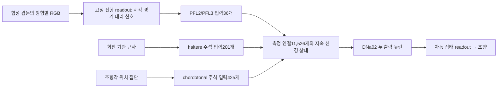

# 측정 연결 기반 부분 회로로 저속 조향

기록: 2026-10-27, Asia/Seoul. **겹눈 근사 → 공학적 시각 경계 어댑터 → MaleCNS927뉴런 부분망 → 두 출력 뉴런 → 조향** 경로가 MuJoCo 개발4조건을 모두 완료했다. 회전·측정 조향각의 기관 피드백도 분리된 입력을 통해 회로에 들어간다. 영상 제거·회로 연결 절단은 각각0/4다. **전체 파리 시각/CX 회로나 Assetto Corsa1랩의 완료는 아니다.**

## 이번에 연결한 경로

앞서 [선형 시각 진단 모델](retinal-diagnostic-20261027.md)이4/4 완료했고 [분리된 기관 포트](../src/flybrain_drive/modality_ports.py)는 단위 자극 시험을 통과했다. 이번에는 [RoutedController](../src/flybrain_drive/routed_controller.py)에서 시각·기관 신호를 실제 입력 ID에 넣고, 수치 상태를 판단 사이 유지하며 측정 연결을 거쳐 나온 DNa02 상태만 조향으로 읽는다.

시각 신호를 조향 명령에 직접 더하는 residual이나 별도 교사 fallback은 없다. `advance`는 출력 뉴런의 차동 상태에 보정 gain을 곱하고 조향 한계로 제한한다. 외부 입력은 input 역할 뉴런에만 허용한다. 코스 위치·정답 횡오차·방향·진행률은 actor 입력에 넣지 않았으며 실행 후 평가 trace에만 기록했다. 속도 의도1.5m/s는 과제의 고정 조건이다.

중요한 제한이 있다. 시각 경계 어댑터는 이미 조향 의도를 근사하는 선형 모델이며, 실제 시각엽·CX가 계산한 신호가 아니다. 이 경계 대리 신호를 넣어 측정 구조의 동작을 시험한 것이다. 실제 파리의 원래 시각 계산 전체를 재현했다고 주장하지 않는다.

## 보정 방법과 생물학적 제한

회로의 시냅스 수와 방향은 [기존 측정 부분망](../configs/malecns-body-steering-candidate.json)을 사용했다. 신경 동역학은 선택된 입력 합으로 정규화한 양의 구조 가중치와 부호 있는 rate 상태·유형별 시정수의 공학 모델이다. transmitter/receptor·측정 시정수·Dale 제약을 검증한 모델이 아니다. 두 출력의 차량 좌회전 부호도 ID10360에-1, ID523769에+1이라는 명시적 가설이다.

경로별 입력 패턴은 상태0 부근의 출력 민감도에서 계산했다. 시각 특징의9개 일정 자극을 각200단계 흘려 출력 gain을 보정했으며 코스 정답을 이 과정에 사용하지 않았다. 시각 정상상태 조향 근사의 RMSE는0.0232였다. 조향 위치 Gaussian 집단 → Ackermann 곡률 변환은 차량 기하만으로 보정했고 RMSE는약0.00015였다.

몸 피드백은 측정 조향의 음의 피드백 gain0.2와 yaw 감쇠 gain0.1을 사용했다. 조향 피드백과 균형을 맞추려고 시각 feedforward를1.2배로 설정했다. 회전의 양/음 채널은 haltere 집단으로, 조향 위치 집단의 선형 변환은 chordotonal 집단으로 들어간다. 개별 수용체의 선호 방향이나 FeCO 아형을 측정한 대응표가 아니며, 서스펜션·진동 feature는 이번 조향 출력에 사용하지 않았다.

[보정 설정·수치](../runs/routed-circuit-driving-20261027/runs/routed-normal-t7/calibration.json), [모델·입력 데이터의 해시](../runs/routed-circuit-driving-20261027/runs/routed-normal-t7/manifest.json).

## 개발4조건의 결과

같은 합성100m 코스·기본 시작·중간 시작·좌우 자세 오차를 사용했다. 표의 평균은 **각 조건 횡오차 RMS의 단순 평균**이다. 반복 학습·여러 서킷의 평균이나 통계적 유의성 검증이 아니다.

| 조건 | 완료 | 조건 평균 횡오차 RMS |
|---|---:|---:|
| 부분 회로 + 회전·조향 기관 피드백 | 4/4 | 0.095 m |
| 같은 체크포인트, 몸 감각 invalid | 4/4 | 0.221 m |
| 처음부터 피드백 gain0으로 보정한 시각 전용 부분 회로 | 4/4 | 0.195 m |
| 같은 체크포인트, 영상 invalid | 0/4 | 이탈 |
| 같은 체크포인트, 모든 회로 연결 절단 | 0/4 | 이탈 |

정상 모델의 조건별 횡오차 RMS는0.028/0.037/0.155/0.159m다. 몸 감각 제거는0.169/0.146/0.283/0.285m, gain0 시각 전용 모델은0.135/0.101/0.267/0.277m다. 이 네 조건에서는 피드백이 있는 모델의 오차가 작았다.

몸 제거만 비교하면 원래1.2배의 시각 feedforward는 유지되어 보정 균형도 깨진다. 따라서 피드백 gain을 처음부터0으로 하고 시각 gain을1로 맞춘 모델을 별도로 실행했다. 해당 비교도 동일 부분망·시각 readout·단위 자극 보정법을 쓴 결과다. 원래의 회로 없는 선형 시각 기준선은 평균약0.061m여서, 이번 결과는 파리 구조가 더 단순한 모델보다 우월하다는 증거가 아니다.

[정상](../runs/routed-circuit-driving-20261027/runs/routed-normal-t7/evaluation.json), [몸 제거](../runs/routed-circuit-driving-20261027/runs/routed-body_missing-t7/evaluation.json), [gain0 시각 전용](../runs/routed-circuit-driving-20261027/runs/routed-visual-only-t7/evaluation.json), [영상 제거](../runs/routed-circuit-driving-20261027/runs/routed-vision_missing-t7/evaluation.json), [연결 절단](../runs/routed-circuit-driving-20261027/runs/routed-circuit_cut-t7/evaluation.json).

연결 절단 조건에서는 모든 판단 단계에서 출력 뉴런과 조향 명령이0임을 검사했다. 원래 시각 신호가0이 아닌 상황에서도 출력이 없어 직접 우회 연결이 없음을 확인했다. 정상·제거 조건은 같은 저장 모델을 복원해 사용하며, 모델 저장/복원 뒤 신경 상태와 명령의 재생 오차는0이었다.

## 검증과 다음 관문

방향성 기준 그래프에서 입력→중간→출력의 갱신 지연, 출력 우회 차단, 지속 상태, 기관 위치 변환, 체크포인트 복원을 검증했다. 최신 WSL 전체 테스트는 **128개 통과, 26.26초**다. [로그](../runs/routed-circuit-driving-20261027/pytest-validation.log). 완료·이탈을 모두 포함한67개 파일은 [SHA-256 영수증](../runs/routed-circuit-driving-20261027/collection-receipt.json)으로 대조해 수집했다.

이번 결과는 하나의 공학적 보정과 한 합성 코스의 개발 평가다. A2/A3의 반복 관문, 상위 시각/CX의 생물학적 대응, 기관 튜닝·노이즈/지연·다른 지형·속도/제동·새 서킷·실시간 비용 검증은 미완료다. AC 설치 위치도 아직 확인되지 않아 실제 게임 연동과 연속1랩은 시험하지 못했다. 다음에는 같은 모델을 별도 시작 조건에서 반복 확인하고, 원래 시각 경로의 확보와 AC 입력/조작 계약을 진행한다.
