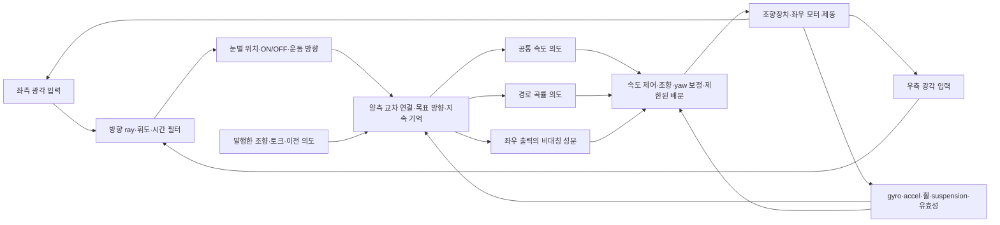

# 후속 설계: 겹눈·몸 감각·좌우 날개와 토크 벡터링

2026-10-05. 사용자의 의도는 **좌우 날개의 공통 추진 성분과 비대칭 방향 전환 성분을
좌우 독립 모터 제어에 연결하는 것**이다. 차량에서 시험할 기능 대응이며 날개와 바퀴의
역학이 같다는 주장은 아니다. 기존 원격 A/B/C/D는 기억·할인 시간·정책 몸 감각 대조다.
아래 시각/구동 대조와 실제 커넥톰은 그 봉인 캠페인에 구현돼 있지 않다.

이 문서는 설계 당시의 상태와 진단을 보존한다. 이후 `retina_v1`·3-action TV·교사 BC를
구현한 최신 상태와 후속 실행은 [시각·TV 구현](vision-tv-implementation.md)을 따른다.

## 현재 코드와 차이

| 항목 | 실제 구현 | 추가할 부분 |
|---|---|---|
| 시각 | 차체 `(0.4, ±0.32, 0.2)` m, yaw ±25°, 수직 FOV 80°, 각 32×32 RGB | 광각·겹눈 방향 지도·광수용 시간 필터 |
| 인코더 | 두 RGB를 6채널 CNN에 합쳐 몸 감각과 GRU에 입력 | 눈별 retinotopy·ON/OFF 방향 감지·optic flow/flyvis |
| 정책 출력 | 정규화된 속도/곡률 action 2개 | 학습 가능한 좌우 토크 차/yaw moment |
| 좌우 토크 | 속도 제어 토크와 고정 yaw feedback의 합 | learned TV·마찰/하중을 반영한 배분 |
| 기록 | 이번에 선택적 동기화 HTML 재생·NPZ·모든 tick의 센서/제어 trace 추가 | 자동 실패 분류·실차 영상·MP4 export |

정방형 perspective 영상은 수평 FOV도 80°다. 차체 yaw 단면에서 좌측 −15°~+65°,
우측 −65°~+15°로 합쳐 약 130°, 중첩 약 30°다. baseline은 0.64 m다. 이는 XML에서
계산한 **차량 카메라 기하**이며 측정한 초파리 시야각이 아니다. 소안 하나에 물리 카메라
하나를 달거나 겹눈 광학을 재현한 구조가 아니다. 실제 graph도 아직 사용하지 않는다.

`camera_hz=30`이지만 100 Hz 제어 tick에서 마지막 실제 exposure 뒤 1/30초를 검사한다.
따라서 기본 실제 간격은 **0.04초, 25 Hz**다. age는 실제 시간이고 테스트로 확인했다.
이번에는 봉인 실험의 영상 시퀀스를 유지했다. 다음 시간 해상도 대조에는 exposure ID와
timestamp, 제어 주기와 맞는 25/50/100 Hz 또는 physics substep 기반 별도 clock을
도입한다. 명목 30 Hz를 실측 30 Hz로 표시하지 않는다.

## 추가로 확인한 근거

- [좌우 날개 운동의 독립 성분 연구, 2015](https://pmc.ncbi.nlm.nih.gov/articles/PMC4339832/):
  양측 날개 진폭의 반대 방향 변화와 yaw torque의 관계. 공통/차동 출력 분리의 근거로
  쓰되 날개 진폭을 모터 N·m에 일대일 환산하지 않는다.
- [Schnell 등, Current Biology 2017](https://pmc.ncbi.nlm.nih.gov/articles/PMC6309624/):
  빠른 비행 조향과 하행 뉴런, 좌우 날개 진폭 차. 포트와 시간 응답을 시험하되
  ‘오른쪽 뇌→오른쪽 모터’ 부호를 가정하지 않는다.
- [Zhao 등, Nature 2025](https://www.nature.com/articles/s41586-025-09276-5):
  비균일 겹눈 방향 샘플링과 운동 방향 선호의 관계. 사각 영상에 육각형 표시를
  얹는 것만으로 겹눈 모델을 구현했다고 판단하지 않는다.
- [Lappalainen 등, Nature 2024](https://www.nature.com/articles/s41586-024-07939-3):
  retinotopic 연결 제약과 시각 계산 학습 기준. ray와 column의 대응·시야/경계 가정을
  명시한다. 현재 CNN/합성 graph는 이 모델이 아니다.
- [BANC, Nature 2026](https://www.nature.com/articles/s41586-026-10735-w),
  [공식 코드](https://github.com/htem/BANC-project): 뇌와 VNC를 함께 검토할 자원.
  좌우 날개 steering/power, 상행/하행·국소 피드백 후보를 선정할 때 참고한다.
  데이터 다운로드·실제 포트 검증은 아직 하지 않았다.
- [RL 기반 TV 제어기 계수 조정, arXiv v1 2021](https://arxiv.org/abs/2103.14892v1):
  계층 제어와 adaptation 대조의 참고다. 비선형 타이어 차량 시뮬레이션 연구이며
  초파리 회로나 MECar의 성능을 검증한 논문이 아니다.

기존 R01–R18/A01–A22는 계속 적용한다. R14의 보행 조향과 비행 날개 회로는 별도다.
R18 CurvACE는 광학/샘플링 참고이며 장치 구매를 전제하지 않는다.

## 제안하는 연결 구조



첫 확장은 `[v_ref, κ_ref, residual M_z]`의 세 번째 action이다. 기본 yaw feedback에
학습 보정을 더해 배분기로 보낸다. 이후 직접 `[steer, T_common, T_difference]`를
학습하는 조건을 별도로 비교한다. 두 구조는 같지 않으며, 현재 2-action checkpoint를
새 3-action 구조에 그대로 불러오지 않는다. action/observation 구조 버전이 필요하다.

양측 readout `h_L,h_R`의 공통 성분 `(h_L+h_R)/2`와 방향 성분 `h_R−h_L`를 분리할 수
있다. 부호는 차량 좌표로 검증한다. 실제 연결을 검토하기 전에는 이를 초파리 날개 운동
뉴런이라고 부르지 않는다. 눈과 출력은 교차 연결과 몸 피드백을 갖는 구조로 시험한다.

평탄하고 뒷바퀴가 차체 전방으로 추진하는 근사에서:

```
T_common = (T_R + T_L) / 2
T_difference = (T_R - T_L) / 2
T_L = T_common - T_difference
T_R = T_common + T_difference
M_z ≈ track / (2 * wheel_radius) * (T_R - T_L)
```

X 전방·Y 좌측·Z 위에서 오른쪽 추진력을 높이면 양의 yaw, 좌회전 성분이다. 바퀴 축
토크와 차량 yaw moment는 서로 다른 양이다. slip·bank·접지 상실 시 이 식을 실제 달성
모멘트로 해석하지 않고 접촉 힘의 `Σ(r×F)`와 비교한다.

현재 `differential=clip(35*(v_measured*κ_ref−gyro_z),−40,40)`이며 각 후륜의
`base±differential`을 0–160 N·m로 따로 clip한다. 포화 시 공통/차동이 함께 변하므로
requested/limited/achieved를 구분해야 한다. 대칭 구동 한도에서 고정한 공통 토크의
가능 범위는 `|T_difference|≤min(T_common,T_max−T_common)`이다. 여기에 모터별
마찰·하중·전류·열·변화율 한도를 추가한다. 공통 토크 0에서 양의 구동 토크만으로 임의
yaw moment를 만들 수는 없다. regen/음토크를 하드웨어 확인 없이 가정하지 않는다.

코너에서는 외측 바퀴가 더 긴 거리를 가므로 좌우 **같은 회전 속도**를 강제하지 않는다.
TV는 요모멘트/힘의 배분, TC는 바퀴별 slip 관리다. 경사·bank·crest에서 하중과 포화를
함께 관찰한다. `gyro_z=v*κ`도 기울어진 자세에서 세계 yaw rate와 같지 않다. frame/운동
모델 보정은 추정 센서를 사용하고 정답 노면 frame을 actor에 추가하지 않는다.

## 겹눈에 맞춘 카메라

실차 후보는 **동기화된 좌우 광각 카메라 두 대 + 소프트웨어 angular sampling**이다.
장착 yaw/pitch·높이·baseline·렌즈 왜곡·차체 가림을 보정한다. 전방뿐 아니라 측면
흐름, 가까운 아래쪽 노면, 위쪽 crest/지평선을 확보한다. 특정 FOV 숫자를 초파리의
해부학적 정답으로 정하지 않는다. 카메라가 차체와 함께 기울고 흔들리는 조건도 포함한다.

시뮬레이터에서는 다중 perspective/cubemap에서 ray를 재표본화하는 광각 adapter를
먼저 검증한다. ray 방향·시야 mask·샘플 수를 manifest에 고정한다. 공개 eye-direction
map은 생물학적 대응, 규칙 육각 grid는 **합성 근사**로 구분한다. 시야 밖/고장 ray는
무효로 표시한다. 머리 안정화 카메라는 별도 대조다.

휘도·밝기 적응/시간 차분→ON/OFF·방향별 운동 가지와 RGB 의미 인지 가지를 분리하는
후보를 둔다. gyro·몸 감각·발행 명령으로 차체 회전 흐름을 함께 해석한다. 실제 timestamp를
사용한다. 현재 색이 다른 경계 구형 표지에 대한 shortcut을 확인하려고 색 교환·무채색·
밀도·밝기/텍스처 holdout을 넣는다. 시야각·각도당 해상도·총 샘플 수를 모두 기록한다.

## 주행 영상 피드백

정책은 이미 렌더링 입력→행동→다음 입력의 폐루프다. 기록 영상은 우선 **실패 진단**에
쓴다. 외부 영상이나 사람/VLM의 점수를 자동 reward로 넣는 기능은 별도 구현/검증이다.

이번 기록기는 실제 좌우 원본 입력·camera age/validity·외부 추적 화면·action·발행한
좌우 토크·encoder/gyro·정답 횡오차를 동기화한다. 모든 tick의 trace와 4 tick 간격의
영상/NPZ, 마지막 종료 프레임을 저장한다. NPZ의 observer/qpos/qvel은 진단 정답이다.
BC/PPO actor 입력으로 읽지 않는다. 토크는 **명령값**이며 전류/실현 타이어 힘이 아니다.

```powershell
$fbPython = Join-Path $env:LOCALAPPDATA 'MECar-FlyBrain/.venv/Scripts/python.exe'
& $fbPython -m flybrain_drive.cli evaluate-suite `
  --checkpoint runs/20261005-followup-local-extension/c_long_discount/seed-3001/training/checkpoint.pt `
  --suite configs/evaluation-followup.json --record --record-every 4 `
  --output runs/vision-wing-replay-new
```

`recording-01/replay.html`은 MP4가 아닌 로컬 HTML 시간 재생이다. 원본은 `samples.npz`,
hash/시간 계약은 `recording.json`이다. codec 의존성을 추가하지 않았다. 기록을 켜고 끈
주행의 모든 tick trace가 동일함을 테스트했다. 기록 wall-clock은 학습 throughput이 아니다.

### 실제 재생 점검

기존 로컬 C/seed 3001의 initial/final checkpoint를 기존 다섯 지형에서 재생했다.
새 학습이나 원격 GPU 결과가 아니다. 두 모델 모두 0/5 완주이고 평균 진행은 학습 전
33.67 m, 학습 후 7.51 m다. 세 조건만 평가했던 기존 pilot의 평균과 구분한다.

final은 다섯 조건의 모든 tick에서 양의 곡률 action을 냈고, 조건별 평균 정규화 곡률은
0.241–0.247이었다. nominal에서 요구 곡률 최대 0.0754 1/m, yaw tracking RMS 오차는
0.00365 rad/s, 후륜 상한 토크 160 N·m 포화는 0%였다. 3.64초에 횡오차 3.00 m로
이탈했다. 이 표본에서는 **일방적인 경로 곡률 요청**을 우선 진단할 이유가 있다.
TV 출력의 부족이 원인이라고 확정하거나 learned TV가 해결한다고 주장하지 않는다.

재생 화면에는 작은 색상 경계 표지와 텍스처가 거의 없는 노면, 검은 배경이 보인다.
nominal final의 저장된 actor 입력에서 완전 검정 pixel 비율은 약 67.3%다. 이 수치가
그대로 정보 손실률은 아니지만 장착 pitch·지평선/노면 비중·표지 크기·텍스처를
시각 대조의 우선 점검 항목으로 삼는다. pose/flow 단서 보강의 실제 효과는 별도 시험이다.

증거는 `runs/20261005-vision-wing-replay-initial/`, `...-final/`,
`runs/20261005-vision-wing-replay-analysis/analysis.json`이다. analysis에는 입력 파일 hash,
action 부호, yaw 오차, 토크 포화, pixel 비율을 남겼다. 브라우저에서 실제 입력·외부
관찰·재생·seek·종료 프레임을 확인했다.

실패 전 2초를 사건 기준으로 검토한다: 길의 가림/시야 이탈·frame age, 요청 곡률과 실제
조향 차, yaw 오차, 토크 포화, 하중 불균형, slip, crest 시야 상실, bank 기울기.
현재 slip·실현 접촉력·요구/달성 TV를 모두 계측하지 않으므로 영상만으로 원인을 확정하지
않는다. 전문가 학습에는 영상뿐 아니라 입력 timestamp·전문가 action·몸 감각·발행 명령·
episode 경계가 있는 sequence dataset이 필요하다. 교사의 저속 flat/3D 완주를 검증하고
BC→DAgger→PPO를 검토한다. 교사만 가진 지도/pose truth는 actor 관측과 분리한다.

## 실험 순서

| 단계 | 공통 조건과 대조 | 확인할 가설 | 상태 |
|---|---|---|---|
| S0 진단 | 동일 initial/final checkpoint·기존 다섯 지형·동기화 기록 | 이탈 전 시야·조향·토크 상태 | 기록/지형 평가 구현 |
| S1 구동 | 같은 3-head GRU·센서·예산, TV off/고정 yaw feedback/learned residual | 좌우 비대칭 학습의 기여 | 새 head/배분/TV off 미구현 |
| S1b 직접 출력 | residual TV 대 steer/common/difference 직접 출력 | 계층 제어와 직접 제어 | 별도 대조·미구현 |
| S2 시각 | 현 시야/광각, 동일 ray의 CNN/motion, 동일 motion의 eye-map/합성 grid | 시야·시간·샘플링의 개별 기여 | 현 카메라 외 미구현 |
| S3 회로 | 같은 감각/action/데이터의 GRU·bilateral graph·구조 대조 graph | 교차·국소 피드백 연결의 효과 | 실제 graph/포트 검증 필요 |

S1의 같은 action dimension에서 세 번째 head를 대조별로 무효/고정/학습에 연결한다.
optimizer·transition 수·차량 제한·제동·감각을 맞춘다. 직접 출력의 제어 자유도는 별도
비교한다. graph는 차수/포트뿐 아니라 도달성·부호·경로 길이 변화와 계산 비용도 검사한다.

직진·저속 고정 반경 양방향·step steer·slalom·경사+bank·crest/요철을 평가한다. 지표는
완주/이탈/전복, 동일 코스 진행 비율, 횡오차 RMS/max, yaw 오차, 토크 차·포화·변화율,
slip/하중이다. split-μ와 한쪽 구동 고장은 공간별 마찰 patch/고장 주입을 구현한 뒤
추가한다. 현재 단일 heightfield의 균일 마찰을 split-μ 시험으로 표시하지 않는다.

감각 대조는 한 눈/두 눈 무효·좌우 교환·freeze/지연, gyro·suspension/하중·발행 명령 복사
제거다. freeze/지연의 원래 exposure timestamp와 truthful age를 유지한다. 단순 replay
반응 시험과 행동에 따라 다음 입력까지 달라지는 실제 폐루프 시험을 구분한다.

기존 paired 2-seed는 탐색용이다. 채택 후보는 최소 3개, 가능하면 5개 이상 공통 seed로
재현하고 raw 결과/불확실성을 남긴다. 완주/실패를 우선한다. 먼저 교사 검증과 짧은 저속
구간, 이후 속도/3D curriculum을 적용한다. 카메라·TV·회로를 한꺼번에 바꾼 결과를
초파리 회로의 효과로 해석하지 않는다.
