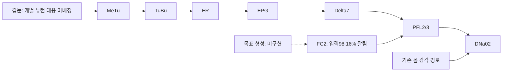

# 시각·방향·목표 회로의 구조 후보와 입력 경계

기록: **2026-10-27, Asia/Seoul**. [직전 겹눈 주행](anatomical-eye-driving-20261027.md)의 조향 의도→PFL 어댑터를 대체하기 위한 구조 조사다. 이번 후보는 아직 동역학·감각 어댑터·주행 정책으로 연결하지 않았다. 기존4/4·30/30 결과를 이 후보의 성능으로 옮기지 않는다.

후속 작업으로 [국소 겹눈 입력과 시간축 평가](local-retinal-circuit-20261027.md)를 구현했다. 아래는 구조 추출 당시의 기록이며, 후속 모델의 연속 주행은0/4다.

## 근거와 추출

시각 전경로의 MeTu·TuBu·ER·EPG 계열은 [Garner 등, 2024](https://doi.org/10.1038/s41586-024-07967-z)를 근거로 검토했다. 방향과 조향의 연결은 [Westeinde 등, 2024](https://doi.org/10.1038/s41586-024-07039-2), FC2의 목표 방향과 PFL3의 비교 계산은 [Mussells Pires 등, 2024](https://doi.org/10.1038/s41586-023-07006-3)를 참고했다. 이 논문들의 개체·뉴런을 MaleCNS의 개별 뉴런과 동일하다고 가정하지 않는다.

기존927뉴런 몸 감각·조향 후보에 다음 집단을 추가했다. annotation의 Traced 유형 목록을 먼저 확장해 [정확한 유형 목록](../configs/malecns-visual-cx-groups.json)으로 고정한 뒤 body ID로 추출했다. 임의 뉴런 수 상한·연결 수 문턱은 사용하지 않았고 선택 뉴런 사이의 모든 원래 연결을 보존했다. 기존 PFL2/3 36개의 외부 입력 역할은 internal로 바꾸었다.

| 집단 | 뉴런 수 | 선택 부분망에 남는 전체 입력 비율 |
|---|---:|---:|
| MeTu | 1,009 | 12.94% |
| TuTu | 8 | 21.48% |
| TuBu | 156 | 79.56% |
| ER | 282 | 82.78% |
| EPG/EPGt·PEN·PEG | 110 | 74.40% |
| Delta7 | 42 | 93.55% |
| PFL2/3 | 36 | 27.15% |
| FC2A/B/C 목표 후보 | 92 | **1.84%** |
| 기존 몸 감각·조향의 나머지 | 891 | 8.64% |

총 **2,626뉴런·92,740개 연결**이다. 입력 역할은 MeTu와 기존 기관 입력이며 출력은 기존 DNa02 두 개다. 이는 정적 구조의 역할 선언이고 실제 시각 자극을 넣는 어댑터는 아직 없다. ER의 모든 형제 유형을 포함했으므로 시각 외·불명확한 기능의 유형도 포함될 수 있다.

## 도달성과 우회 경로를 구분

화살표는 조사한 구조를 요약한다. 그림에 없는 실제 회귀·교차·우회 연결도 파일에는 남겼다. 최단경로만 보면 MeTu 1,006/1,009개가 출력에 도달하고 일부는2개 연결만 거친다. 따라서 이를 전부 시각·방향 회로를 거친 계산으로 부를 수 없다.

별도로 **MeTu→TuBu→ER→EPG→Delta7→PFL→DNa02의 각 단계를 직접 연결 순서대로 거치는 경로**를 검사했다. 이 조건을 만족하는 MeTu는974개다. TuBu156, ER282, EPG46, Delta7 42, PFL28개가 이 직접 체인의 해당 위치에서 출력에 도달한다. 개별 경로의 존재가 실제 자극 전달·안정성·방향 계산·운전 성능을 증명하지는 않는다. 향후 단계별 절단과 우회 경로 대조가 필요하다.

## 빈틈: 목표 방향과 겹눈 대응

FC2 집단은 총119,721개 입력 시냅스 가운데 이 후보에 남은 비율이1.84%다. 주요 누락 입력에는 FB5A, 여러 hDelta, PFNp 등이 있다. PFL의 전체 입력도27.15%만 남는다. 방향 나침반만 확장하고 나머지를0으로 두면 원하는 도로 방향을 계산하는 기능까지 구현했다고 주장할 수 없다. FC2A/B/C 전체를 논문의 FC2 기능과 동일시하는 것도 별도 검증이 필요하다.

MeTu 1,009개의 `assignedOlHex1/2`는 모두 비어 있다. 전체 annotation에는 이 좌표가 있는23,720개 기록이 있으므로 데이터셋 전체에 좌표가 없다는 뜻은 아니다. 겹눈의 head-frame 방향과 optic-lobe hex 좌표는 서로 다른 표현이며 이번 자료에서 변환이 정해지지 않았다. soma side나 instance 순번을 광학축 각도로 사용하지 않는다.

이번 [잘린 입력 조사](../runs/visual-cx-audit-20261027/cut-input-audit.json)는 MeTu·FC2·PFL의 **모든 직접 입력 유형**을 기록한다. 이는 다음 선택과 대응 조사를 위한 목록이며 입력 상위 몇 개만 골라 완전한 기능 회로라고 부르는 근거가 아니다.

## 신경전달물질 자료

[공식 다운로드 목록](https://male-cns.janelia.org/download/)의 body-neurotransmitters v1.0 자료43,282,834바이트를 확보했다. SHA256은 `95c9289220663abeb3409f3ad9e5a7f8a53f8093f5139d15502cd08da8879621`이며 [원본 등록부](../configs/malecns-neurotransmitters-source.json)에 URL·취득 시각·헤더·라이선스와 경로를 남겼다.

후보2,626개 중2,625개의 body ID가 일치한다. consensus는 acetylcholine2,144, GABA381, glutamate77, unclear15, histamine2, serotonin6이며1개는 기록이 없다. 개별 예측과 consensus가 다른 기록33개, 개별 예측 신뢰도0.8 미만322개를 숨기지 않고 보관했다. 이름이 있는 유형끼리의 불일치는0개다. Delta7 42개는 모두 glutamate consensus다.

이 표는 **전달물질 예측/consensus**다. 수용체별 부호나 전도도가 아니다. 현재 드라이버의 전부 양성인 구조 가중치는 공학적 모델로 유지하며, 이 표만으로 모든 glutamate 연결을 강제 음수화하지 않았다. 개별 예측·유형 예측·ground truth 필드는 [뉴런별 기록](../runs/visual-cx-audit-20261027/candidate-neurotransmitters.json)에 각각 보존했다.

## 검증과 다음 구현

새 검증은 입력→출력 방향, 원래 연결 보존, PFL 외부 주입 제거, 누락·겹치는 유형 거절, 짧은 우회를 전체 체인으로 오인하지 않는 조건을 검사한다. 최종 전체 테스트는 **142개 통과(25.76초)**, 정적 검사 통과다. 초기 추출과 최종 체인 검사 버전의 graph 배열이 정확히 같음을 확인했고, 종료된 실행의23파일을 수집해 SHA256을 대조했다. [수집 증거](../runs/visual-cx-audit-20261027/collection-receipt.json), [검증 기록](../runs/visual-cx-audit-20261027/verification.json), [후보 등록부](../configs/malecns-visual-cx-candidate.json).

다음 구현에서 두 문제를 구분한다.

1. **시각·방향 입력:** retinal→MeTu는 조향 의도 한 개를 복제하는 어댑터 대신 공간·시간 특징을 전달하도록 설계한다. 해부학적으로 미배정인 대응은 학습된 공학적 어댑터로 표시한다. EPG/Delta7 등의 방향 반응과 회귀 상태를 자극 시험으로 검증한다.
2. **주행 목표 형성:** 영상에서 도로의 진행 방향을 얻는 학습 가지와 목표 집단의 경계를 명시하고 FC2 상류 후보를 검토한다. actor에 world heading·정답 도로 tangent·미래 곡률을 넣지 않는다. 방향 신호와 목표 신호를 따로 검증한 뒤 DNa02 조향과 몸 피드백으로 연결한다.

AC 연결·속도/제동·실제1랩 관문은 그대로 남아 있다. 이번 구조 조사로 최종 목표 또는 주행 관문을 완료 처리하지 않는다.
